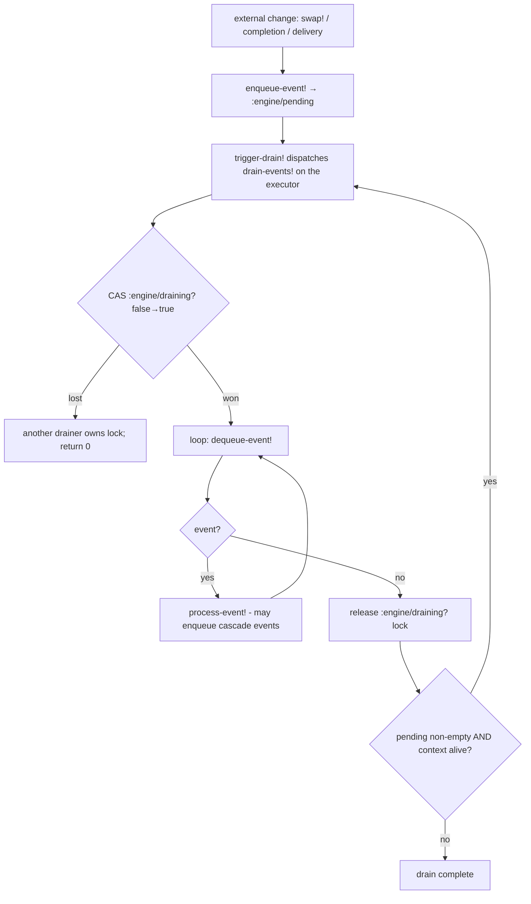
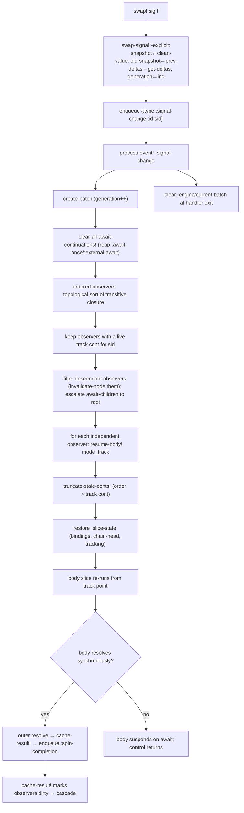
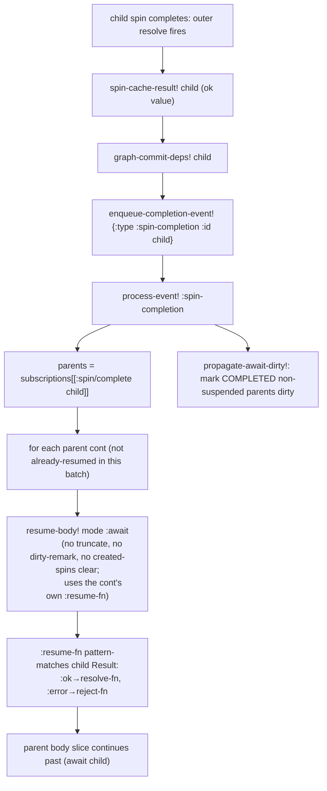
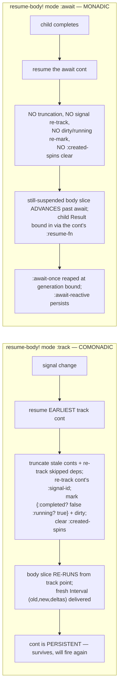
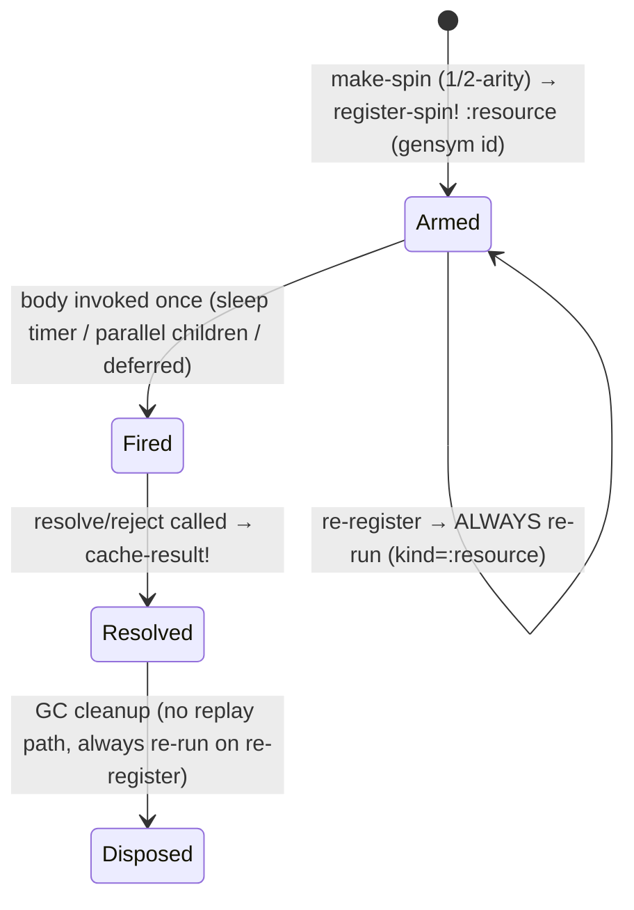
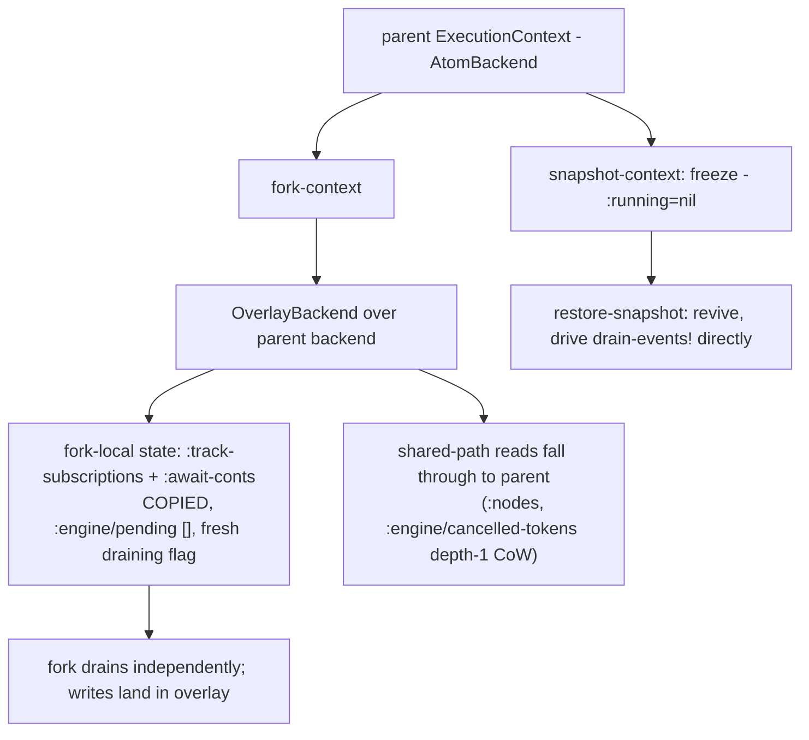

# Spindel Engine Formalism

A formal account of the spindel reactive engine: its algebraic
properties, flow-chart diagrams, and a correctness argument per
reactive composition.

This doc does not re-explain the model — [`concepts.md`](concepts.md)
teaches signals, spins, `track`/`await`, checkpoints, and the drain
queue, and [`engine.md`](engine.md) covers the implementation (state
shape, addressing, CPS/trampoline, executors, overlay backend). This
doc *formalizes* what those teach: every claim is stated as a law and
classified **Holds** (with the enforcing code), **Conjectured**
(plausible but not enforced/tested), or scoped/fragile (with the
boundary noted). Citations are `file:line` against the source tree.

Parts 1–3 describe the engine as implemented. Part 4 is different: it
is the normative target contract for lifetimes, ownership and
settlement, with invariants L1–L25 and laws TL1–TL20, and it records
where main differs.

---

## Part 1 — Algebraic Properties

### 1.1 `track` as a comonad

**Claim.** `track` exposes a comonadic structure: the value it delivers
is an `Interval` `(old, new, deltas)` — a *context-carrying* value, not
a bare value. The comonad is "a value in the context of its own
history."

Mapping to comonad operations:

* `extract : W a → a` is `@interval` / `(:new interval)` — discard the
  context, take the current value (`interval.cljc:97-98`).
* `duplicate : W a → W (W a)` corresponds to re-tracking: the body
  re-runs and `track` again delivers an interval, whose `old` is the
  previous `new`. The persistence of the track continuation
  (`:kind :track`, never reaped — `clear-all-await-continuations!` only
  reaps `:await-once`/`:external-await`, `engine/impl/simple.cljc:1597-1600`)
  is what makes the comonadic *co-bind* well-defined: the body is a
  co-Kleisli arrow `W a → b` that the engine re-invokes on each new
  context.

**Counit / identity law** — `extract ∘ duplicate = id`. The first
`track` call returns `(iv/->Interval old snapshot deltas)` synchronously
(`effects/track.cljc:197`); `@` of it yields `snapshot`, the live value.
**Holds** structurally.

**Comonad coherence across re-runs.** On a signal change the engine
resumes the *earliest* track cont and truncates later ones
(`truncate-stale-conts!`, `engine/impl/simple.cljc:329-361`); the body
slice re-runs from that track point with `:slice-state` restored. The
"context" delivered on resume comes from `:on-resume` →
`get-track-value-if-newer` (`effects/track.cljc:71-103`), which honours
generation so a stale resume delivers `deltas = nil` rather than
replaying consumed deltas. **Holds**, modulo the generation caveat
in 1.7.

**Status: Holds (structural).** The comonad laws are not mechanized;
the structure is real and the engine's persistence + interval delivery
realize it. Conjectured: a full categorical proof would need
`track` to be referentially transparent in its argument, which it is
(it dispatches solely on `SignalRef` identity, `effects/track.cljc:209-212`).

### 1.2 `await` as a monad

**Claim.** `await` is monadic sequencing over `Result`. The CPS
transform makes a spin body a sequence of `await`-bind steps; each
`await` is `>>= : M a → (a → M b) → M b` where the continuation is the
`a → M b` arrow.

* **Return** — a spin that resolves synchronously is `return v`: the
  body invokes `resolve` directly (`spin/core.cljc:311-342`).
* **Bind** — `await child` suspends the parent; when `child` completes,
  `:resume-fn` pattern-matches the child's `Result` and routes `:ok`
  payload to the cont's `:resolve-fn`, `:error` payload to `:reject-fn`
  (`effects/await.cljc:129-132`). This is the Either/Result monad's
  bind: errors short-circuit.

**Left identity** — `return a >>= f = f a`. An `await` of an
already-completed child takes the fast path and resumes inline with the
cached value (`effects/await.cljc:165-190`). **Holds.**

**Right identity** — `m >>= return = m`. A spin body whose last form is
`(await child)` resolves with the child's value unchanged (the outer
`resolve` is called with the child payload). **Holds.**

**Associativity** — `(m >>= f) >>= g = m >>= (λx. f x >>= g)`. CPS
nesting is associative by construction: `ioc/invert`
(`spin/cps.cljc:136`) produces a right-nested continuation chain
regardless of how `await`s are grouped in source. **Holds (structural).**

**Error short-circuit** — the Result monad's defining property. A child
`:error` routes to `:reject-fn` → `abort-spin-chain!`
(`spin/core.cljc:345-381`, `:524-546`), which caches the error and
marks observers dirty so they rediscover it. **Holds.**

*Rendering consequence.* Because errors short-circuit every ancestor
bind, a single body exception rejects the whole chain up to the root
render effect, which produces **no vdom** — the UI freezes at the last
resolved frame with one `:render/error` log line. Semantically correct,
observationally near-silent (the simmis AsOfDB episode: a `contains?`
probe threw inside the page-editor body and the app appeared to ignore
all updates). Dev builds now surface this visibly
(`dom/render.cljc::show-render-error-overlay!`).

**Status: Holds (structural).** Not mechanized; CPS construction
guarantees the monad laws the way any CPS encoding of a monad does.

### 1.3 The typed delta algebra laws

Each algebra is a monoid `(D, ·, id)` with `-apply-deltas`,
`-compose-deltas`, `-empty-deltas` (`incremental/algebra.cljc:42-63`),
subject to three laws (stated `algebra.cljc:13-17`).

**Identity** — `apply(t, id) = t`.
* `ScalarAlgebra` — `id = ::no-change`; `-apply-deltas` returns `old`
  unchanged for it (`algebra.cljc:186-188`). **Holds.**
* `SequenceAlgebra` — `id = (empty-diff size)` (all-zero/empty fields,
  `sequence_algebra.cljc:70-74`); `apply-pipeline` of an empty diff is a
  grow-0/shrink-0/identity-perm/empty-change no-op
  (`sequence_algebra.cljc:91-114`). **Holds.**
* `MapAlgebra` — `id = {:assoc {} :dissoc #{} :update {}}`;
  `apply-pipeline` over empty fields is identity. **Holds.**

**Application homomorphism** — `apply(t, d₁·d₂) = apply(apply(t,d₁), d₂)`.
* Scalar — last-write-wins compose; `apply(apply(t,d1),d2)` and
  `apply(t,d2)` agree because compose returns `d2` unless `d2` is
  no-change (`algebra.cljc:193-198`). **Holds.**
* Sequence — `compose-pair` (`sequence_algebra.cljc:136-172`) is
  carefully built so the composed diff reproduces the two-step effect;
  the namespace docstring states this and a property test is referenced
  (`algebra.cljc` and `sequence_algebra.cljc:38-48`). **Holds**
  (conjectured complete; relies on the property test).
* Map — `compose` recurses one level into inner algebras
  (`map_algebra.cljc:37-44`). **Holds** for one nesting level. Scope
  boundary: sequence-nested `lift`/`lower` is deferred
  (`algebra.cljc:259-264`) — the `:change` field has no
  `(:nested algebra delta)` variant yet, so the homomorphism is
  **not claimed** for sequence-nested paths.

**Associativity of `compose`** — `(d₁·d₂)·d₃ = d₁·(d₂·d₃)`.
* Scalar — trivially associative (last-write-wins). **Holds.**
* Sequence — permutations form a group, the other fields are additive
  monoids; `sequence_algebra.cljc:36-48` claims the quotient monoid is
  associative. **Holds (conjectured, property-tested).**
* Map — per-key folding; associative because each field's merge is
  associative. **Holds (conjectured).**
* `compose-deltas` variadic left-folds (`algebra.cljc:118-125`); the
  fold is well-defined *iff* the binary op is associative.

**`nil` vs `[]` contract.** `nil` = uncertainty, `[]` = verified
no-change (`interval.cljc:30-49`). `no-change?` checks *both*
`old = new` *and* the delta being the algebra's identity
(`interval.cljc:186-219`). **Holds** where producers obey it — fragile
because it is a *convention*, not a type: nothing prevents a combinator
from emitting `nil` when it could emit `[]`. The docstring explicitly
warns "Combinators MUST NOT conflate them via `(seq deltas)` alone."

**Size-composability invariant (Sequence).** `-compose-deltas` throws
if `size-after(d1) ≠ size-before(d2)` (`sequence_algebra.cljc:395-401`).
This makes the sequence algebra a *partial* monoid — composition is
defined only for size-compatible pairs. **Holds** (enforced by throw);
worth noting it is not a total monoid.

### 1.4 Glitch-freedom

**Law.** Within one drain, a spin re-runs *at most once per generation*,
and observers run after their dependencies (topological order). This
law is **scoped to the synchronous sub-graph** — see the async caveat.

* **Topological dispatch.** `:signal-change` resolves observers via
  `rtp/ordered-observers` → `topological-sort` (Kahn's algorithm,
  `engine/impl/graph.cljc:30-81`) over the transitive observer closure.
  **Holds** for the synchronous portion of the graph.
* **Descendant filtering.** `compute-descendant-observers`
  (`engine/impl/simple.cljc`) finds observers created by another
  observer; `delegated-descendants` keeps those the creator's resume
  really re-creates — the creator's resume cont must PRECEDE the child's
  registration — its `:order` is within the creator's continuation count
  at the registration (`:creator-cont-mark`, an O(1) watermark recorded
  by `register-spin!`). `:order` is count-based, so this relies on the
  continuations counted in the mark outliving the registration; where a
  cont is removed in between, the test errs either way — an extra
  independent resume, or a wrongly delegated child left `:dirty` (re-run
  when next reached) instead of eagerly re-run; no violation has been
  constructed — or
  the creator must itself be a delegated descendant (it re-runs from
  scratch). Those are filtered and *invalidated* in the same step
  (`invalidate-node`), so deferring the re-run to the parent never leaves
  a stale `:clean` cache behind (3.4). A child created *before* the
  creator's resume point — `(let [c (spin (track a) …) x (await c) v
  (track a)] …)` — is not re-created by that resume, so it is resumed
  like an independent observer (it used to be filtered too, and the
  parent glitched: `[1 2]` for `[2 2]`). **Holds.**
* **Escalation.** `find-root-await-ancestor` escalates a child observer
  to its root await-ancestor so child-fires-then-parent-refires
  double-execution is avoided (`engine/impl/simple.cljc:463-490`,
  `:561-588`). **Holds.**
* **Per-generation dedup.** `:spin-completion` keys `[parent child
  generation]` in `(:resumed-conts batch)` and skips an already-resumed
  triple (`engine/impl/simple.cljc:653-679`). Track deltas are deduped
  per-observer by `:consumed-generation` (1.7).
* **Async caveat.** The docstring at `engine/impl/simple.cljc:511-526`
  is explicit: glitch-freedom holds only within the **synchronous**
  portion. A body suspended on a `:deferred-delivery` / `:mailbox-post`
  resolves in a *later* drain pass — async branches are only
  **eventually consistent**. A diamond where one arm is async and one
  is sync *can* transiently show a glitch (the sync arm updates, the
  async arm lags). This is a deliberate design boundary, not a bug, but
  it means the law is **scoped**, not absolute.

**Status: Holds for the synchronous sub-graph; explicitly scoped (not a
global law) across async boundaries.**

### 1.5 Determinism / replay

**Law.** Re-executing the same code path produces the same spin ids,
hence cache hits land on the same nodes — enabling fork/restore.

* **Computation spins** — ids minted by `next-address!` from
  `(source-loc, chain-head)` (`addressing.cljc:133-155`). The chain-head
  is **per-spin**, seeded at body start with `body-start-chain-head`
  (`addressing.cljc:74-87`) and restored at resume from
  `:slice-state :chain-head`. The same call sequence in the same body
  produces the same id sequence. **Holds.**
* **The computation-vs-resource split is the replay-membership rule.**
  Only `:computation` spins are in the replay set: their ids are
  deterministic and `register-spin!` can serve cached results under
  rebuild. `:resource` spins get gensym ids (`spin/core.cljc:428`) and
  are *not* replayable — `register-spin!` always re-runs them
  (`engine/impl/simple.cljc:1493`). This is correct: a `sleep`/`mailbox`
  body is effectful and one-shot; replaying it would re-arm the timer.
  **Holds.**
* **Rebuild mode** — `Spin` invoke Case 1a (`spin/core.cljc:231-253`)
  executes the body for side effects (re-creating nested spins,
  re-registering conts) while returning the cached value. Relies on the
  per-spin chain-head being re-seeded (`spin/core.cljc:240`). **Holds.**
* **Usage contract** — determinism depends on the body being a pure
  function of its captures and source location. A body that mints spins
  inside a data-dependent loop without `with-key` (`addressing.cljc:194-216`)
  will produce *colliding* ids across iterations. The engine does not
  detect this; it is a usage contract.

**Status: Holds; the kind split makes the replay set precisely the
content-addressed spins.**

### 1.6 The B-gate (idempotence of re-registration)

**Law.** Re-registering a `:computation` spin re-runs its body **iff**
its captured environment changed; otherwise re-registration is a no-op
on cache validity (idempotent).

`register-spin!` (`engine/impl/simple.cljc:1476-1501`): on
re-registration of an *existing* node, it re-runs (marks
`{:completed? false}` + dirty) when

```
(or (= kind :resource)
    (captures-changed? old-captures new-captures))
```

`captures-changed?` (`engine/impl/simple.cljc`) returns true if the key
set differs *or* any value is not the same as its prior (`same-capture?`:
`identical?`, or for a scalar the same value of the same type).

* **Idempotence** — re-registering with the same captures leaves the
  node `:clean` and `:completed?` true: `await`/`@spin` serve the cache.
  **Holds.**
* **Re-registration with changed captures** invalidates the node's run
  generation (`invalidate-node`): any run of the old closure — in flight,
  or re-completed later by a track resume — closes over the old
  captures, and its result must not be certified `:clean` (3.4,
  generation rule). Only a fresh body entry certifies again. **Holds.**
* **`identical?`, scalars by type and value, never `=`** — `identical?`
  is O(1) and never throws; Clojure structural sharing keeps unchanged
  persistent values `identical?`. A scalar (number, character, keyword,
  symbol, boolean) is boxed afresh when the body computes it again, so it
  compares by type and value: JVM `.equals` (doubles bitwise, BigDecimal
  with scale, mutable numbers by identity), JavaScript `Object.is` for
  numbers. Not Clojure `=`, which equates captures a body can tell apart
  (0.0 and -0.0, 1.0M and 1.00M, 1 and 1N). The cost is an occasional
  needless re-run when a collection is rebuilt `=`-equal but not
  `identical?`. This makes the gate a **sound over-approximation**: it
  may re-run when it didn't need to, but it never *skips* a re-run that
  was needed. **Holds (conservative).**
* **`:resource` always re-runs** — correct, since resource bodies are
  effectful (1.5).
* **First registration** — new node, records captures, no re-run gate
  applies. **Holds.**

This is the formal content of the `stale_lexical_scope_test` regression
(`test/.../stale_lexical_scope_test.cljc`): a nested `(spin …)` form
re-evaluated by a re-running parent yields a *fresh closure*; the B-gate
re-runs it iff its captured environment actually changed.

**Status: Holds; sound conservative idempotence.**

### 1.7 Per-observer delta-once delivery

**Law.** Each observer of a signal sees each generation's deltas
*exactly once*.

A track cont captures the signal's `:generation` at registration as
`:consumed-generation` (`effects/track.cljc:128-129`, `:182-186`). On
resume, `get-track-value-if-newer` returns deltas only if
`current-generation > consumed-generation`, else delivers
`(Interval new new nil)` (`effects/track.cljc:71-103`).

**Open edge case.** The `:consumed-generation` is captured once at cont
*creation* and is **not advanced** when the cont fires.
`get-track-value-if-newer` compares against the *original* captured
generation. On resume the body slice re-runs and `track` is called
again, creating a *new* cont with the *then-current* generation — so in
the normal track-resume path the consumed generation does advance via
cont replacement. But the persistent track cont kept by
`truncate-stale-conts!` for `:order`-less conts is re-tracked via
`track-signal-dep!`, and that re-track does *not* refresh
`:consumed-generation`. **Conjectured latent issue:** a spin tracking
signals A and B, resumed on B, keeps A's cont with A's *old*
consumed-generation; if the body slice that re-tracks A is the
*truncate* re-track (not a body re-run), the generation is stale. The
`multi_track_observer_test` pins the *observer-set* survival but does
**not** assert delta-once for the kept cont.

**Status: Holds for the common path; conjectured edge case around
truncate-re-tracked conts — a targeted test is recommended.**

### 1.8 Commutativity of independent signal changes

**Law.** Two signal changes to *independent* sub-graphs produce the same
final state regardless of order.

Each `:signal-change` is processed as its own event with its own batch
(`engine/impl/simple.cljc:532-535`); FIFO ordering of the queue means
two enqueued signal changes drain sequentially. For *disjoint* observer
sets the two drains touch disjoint nodes, so the result is
order-independent. **Holds (conjectured)** — not mechanized, but follows
from disjointness + the per-event batch isolation.

For *overlapping* sub-graphs order matters and the engine makes no
commutativity claim — last-write-wins on the shared spin's cache. The
`batch` macro (`signal.cljc:21-55`) coalesces multiple swaps into one
`:signal-change` *per distinct signal* in insertion order, which is a
determinism aid, not a commutativity guarantee.

### 1.9 Resume idempotence

**Law.** `resume-body!` applied to the same `(spin, cont)` is safe to
attempt more than once without double-executing side effects.

`resume-body!` (`engine/impl/simple.cljc:411-…`) itself is not
idempotent — it unconditionally re-runs the body slice. Idempotence is
provided by the layers around it:

* **`:spin-completion` dedup** — `[parent child generation]` triple
  guard prevents a second resume of the same await cont in one batch
  (`engine/impl/simple.cljc:653-679`).
* **Cancellation gate** — for external-await, `truncate-stale-conts!`
  fires `:cancel!` before dissociating a stale cont
  (`engine/impl/simple.cljc:355-356`); the orphaned external closure
  then no-ops via `cancellable-external-pair`'s gate
  (`effects/await.cljc:322-463`). This is precisely the
  `cont_cancellation_test` regression: a deferred's `:pending` holds
  *both* the orphaned and the new resolve closure; only the new one
  advances. **Holds.**
* **`try-claim-execution!`** — atomic cache+running check prevents two
  `:spin-execution` events from both running a cold body
  (`engine/impl/simple.cljc:1852-1899`). **Holds.**

**Status: Holds — idempotence is enforced by dedup + cancellation gate +
claim, not by `resume-body!` itself.** `resume-body!` is the *one*
resume path, taking a single `mode ∈ {:track :await}` argument. The
mode is a `case` with no `:else`, so an illegal mode throws rather than
silently mis-resuming; the per-mode data (`:signal-id` to re-track for
`:track`, `:resume-fn` for `:await`) is carried by the continuation
itself.

---

## Part 2 — Flow-Chart Formalism

### 2.1 The drain cycle



### 2.2 Signal-change propagation



### 2.3 The await-cascade



### 2.4 Track-resume (comonad) vs await-resume (monad)



The two columns are exactly the comonad/monad distinction, and the
`mode` argument names which one. A `:track` resume *re-runs* (comonadic
co-bind: re-invoke the co-Kleisli arrow on a new context); an `:await`
resume *advances* (monadic bind: feed the bound value into the rest).
`resume-body!` derives all the per-mode behavior from `mode` — the four
behaviors are not a 4-tuple of caller-supplied flags.

### 2.5 Computation-spin lifecycle

```mermaid
stateDiagram-v2
    [*] --> Registered: make-spin (3-arity) → register-spin! :computation
    Registered --> Running: (spin r e) invoke Case 2 / :spin-execution / await slow path
    Running --> Completed: outer resolve → cache-result! (:clean, completed?, running?=false)
    Running --> StaleRun: invalidated in flight → invalidate-node (:dirty, :invalid-gen = :run-gen)
    StaleRun --> Dirty: outer resolve OR reject → cache-result! (result kept, NOT certified :clean)
    StaleRun --> Running: fresh body entry (enter-body! → new :run-gen; prologue cancels the stale run, hands its callbacks over)
    Running --> Suspended: body returns the incomplete sentinel (await/track)
    Suspended --> Running: resume-body! (cont fires)
    Completed --> Dirty: dependency changed → mark-dirty! / cache-result! cascade
    Completed --> Completed: re-register with the same captures (B-gate no-op)
    Dirty --> Running: re-run (track resume / :spin-execution / B-gate re-register / await slow path)
    Completed --> [*]: GC + no observers + no live signal cont → full-cleanup-spin!
```



**Body-entry prologue invariant.** Every `Registered/Dirty → Running`
transition that invokes the cps-fn from scratch MUST run the shared
prologue `simple/enter-body!` (mark-running!, clear-created-spins!,
clear-prior-body-conts!, seed-body-chain-head!; rebuild paths use the
`:rebuild?` variant that leaves run-state untouched). The prologue
maintains the invariant the dispatch rules silently assume: **at most
one body-generation of continuations exists per spin.** Earliest-cont
selection (§2.4 T2) and `truncate-stale-conts!` (§3.4) are sound only
under it — a surviving earlier-generation cont always wins dispatch,
and resuming it truncates the *live* body's conts and re-runs a frozen
lexical closure (the zombie-repaint bug). The enumeration of body-entry
sites is normative: `Spin -invoke` Case 2, `await-spin`'s slow path
(the one entry that calls `.-spin-fn` directly — it bypassed the
prologue until 71d5801), the `-invoke` rebuild branch, and `deref-spin`'s
JVM rebuild path; `:spin-execution` events route through `-invoke`.
Any NEW direct body invocation must call `enter-body!` — see its
docstring's call-site list.

### 2.6 Resource-spin lifecycle



### 2.7 Fork / restore



---

## Part 3 — Correctness per Reactive Composition

For each composition: the **invariant** that must hold, and the
**argument** the engine preserves it (or where it is fragile).

### 3.1 Nested spins (spin-in-spin)

**Invariant.** A `(spin …)` form lexically inside another spin's body,
re-evaluated when the parent re-runs, must observe its *current* captured
lexical scope — no stale closure.

**Argument.** The parent re-run re-evaluates the inner `(spin …)` form,
producing a fresh `cps-fn` closure over the new locals and a fresh
`:captured-locals` map. `register-spin!`'s B-gate
compares `:captured-locals` capture by capture (`same-capture?`) and
re-runs the inner spin iff a capture changed. The
inner spin's id is *stable* across parent re-runs (per-spin chain-head
re-seeded at parent body start, `addressing.cljc:121-127`), so the
re-evaluation lands on the *same* SpinNode — re-registration, not a new
node. **Holds** — this is the `stale_lexical_scope_test` /
`nested_spin_invalidation_test` regression, fixed by the B-gate.

### 3.2 `track` inside a re-running spin

**Invariant.** Each `track` call re-registers a persistent cont; the
spin remains an observer of every signal it tracks, across re-runs.

**Argument.** `track-signal-dep!` eagerly registers the observer at
*track time* (`engine/impl/simple.cljc:1335-1384`). On a body re-run the
new track call re-registers; `record-deps!` at body completion prunes
only signals tracked *last* run but *not this* run
(`engine/impl/simple.cljc:1063-1084`). **Fragile point — see 1.7 and
3.4:** the `:slice-state :tracking` snapshot must include the
just-tracked signal, else `record-deps!` would commit deps missing it
(`effects/track.cljc:146-159` documents this fix; `multi_track_observer_test`
is the regression). **Holds post-fix.**

### 3.3 `await` inside a spin (await-cascade)

**Invariant.** When an awaited child completes, the parent resumes
exactly once per completion, with the child's Result correctly routed
(`:ok`→value, `:error`→propagated).

**Argument.** `:spin-completion` dispatch resumes the parent's await
cont via `resume-body!` in `:await` mode, the cont's `:resume-fn` doing
the monadic match (`effects/await.cljc:129-132`). The
`[parent child generation]` dedup prevents a double resume in one batch.
`:await` mode does no truncation, no dirty/running re-mark, and no
`:created-spins` clear, because it *advances* a still-suspended body
rather than re-running it — wiping `:created-spins` would drop the
awaited child itself. **Holds.**

### 3.4 `track` + `await` in one body (continuation `:order` truncation)

**Invariant.** A body `(track A) … (await X) …`: if A changes while
suspended on X, the body re-runs from the `track A` point and the stale
`await X` cont must be cancelled so X's eventual completion does *not*
also advance the orphaned slice.

**Argument.** `truncate-stale-conts!` drops every cont with
`:order` > the resumed track cont, firing `:cancel!` first
(`engine/impl/simple.cljc:329-361`). For external resources the
cancellation gate (`cancellable-external-pair`) makes the orphaned
closure a no-op (`effects/await.cljc:322-463`). For a child Spin await,
the truncated cont simply ceases to exist, so the child's
`:spin-completion` finds no subscriber for the old cont. The
re-running body re-issues a fresh `await X` cont. **Holds** — this is
the `cont_cancellation_test` suite (deferred, mailbox, fork-isolation).

**Generation rule (no stale certification).** The truncation above
covers the case where the spin is *resumed* at its track point. A spin
can also be invalidated without being resumed, while a run of it is in
flight:

* a `:signal-change` filters it out as a *descendant observer* — its
  re-run is delegated to the ancestor that re-creates it (1.4);
* a re-running parent re-registers it with *changed captures* (B-gate,
  1.6).

Neither truncates the in-flight run, and they must not: an awaiter
outside the re-running subtree may be parked on it, and would be
stranded. The invariant is instead: **a run may cache its result as
`:clean` only if nothing invalidated the node since the run began.**
It is enforced with *run generations* (`engine/impl/simple.cljc`):

* every fresh body entry (`enter-body!` → `mark-running!`) stamps the
  node with a new, process-wide unique `:run-gen` and returns it; the
  run's resolve/reject continuations (`-invoke` Case 2, the await slow
  path) hand it back to `cache-result!`;
* `invalidate-node` records the generation it invalidates
  (`:invalid-gen`) and marks the node `:dirty`; `:completed?` is left
  alone (it says the body finished — the GC reap predicate needs it);
* `cache-result!` ignores a completion whose generation is no longer the
  node's (an older run finishing after a newer one entered — a boolean
  mark could not tell the two runs apart); for the current generation it
  stores the result but certifies it `:clean` only if that generation was
  not invalidated. The mark is not consumed, so a second write of the
  same run (a reject path re-caching through `abort-spin-chain!`, which
  passes the same generation) cannot certify it either; nor can a later
  track resume of the same run. A node that never entered a run has no
  generation and is only marked `:dirty`;
* a stale run is never joined: `try-claim-execution!` and `deref` start a
  fresh run instead. The fresh entry (`mark-running!`, in the same
  transaction as the generation stamp) hands the superseded run's
  never-served invoker callbacks to the new run (`:run-callbacks` →
  `:pending-callbacks`); `cache-result!` drops the record in the same
  transaction as the run's completing write. The contract is **at most
  once per world**: within a world a caller callback is served by its run
  or by the run it was handed to, never both. The record is fork-local, so
  each world decides for itself; a `:causal-follow` callback is served
  once per world that completes the run — the engine's existing
  cross-world fan-out (forking.md), which a savepoint's terminal site
  dedups per world. Nothing is shared between worlds to arbitrate it
  (that would leak a fork's completion into its parent's decisions);
* a superseding run that completes *inline* (the await slow path) still
  enqueues `:spin-completion` when other awaiters are subscribed to the
  child — the superseded run's completion is ignored as outdated, so the
  event is their only wakeup. The inline awaiter's own cont is claimed
  inline, so it is not resumed twice.

So whoever *reaches* the node next — inside the batch or in a later
drain — re-runs it against the current values. Nothing schedules that
re-run by itself: an awaiter already parked on the stale run receives
the stale value, and catches up only if the node is re-run and
re-completes (its reactive await cont then fires) — e.g. when its
creator reaches it. A stale node nobody reaches again stays `:dirty`.

Why the descendant must be invalidated *eagerly*: its freshness used to
rest on the batch-mode await fast-path guard (`await-spin` refuses a
cache hit during a batch unless the child was processed in it). That
covers an ancestor whose re-run reaches the child synchronously within
the batch. An ancestor that suspends first — an `ifor-each` awaiting a
newly *prepended* item that awaits a deferred — reaches the old child
only after the batch has ended; the child's still-`:clean` cache (or
its in-flight run, completing on the delivery) was then served as is,
permanently. (Regression: `engine/stale_run_test.cljc`; the
differential DOM fuzzer's defect 1 in
`dom/differential_fuzz_regressions_test.cljs`.) This also makes
`events-settled?`'s promise ("what is clean is current") true for
descendant observers.

**Superseded children (GC of a removed descendant).** An item removed by
a change is never re-created, but it keeps its own track continuation on
the signal — and that continuation reaches the item's Spin object (body
continuation → the resolve its awaiter passed in → the awaiter's loop
state, e.g. an `ifor-each` holding all its item spins), so the Spin is
never collected and the Cleaner never runs. `gc-quiescent?` would refuse
it anyway (track subscription), and the next change of the signal resumed
it as an independent observer. The rule now:

- A run of a creator holds a set of children, `live-children`: those it
  (re-)registered (`:created-spins`) plus, after a track resume, those
  created *before* the resume point (`:kept-children`, snapshotted on the
  track cont as `:slice-state :live-children`), which the resumed slice
  does not re-evaluate. Each new run records what it starts out not
  holding (`:dropped-children`).
- When the creator's run completes (`record-deps!` →
  `release-superseded-children!`), ONE transaction (`detach-superseded`)
  re-checks and detaches every dropped child that still names that
  creator, is not held by it, is observed by no other spin, has no run in
  flight and no caller waiting on one, and is owned by this world — then,
  transitively, what each detached child held. Detaching drops its conts
  and subscriptions (one pass over `:subscriptions` for the whole set),
  prunes its observer edges and empties its deps, and sets `:detached?`.
  Only a child that could have gone stale (`signal-dependent?`: it
  tracked a signal, directly or through a spin it awaited — an await
  alone leaves a persistent `:await-reactive` cont and does not count) is
  marked dirty; any other keeps its clean result, so a holder of its Spin
  awaiting it later does not re-run its effects. A child whose run was in flight is checked when that run
  completes (error completions too).
- Not while the context has a reachable **following** fork
  (`ec/following-forks?`): a following fork reads every node it has not
  written through from this world, so a detach decided by this world's
  creator would also detach the child in a fork whose own creator still
  holds it. The candidates stay recorded and the generation sweep retries
  once the fork is gone. The release, the sweep's retry and the deferral
  record only touch nodes the running world owns: a fork's sweep never
  acts on a creator it reads through from its parent (writing even its
  `:dropped-children` would copy it into the overlay and stop the fork
  following it). On a JS runtime without `WeakRef` a fork cannot be
  tracked without pinning it, so the registry records an unreferenced
  marker that never expires: such a context defers detaching for good once
  it has had a following fork.
- A detached node is quiescent even if it was invalidated and never
  re-ran (`gc-quiescent?` accepts `:detached?` for `:completed?`): it is
  reaped once its Spin is collected, or in the same transaction if it
  already was. `superseded-child?` makes `gc-quiescent?` accept an orphan
  whose creator exists, is complete and no longer holds it, despite
  remaining track conts; a creator absent from the world proves nothing
  (`*spin-id*` can name a spin of another context).

Regressions: `engine/context_retention_test.clj`, and the jsdom
differential `removed-item-is-reaped-after-same-change-removal`.

**Open subtlety.** Conts with `:order` *less* than the resumed one are
*kept* and their signal deps re-tracked (`engine/impl/simple.cljc:357-361`)
— but `truncate-stale-conts!` re-tracks via `track-signal-dep!`, which
does **not** refresh `:consumed-generation`. See 1.7 — flagged.

### 3.5 Sibling spins

**Invariant.** Two spins observing the same signal both re-run on a
change, in topological order, each at most once.

**Argument.** `ordered-observers` returns both in a Kahn topological
order (`engine/impl/graph.cljc:63-81`); the JVM path may resume
*independent* observers in parallel on the executor with a
`CountDownLatch` join (`engine/impl/simple.cljc:603-623`) — safe because
each resume is atomic `swap-state!` on its *own* node. CLJS is always
sequential. **Holds.**

### 3.6 `parallel` / `race`

**Invariant (parallel).** Completes when all children complete; result
is the vector of child results; reactive — re-fires when a child
re-completes.

**Argument.** `parallel` is a `:resource` spin
(`spin/combinators.cljc:66-163`). It registers an `:await-reactive`
cont per child (`combinators.cljc:111-141`) so a child's later
re-completion re-caches `parallel`'s result and enqueues a fresh
`:spin-completion`. Fail-fast: first child error cancels siblings
(`combinators.cljc:145-151`). **Holds.** *Fragile:* coordination atoms
`completed`/`done?` are local closures, *not* in context state — the
docstring admits they are "write-once, not forked"
(`combinators.cljc:63-64`). A fork of a context with an in-flight
`parallel` shares those atoms — correct only because they are write-once.

**Invariant (race).** Completes with the first child; losers cancelled.
**Argument.** `compare-and-set!` on `done?` picks the winner
(`combinators.cljc:246-265`); cancellation errors from losers are
swallowed. **Holds.**

### 3.7 `debounce` / `throttle` / `sample`

**Invariant.** Rate-control combinators delay / coalesce value delivery
without losing the *final* value.

**Argument.** Each is a `:computation` spin composing a `:resource`
`sleep` then an `await` of the source (`combinators.cljc:300-353`).
When the source signal changes, the *computation* spin re-runs from the
top (it tracks the source transitively), restarting the `sleep` — that
is the debounce timer reset. **Holds for value delivery.** *Scope:*
the namespace docstrings note rate control "may lose intermediate
deltas" unless wrapped in `accumulate` (`combinators.cljc:455-456`) —
i.e. the *delta* history is not preserved by debounce/throttle alone,
only the snapshot. `accumulate` (`combinators.cljc:457-466`) uses a
closure atom that persists across re-runs to merge intervals; its
correctness depends on `merge-fn` being associative (a stated
precondition, `combinators.cljc:425-427`).

### 3.8 Deep nesting under await-cascade

**Invariant.** A → awaits → B → awaits → C: when C completes, the
completion propagates up through B to A, each parent resuming once.

**Argument.** Each completion enqueues its own `:spin-completion`;
`process-event!` resumes the immediate parents, whose own resolution
enqueues the next `:spin-completion` — a cascade through the FIFO queue.
`propagate-await-dirty!` (`engine/impl/simple.cljc:1658-1711`) marks
*completed, non-suspended* ancestors dirty so a re-run reaches stale
caches. **Holds.** *Fragile:* `find-root-await-ancestor`
(`engine/impl/simple.cljc:463-490`) walks `:observers` taking
`(first parents)` — for a spin awaited by *multiple* parents it picks
an arbitrary one as "the" root. Escalation to *one* root is fine when
the await graph is a tree; for a DAG with shared awaited children the
"root" is non-deterministic. Flagged as a latent question.

### 3.9 Rendering identity (delta-direct DOM)

Rendering has **no tree diff**. `build-element` reconciles each element's attrs
and children against caches keyed by its address, attaches the resulting
`:deltas` to the vnode, and `update-render!` discharges those deltas against the
DOM element **bound to that address**. Two consequences follow, and both were
violated in practice before they were stated:

**R1 — Identity is the address.** `reconcile-slot` decides "did this child slot
change?" and `discharge-vnode!` decides "which DOM node do I write to." They must
agree, and the only thing the DOM layer binds by is `:addr`. A vnode's address is
`content-hash[source-loc, parent-addr, slot-index]`, and a keyed element's is
`keyed-child-address(my-addr, key)` — so **addr equality implies key equality and
structural position, but not conversely**. `:key` on a plain element is a
*disambiguator* for siblings at one source location, never an identity token;
position-independent identity is `ifor-each`'s job, and its items travel through
the `:keyed` slot type. Letting `:key` override `:addr` in reconciliation makes
the parent declare a child "unchanged" while the child's deltas address a node
that was never created: the update vanishes with no error. (Regression:
`dom/branch_flip_test.clj`.)

**R2 — The root is unaddressable from above.** Every node except the mounted root
is reachable through some parent's slot reconciliation. The root has no parent, so
a spin whose body returns a *different* root element (a conditional at the top of
the spin) cannot be updated by deltas at all — the new root's address has no bound
element. `update-render!` detects a changed root identity and re-mounts, running
the full teardown protocol first (`call-refs-on-unmount!` → `render-initial!` →
`flush-pending-evictions!`) so foreign nodes release resources and dead caches are
evicted, while addresses the new tree re-claims are spared by `(pending − live)`.

**Corollary (unmount completeness).** Every address the render path writes must be
reachable from the teardown walk. `flatten-slot` splices a `:keyed` slot's items
into `:children` and drops the `KeyedFragment` itself, so the `ifor-each` call-site
address — which holds `:by-key`, i.e. every rendered vnode and its handler closures
— is on no vnode. `evict-cache!` therefore cascades through the evictee's slot
cache into its keyed slots. Without that cascade, unmounting any subtree containing
an `ifor-each` leaked the entire rendered list for the lifetime of the context.

Because a changed root re-mounts (and thus loses DOM state), **keep a spin's root
element structurally stable** and branch *inside* it. This is the loading-state
idiom: one container with a stable key, `cond`/`if` on the content within.

**R3 — Reconciliation happens AT the commit point; the caches advance in the
same step as the DOM write.** Builds are pure values: `build-element` and
`for-each*` classify slots and package items — no cache reads, no diffing, no
staged deltas. At the commit points (`initial-mount!` seeds caches from the
mounted tree; `update-render!` runs `commit-reconcile!`, dom/commit) the
arrived tree is diffed against the committed per-address caches and applied,
and the caches are advanced in one step.

Why this is a rule and not an implementation detail: it is what makes both
abandonment AND repetition free. An abandoned body slice never touched
anything, so nothing needs undoing. A body executed N times for one logical
change — routine when a parent's `:await-reactive` cont re-fires per child
re-completion — produces N pure values; the first commit advances the
baseline, and every later build diffs against it and collapses to its genuine
residual. The earlier design (compute-time reconciliation with staged caches
promoted at commit) could not have the second property: N racing builds all
diffed one uncommitted baseline and each carried the same `:add`, more than
one of which could reach the DOM in separate passes (measured live: six
builds of one container per settled expand, the same `:add` discharged
twice); and the shared last-write-wins staging slot meant the committed
baseline could advance past what the DOM actually held. (Acceptance:
`dom/commit_reconcile_test.clj` — five distinct builds, one insert;
`dom/jsdom_final_state_test.cljs` — the app-shape protocol on a real tree.)

One prerequisite the rule imposes on builds: the vnode carries its slot
structure (`:slots`), because `flatten-slots` destroys the `:nil`-slot
information the commit diff needs for stable slot indices. And the diff runs
against the ARRIVED TREE only — never against any build-side accumulation.

**R4 — The environment travels with the continuation, never with the
event.** A body slice always executes in the environment captured at its own
suspension point (or construction, for a first slice): `(:bindings ctx)`,
the addressing chain-head, and the transient dep tracking. The environment
of the COMPLETER — whoever delivered the value that woke the slice — must
never be observable. Enforced at three places: (1) `restore-slice-state!`
REPLACES the context's bindings with the cont's snapshot (merge restored
presence but not absence — a key the slice never bound leaked in from the
resume context); (2) every continuation carries `:slice-state`, including
`:external-await` conts (Deferred/Mailbox/thunk), whose `:cont-resume` and
reject paths restore it; (3) the drain NORMALIZES its context to the
creation-time `:base-bindings` — enqueue closures smuggle body-scoped
context values into `trigger-drain!`, and an un-normalized drain executed
whole cascades (including FIRST slices of fresh spins, whose construction
scope is a delta merged onto the drain context) in a random body's
environment. Violation symptom, measured before the rule: an element built
after `(await (for-each* …))` was addressed under the last-completing
ITEM's keyed scope, so its address changed with completion order — R1
broken nondeterministically, the subtree re-minted every render.
(Regression: `dom/jsdom_final_state_test.cljs`
`fragment-parent-keeps-its-identity-across-rerender`; full derivation in
`.internal/slice-environment-integrity.md`.)

**R5 — Mount refs are a commit-time effect.** `render-initial!` builds a
subtree DETACHED; the parent's `append-child!` / `insert-child!` /
`replace-child!` (or the container's `appendChild`) attaches it only after it
returns. A `:ref` fired from inside it — where it used to fire — saw a node with
no parent: `.isConnected` false, `.closest` nil, zero layout; every consumer
needing an ancestor or a measurement deferred with `requestAnimationFrame`.
Every commit point (`initial-mount!`, the R2 root re-mount, `commit-update!` /
`commit-reconcile!`, `browser/mount!`) now runs inside
`disch/with-mount-effects`: `render-initial!` QUEUES mount refs instead of
firing them, and each commit-time attach of a built subtree (the
`insert-child!` / `replace-child!` / `appendChild` that places a
`render-initial!` result) marks that subtree's queued refs attached
(`disch/subtree-attached!`). When the commit step returns — all DOM writes
landed, caches seeded/advanced, dead addresses retired — the queue fires.
Contract:

- *Attached when it fires.* A mount ref fires after the write that attached its
  element to the committed tree (or to the render container), hence on an
  element that is document-connected whenever the container is. What is
  guaranteed is the tree as the commit left it: refs fire one after another,
  synchronously, so a ref that itself moves or removes DOM nodes changes what
  the refs after it see.
- *Exactly once per created element.* Every element `render-initial!` creates
  inside a commit gets one mount call, and a reconciled element (whose identity
  survives) gets none.
- *Order.* Each created subtree contributes its refs in post-order —
  descendants before their ancestor, siblings left to right (the order
  `render-initial!` completes elements in); subtrees contribute in the order
  the commit walk created them.
- *Committed builds only.* Builds are pure values (R3), so a build abandoned or
  superseded before commit never reaches `render-initial!` and fires nothing.
- *A commit that throws* fires the refs of the subtrees it had already attached
  (in the order above), then rethrows; the refs of a subtree built but not
  attached when the exception hit — including the completed descendants of an
  element whose construction threw — never fire. Those attached elements stay
  in the DOM, and a later unmount must find the ref they were given.
- *Unmounts are not deferred.* `call-refs-on-unmount!` fires `(ref nil)` during
  the walk, while the departing element is still attached.

A ref that throws is caught (`Throwable` on the JVM) and logged as
`::ref-callback-error` with the exception under `:error`; it neither stops the
remaining refs nor fails the commit.

Outside `with-mount-effects` (direct `render-initial!` calls in tests and
tooling) refs fire inline on the detached subtree — the caller owns attachment
there. (Regression: `dom/ref_linkage_test.cljs` — initial mount, `ifor-each`
insert, conditional flip, root re-mount, superseded build — asserting
`.isConnected` and `.closest` from inside the callback; `dom/ref_test.cljc`
`test-mount-refs-are-a-commit-effect` for the queue itself and
`test-throwing-commit-fires-refs-of-attached-subtrees` for the throw case; the
differential fuzzer checks once-only and `.isConnected` at fire time on every
trial.)

### Invariant summary table

| composition          | glitch-free | no double-exec | no stale-cache | no orphan cont | deterministic id |
|----------------------|:-----------:|:--------------:|:--------------:|:--------------:|:----------------:|
| nested spins         | ✓           | ✓ (B-gate)     | ✓ (B-gate)     | ✓              | ✓                |
| track in re-run      | ✓           | ✓              | ✓              | ✓ (post-fix)   | ✓                |
| await-cascade        | ✓ (sync)    | ✓ (dedup)      | ✓ (propagate)  | ✓              | ✓                |
| track + await        | ✓           | ✓ (cancel gate)| ⚠ gen-staleness | ✓ (truncate)  | ✓                |
| sibling spins        | ✓           | ✓              | ✓              | ✓              | ✓                |
| parallel / race      | ✓           | ✓ (CAS)        | ✓              | ✓              | ✗ (resource)     |
| debounce/throttle    | ✓           | ✓              | ⚠ deltas lost  | ✓              | ✓ (comp) / ✗ (sleep) |
| deep await nesting   | ✓ (sync)    | ✓              | ✓              | ✓              | ⚠ multi-parent root |

---

## Part 4 — Lifetimes, Ownership and Settlement (normative)

Parts 1–3 describe the engine as implemented. Part 4 is the **target
contract** for lifetimes. It defines what state the engine keeps about
lifetimes, which transitions change that state, and which predicates
hold after every committed transaction. It is normative. Two artifacts
are derived from it directly and accept engine changes:

- a pure-Clojure **reference model**: a transition system over the
  data in §4.1;
- a debug-mode **invariant checker** for L1–L26.

Where `origin/main` (06ce205) differs from this contract, §4.8 says so.
Nothing in Part 4 claims that main already behaves this way.

**Sources.**
- The target design "spindel memory model — explicit lifetimes", with
  the decisions of 2026-10-26.
- Caller requirements R1–R17.
- The dvergr/simmis review (gaps G1–G8, conflicts C1–C5).
- The dvergr specification draft 4: prerequisites P1–P6, laws F\*,
  S\*, H1 and W6.

**Numbering.** `I1–I24` cite the as-is memory model. This part uses
**L1–L26** (state invariants), **TL1–TL20** (temporal laws), **T1–T38**
(transitions) and **O1–O14** and **F05** (decisions, §4.11). "Review G*n*" cites a gap
from the dvergr/simmis review.

**Conventions.**
- A *transaction* is one transition of §4.4. It either commits
  atomically or refuses with error data naming the offending ids, and a
  refusal leaves the state unchanged.
- "After every transaction" means that the checker may assert at every
  commit.
- Reclamation happens inside the transaction that removes an entity's
  last reason. There is no deferred sweep.

### 4.1 State

#### 4.1.1 Identifiers

| Set | Element | Identity |
|---|---|---|
| `W` | world `w` | `root-…`, `fork-…`; never reused |
| `S` | scope `s` | local to one world. A run's scope id is its run id. |
| `E` | entity `e` | spin: structural id. Signal: fresh id, or `keyid(root(w),k)` when keyed, where `root(w)` is the lineage root. Atom (also Deferred, Mailbox, pubsub buffer state): fresh. Keyed entry: `[instance key]`. Cache row: `[instance site]`. Timer and waiter: fresh. Fork: `[:fork v]`. |
| `R` | run `r = [e n]` | `n` is an opaque ordered run stamp, fresh for each new run and greater than prior stamps of that spin. Dense numbering is optional. One run *value* may have rows in several worlds: the **copies** `⟨w, r⟩`. |
| `O` | obligation `o` | fresh per registration |
| `K` | settlement capability `k` | affine token |
| `Op` | settlement operation `op` | supplied by the caller, durable |
| `C` | cut `c` | fresh |
| `Tok` | incarnation token | one per host `Spin` object |
| `H` | host party `h` | callback, executor or native op. Never owned. |

#### 4.1.2 Shape

```clojure
;; Σ: :worlds :registry :cuts :caps are runtime state (lost on crash, T31);
;; :durable survives a crash; :env models the host and moves only by
;; environment transitions (T16, T31, T35, native-op progress, timeouts).
{:worlds   {w World}
 :registry #{w}                        ; worlds with status ≠ :released (review G7)
 :cuts     {c Cut}
 :caps     {k Cap}                     ; capabilities of in-memory forks (no durable system)
 :durable  {:caps {k Cap} :records {op Record}}   ; capabilities and records of durable forks
 :env      Env}

World
{:id        w
 :lineage   {:parent p-or-nil :root w0 :mode m :cut c-or-nil :basis b-or-nil}  ; immutable
 :status    st                         ; :live | :sealed | :released (a tombstone: only
                                       ; :id, :lineage, :status remain; ids are never reused)
 :admission ad                         ; :open | :fenced
 :seal-seq  n-or-nil                     ; queue seq at T26
 :root      s0
 :scopes    {s {:kind sk :parent s-or-nil :status ss}}               ; ss: :open | :closed
 :entities  {e {:kind ek :origin og :owner s-or-nil :creator r-or-nil
                :completed? bool :kept? bool :order n :result v :tokens #{tok} :key k-or-nil}}
                                       ; :order = creator's continuation order at creation
 :runs      {r {:spin e :owner s :pred r-or-nil :ancestors #{r} :status rs
                :creations #{e} :spawned #{r} :seq n
                :anchor [s]-or-nil}}   ; :unwinding only: owner chain at cancellation (join)
 :obligations {o {:kind ok :debtor end :creditor end :standing? bool
                  :cont kont-or-nil :token t-or-nil :order n :slot (:armed|:consumed)
                  :filter {:mode (:local|:causal-follow) :origin w}-or-nil}}   ; host creditors only
 :releasing #{[e v o] | [:bundle v D]} ; ended dependencies awaiting {:fdep-ended} here (F24)
 :fdeps     #{[e v o] | [:bundle v D]} ; e of this world; o open in world v, v ≠ this world;
                                       ; [:bundle v D]: fork-level aggregate, D = this world's
                                       ; entities named by v's inherited obligations (persistent set)
 :pins      #{e}
 :queue     [event]}                   ; every event carries :seq and names existing rows

end ::= [:run w r] | [:entity w e] | [:host h]
m   ∈ #{:root :following :frozen :materialized}
sk  ∈ #{:world-root :fork :run :render-root :supervisor :explicit :sci-component}
ek  ∈ #{:spin :signal :atom :deferred :keyed-entry :cache-row :timer :waiter :fork}
og  ∈ #{:created :copied :inherited}
rs  ∈ #{:running :parked :inherited :stale :completed :unwinding}   ; terminal runs are removed
ok  ∈ #{:deref :await-once :await-reactive :track :callback :external :timer}

Cap    {:world v :scope #{sys} :holder h :disposition d :op op-or-nil
        :pred k-or-nil :successors [k] :bases {sys base}   ; bases move with the cap
        :durable? bool    ; ⇔ scope contains a durable registered system; fixed at creation
        :published? bool} ; false only for a T23 capability before T24
d      ∈ #{:open :sealed :settling :incomplete             ; non-terminal
           :merged :discarded :transferred :partitioned}   ; terminal
Record {:op op :cap k :kind (:merge|:discard|:transfer|:partition) :payload-hash x
        :steps [{:id i :kind sk2 :system sys :recovery (:retry|:query)
                 :compensation? bool :status (:pending|:done|:failed|:unknown)
                 :effect-id [op i] :witness x-or-nil}]   ; adapters look up / dedupe by :effect-id
        :bases {sys base} :effects-released? bool}
sk2    ∈ #{:system-merge :intent-replay :stamp :integration :system-discard}
Cut    {:participants {:worlds #{w} :components #{sci} :systems #{sys}}
        :phase (:fenced|:ready|:captured|:attached|:released|:failed)
        :fence-seq {w n} :basis b-or-nil :child v-or-nil :requester s :deadline t}
Env    {:handles {tok {:spin e :reachable? bool :touched #{w} :dropped #{w}}}
        :threads {th {:world w-or-nil :scope s-or-nil :run r-or-nil
                      :read-permits #{sci} :excl-permits [sci]}}
        :native  {n {:owner [w r] :state (:running|:cancel-requested|:joined)}}
        :outside [delivery]}           ; deliveries held outside a fence
```

Notes:
- **Run scopes.** A scope of kind `:run` is the run row itself. It is
  open exactly while the row exists. Terminal runs (superseded,
  cancelled) are deleted, so a late completion of such a run finds no
  row (TL5).
- **Forks.** A fork is an entity `[:fork v]` in the **parent** world,
  owned by the scope that forked. The child world `v` has its own root
  scope of kind `:fork`.
- **Obligation placement.** An obligation row lives in the world of its
  creditor when the creditor is a run, and otherwise in the world of
  its debtor. A host registration on a debtor in another world is
  therefore a transaction of the debtor's world: the caller enqueues a
  `{:register-host …}` event there (T4); the row is retained by the
  local `obl` reason and has no `fdeps` row. `fdeps` exist only for
  run creditors. A cross-world debtor `e ∈ W` is mirrored by the row
  `[e v o] ∈ fdeps_W`. That row is both the retention reason and the
  delivery index (T8).
- **Continuations.** The continuation lives only in `:cont` of its
  obligation row (contract rule 5).
- **Phases of a cross-world obligation.** An obligation `o ∈ ob_v` with
  debtor `[:entity W e]`, `W ≠ v`, is in exactly one phase:
  - *pending-start*: `{:start-for e v o}`, or a `{:join-bundle v D}`
    with `e ∈ D`, is queued in `W` (T5, T19, T24); or `v` is an attached
    cut child whose requests T24 will issue (copy rule 4). There is no
    dependency row, and `e` may be absent;
  - *admitted*: `e ∈ ent_W`, and `[e v o] ∈ fdeps_W` (active creditor)
    or `e ∈ D` of `[:bundle v D] ∈ fdeps_W` (inherited creditor);
  - *cancelling*: `{:cancelled o}` is queued in `v` (the debtor world
    was released, T34; rejected the start, T37; or cancelled the
    debtor's run, T11 and its cascades T10/T13/T15); there is no
    dependency row, and `e` may be absent.

  Phase changes happen in the transaction that causes them. When the
  debtor world cancels the debtor (T11), it deletes `[e v o]` from its
  own `fdeps`, or removes `e` from `[:bundle v D]` unless another
  admitted inherited obligation of `v` still names `e`, before it
  enqueues `{:cancelled o}`. If `o` is still pending-start, it instead
  deletes the `{:start-for e v o}` request (or the member of a queued
  `{:join-bundle}`) from its own queue. These are
  its own rows and events, so no `releasing` row is needed, and `o` is
  never in two phases. Copies preserve the phase (T19, T23).

  Every cross-world reference is either backed by rows (admitted) or
  in flight, meaning that it is backed by an event queued in the world
  responsible for resolving it. **Completion envelopes**
  `{:completion e res}` are value-only: they carry the result, and the
  debtor id only as provenance. They need no existing row. Delivered
  while `o` is cancelling, they consume `o`, and the later
  `{:cancelled o}` is a no-op.
- **Copy rule (T19, T23).** A copy carries each in-flight item with its
  phase and its own pending event, or it carries nothing of it. Rows
  are copied as values. In-flight state is never copied as found;
  it is re-derived per copied creditor:
  1. **Evidence.** The phase of a source obligation `o` is read from
     one consistent source view: its dependency row, the source
     world's admitted queue *and* the envelopes held for it in
     `env.outside` under a fence. For T23 this view is part of the
     basis read at T22.
  2. **Re-issue.** The copy `o′` in the child `v` gets fresh evidence
     of the same phase, addressed to `v`:
     - admitted → a dependency in the debtor world (T19: a bundle
       member, written in the same transaction; cut child: a join request
       issued at T24, rule 4);
     - pending-start → its own `{:start-for e v o′}` (cut child: issued
       at T24);
     - cancelling → its own `{:cancelled o′}` in `v`'s queue with the
       same payload;
     - a completion envelope already delivered to the source for `o`
       → its own value-only envelope in `v`'s queue.

     Held envelopes become ordinary entries of `v`'s queue, and `v`
     executes them only once it is executable (T19: at once; T23:
     after T24). The source keeps its own evidence unchanged.
  3. **Source-side bookkeeping stays.** Rows and events that the
     source holds as a *debtor* or as a releasing world are not
     inherited: its `fdeps` and bundle rows for other worlds' creditors,
     its `releasing` rows and their `{:fdep-ended}` events, and queued
     events that resolve no copied creditor obligation. The child's
     `fdeps` and `releasing` start empty; only rule 2 fills
     dependencies, and only for its own copied creditors.
  4. **A cut child talks to other worlds only once it is released.**
     T19 is one transaction of the parent, so it may write the debtor's
     dependency rows directly. T23 writes nothing outside the child: the
     child's cross-world copies are *pending-start* by virtue of the
     cut being `:attached`, and no request or reply exists yet, so the
     child stays exactly the basis until T24. T24, in the transaction
     that makes the child executable, issues the requests:
     - one aggregate `{:join-bundle v D_X}` per debtor world `X` of the
       admitted copies;
     - its own `{:start-for e v o′}` per pending-start copy.

     `X`'s transaction (T36/T37) admits each member that still exists
     with an admitted source dependency, adding `[:bundle v _]`, and
     makes every other obligation cancelling (`{:cancelled o′}` in
     `v`). A request to a released world fails locally (`::released`),
     as for any request. T25 never issues them.
  5. **One generation.** A copy holds at most one generation of a
     spin. A fresh start of a spin that has a dormant `:inherited` run
     in `v` (T4, T5 or T37 Start) first retires that run: T11 on it,
     which drops its dormant resources and bundle members. A later T6
     on its obligations is therefore a no-op.
- **Token coverage on insertion.** A transition that inserts a spin
  row `e` into `w` (T1, T4, T19 copy, T37) first sets
  `tokens_w(e) := {tok | spin(tok) = e ∧ reachable?(tok) ∧ w ∈ touched(tok) ∖ dropped(tok)}`.
  A handle names the structural id, not a row, so a handle that
  touched an earlier, reclaimed row of `e` covers the new row (F43).

#### 4.1.3 Owner at creation

| Entity | Owner at creation | Ownership moves when | Released when |
|---|---|---|---|
| Spin created in a body | the creating run | a later run of the same spin re-creates the same structural id (adoption, T1) | T10 (the run's successor completes without re-creating it), T11 (the run is cancelled) or T13 (an owner scope closes) |
| Spin first invoked outside a body | the current scope | — | rule L: completed spins become idle |
| Invoked run (`@s`, `(s ok err)`, `run-spin!`, `spawn!`, `render-spin!`, pump start) | `:scope` option, else the current scope (the run owner; the entity's owner is unchanged) | — | cancel, owner close, its owning run superseded (a tracking run stays owned after its first result), or the owner release of its entity |
| Signal, atom | the current scope (top level: world root) | a keyed signal created in a run is adopted by the next run that re-creates its key, like a spin (T2). Otherwise never. | owner closes. Top-level signals live as long as the world (R7). |
| Keyed entry, cache row | the keyed parent's current run (key includes the instance) | the next run touches the same key | the run is superseded without the key being touched |
| Fork `[:fork v]` | the forking scope; handle-less: root of the parent | T32/T33 move the *capability* only | its world is released (T34) |
| Timer, external waiter | the run that armed it | never | that run leaves `:running`/`:parked` |
| Pin | a retention reason held by the world root; the owner is unchanged (T14) | — | `unpin!` or world release |

**Current scope.** `cs(th)` is determined in this order:

1. the explicit scope bound on `th` by `with-owner` (bind an existing scope) or `with-new-scope` (open a scope, bind it, close it on exit);
2. otherwise, the run executing on `th`;
3. otherwise, the root scope of the world bound on `th`;
4. otherwise (no world is bound): error, never a fallback (H1).

The binding travels with the execution context (`engine/bindings.cljc`),
so a continuation resumes in the scope it suspended in. A scope belongs
to exactly one world. Code running in world V that names a scope of
world W must hold a W capability; without one the call is refused. When
no scope is named, an entity created in W is owned by W's root.

### 4.2 Derived predicates

```
work(r)      ≡ status(r) ∈ {:running :parked}
busy(r)      ≡ work(r) ∨ status(r) = :unwinding          ; logical work/retirement
physical(w,r) ≡ (∃th. world(th) = w ∧ run(th) = r) ∨ (∃n. owner(n) = ⟨w,r⟩ ∧ state(n) ≠ :joined)
join-busy(w,r) ≡ busy(r) ∨ physical(w,r)
dormant(r)   ≡ status(r) = :inherited
current(r)   ≡ r is the newest run of spin(r) in its world
open(s)      ≡ s ∈ scopes_w ∧ status(s) = :open          ; run scopes: row exists
reactive(r)  ≡ ∃o. standing?(o) ∧ creditor(o) = r ∧ kind(o) ∈ {:track :await-reactive}
final(e)     ≡ completed?(e) ∧ ¬reactive(current run of e)
quiescent(w) ≡ ¬∃r ∈ runs_w. busy(r)  ∧  ¬∃o ∈ ob_w. kind(o) ∈ {:timer :external} ∧ ¬dormant(creditor(o))
joined(w)    ≡ ∀n ∈ env.native. world(owner(n)) = w ⇒ state(n) = :joined
```

**Reasons** of an entity `e` in world `W`:

```
own(e)    ≡ owner(e) ≠ nil ∧ rooted(owner(e)) ∧ open(owner(e)) ∧
            ( kind(e) ∈ {:signal :atom :deferred :keyed-entry :cache-row :fork}
            ∨ kind(e) ∈ {:timer :waiter} ∧ (work(owner(e)) ∨ dormant(owner(e)))
            ∨ kind(e) = :spin ∧ (¬completed?(e) ∨ kept?(e)) )
active(e) ≡ ∃r ∈ runs_W. spin(r) = e ∧ (work(r) ∨ dormant(r) ∨ status(r) = :stale)
obl(e)    ≡ ∃o ∈ ob_W. rooted(o) ∧ e ∈ ends(o)
            ∨ a queued or held host registration names e
dep(e)    ≡ ∃v,o. [e v o] ∈ fdeps_W ∪ releasing_W
            ∨  ∃v,D. [:bundle v D] ∈ fdeps_W ∪ releasing_W ∧ e ∈ D
pin(e)    ≡ e ∈ pins_W
settle(e) ≡ e = [:fork v] ∧ ∃k. world(k) = v ∧ disposition(k) ∈ {:sealed :settling :incomplete}
scope(e)  ≡ a rooted :completed run of e owns a rooted non-unwinding run or rooted entity
extent(e) ≡ (owner(e) ≠ nil ∧ open(owner(e)) ∧ ¬rooted(owner(e)))
            ∨ ∃r ∈ runs_W. spin(r) = e ∧ status(r) ≠ :unwinding ∧ ¬rooted(r)
reasons(e) = the subset of {own active obl dep pin settle scope extent} that holds
idle(e)   ≡ kind(e) = :spin ∧ completed?(e) ∧ reasons(e) = ∅
```

**Rooted execution is a least fixed point.** Start with independently live
world-root scopes, work/dormant/stale runs, host observations (including queued
and held registrations), pins and settling fork descriptors. Follow these
retention edges until no new vertex is reached:

- an entity keeps its non-unwinding runs and the scope owning it;
- a run keeps its entity and its owning scope;
- a rooted scope keeps its open child scopes and the owned entities selected
  by the `own` clauses above; a retained child keeps its enclosing scope;
- a rooted run or entity creditor keeps its obligations, and those obligations
  keep their entity debtors, except after debtor-side cancellation has retired
  the foreign authority and queued the cancellation.

A completed invocation is not rooted merely because its owning scope is open.
An ownership/dependency cycle without one of the independent roots therefore
cannot retain itself. `kept?` is conditional on the creating scope remaining
rooted, rather than an independent root for that scope.

Foreign `fdeps`/`releasing` rows are storage authority, not independent execution
roots. A live foreign creditor's actual obligation conveys execution liveness.
After that creditor loses its root, the debtor's value remains stored until its
own release acknowledgement, but obsolete completed runs may be retired at the
debtor world's next publication. Before T8 dispatches an envelope it applies
local reclamation, so an old completion cannot resurrect an unrooted creditor.
No publication reclaims another world's heap. Until the owning world publishes
cleanup, entities under an open unrooted owner, and the entities of unrooted
non-unwinding runs themselves, have the storage-only `extent` reason. It does
not enter the rooted closure or authorize execution. Local
normalization retires the obsolete completed owner and releases its extent.
T17 only collects already-idle caches; it does not perform this execution or
protocol normalization. T18 first publishes local normalization, then selects
the eligible idle caches for explicit release.

Unwinding rows retain physical join evidence, not execution ownership. Retained
snapshots and frozen bases keep their immutable versions; a value-only basis
does not keep live scheduler registrations. A resumable inherited copy remains
a dormant execution root until activated or explicitly released. Following
lineage alone pins no historical computation.

`kept?(e)` is fixed when `e` is created or adopted (T1): it is
`reactive(r)` for the creating run `r`, i.e. `r` held a standing
`:track` or `:await-reactive` obligation at that moment.

The spin clause of `own` is the four-row rule for children of a run R
(review G1). It is stated per child `e`:

| `e` | R | `e` is |
|---|---|---|
| has a work run, or R holds an open obligation on it | any | live (`active`/`obl`) and owned by R. Cancelled with R. |
| completed; created while R was **not** reactive | any | **idle** at completion (owner cleared by rule L) |
| completed; created while R was reactive (`kept?`) | rooted (running, parked, stale or completed) | kept by R |
| kept; not re-created by R's completed successor | removed (superseded or cancelled) | released. Idle if a token remains. |

Why reactive runs keep their children: a reactive run re-runs from its
track point (T9, prefix adoption), so children created before any
`track` are never re-created, while children created after it are, and
must be found (R4). A non-reactive run is only re-entered from the
start by `:dirty`/`:rerun!`.

**Run allocation evidence.** The bounded checker normally chooses the
next dense generation for a spin. Replay may instead supply `:fresh-runs`,
a vector of `[world entity stamp]` witnesses consumed in exact allocation
order. Each stamp must be an integer greater than every previously allocated
stamp in that replay; missing, mismatched, reused and unused witnesses refuse
the whole transition. A present empty vector forbids allocation. Copying a
run at T19 consumes no witness. This changes allocation names, not admission,
retirement, ownership, fencing or delivery rules.

A production engine may allocate stamps from one shared family counter.
Forks share that allocator and preserve copied stamps. The checker's
per-entity `:generation-clock` is ghost history needed to validate replay;
it is not required production storage. Diagnostic runs may retain it along
with their full traces. Without diagnostics, retiring the last entity row
must not leave an identity-to-generation history table behind.

**Adoption ancestry.** `:pred` records the immediate predecessor used by
lifecycle cleanup. Adoption uses `:ancestors`, inherited from the chosen
predecessor plus that predecessor's ID at run creation. Removing an
intermediate stale row must not sever eligibility to an older completed
basis, or a burst of child completions can destroy a fan-in's subscriptions.
At publication, prune ancestor IDs that name neither a non-unwinding run nor
a surviving entity's creator. Ancestry itself is never a retention reason.
A new run after cancellation inherits only its chosen predecessor's ancestry;
it does not acquire other generations merely because they remain relevant.
This keeps eligibility evidence bounded by current rows and cached creators,
rather than all past executions. A physically retired row has empty ancestry
and remains subject to L25's complete detachment.

**Cost.** A reactive run keeps every child it creates while reactive
until the run is removed (T10, T11). T9 keeps at most one `:stale`
generation per spin, so a spin holds the kept children of its current
run plus those of at most one stale predecessor. A never-ending loop
inside a reactive run (one holding a standing `:track` or
`:await-reactive`) therefore grows retention for as long as it runs.
Kept children are live entities, so L13 and TL16 still hold; it is the
live set that grows. This is correct for R4: a re-run from the track
point re-creates those children and must reuse them.

**Guidance (normative for spindel's own code).** A long-running loop
belongs in its own non-reactive spin: track or configure in the outer
spin, then spawn the loop. spindel's pubsub pumps (mult, pub,
partitioned, promise) do only one-shot awaits, so they are
non-reactive and their retention is bounded by their open children.

**Detection.** There is no error for this: reactiveness can be acquired
dynamically by awaiting a reactive spin, so it cannot be decided
reliably at creation. The debug census reports it instead (§4.5,
kept-children diagnostic).

### 4.3 Liveness and reclamation

Signal and atom writes publish each new state, but their pending reactive
notifications are conflatable state invalidations, not a lossless change
feed. An envelope records `:source-change? true` and immutable debtor-world
and entity provenance. Within one destination's admitted queue, a newer
notification replaces an older one with the same provenance by removing it
and appending the new value with its new sequence number. Held notifications
are a separate segment: a post-fence value never rewrites a pre-fence basis.
Classification does not depend on whether the debtor row still exists.
Per-write host watches remain per-commit egress.

Spin completions and first-result deliveries are not conflated by this rule.
Lossless bursts and held raw ingress still require bounded admission or
backpressure; signal conflation alone does not establish their L13 bound.
The census constant remains fixed, rather than absorbing queued history into
its denominator.

**Rule L.** After every transaction, for every world `W` and every
`e ∈ entities_W`:

```
reasons(e) ≠ ∅   ∨   (idle(e) ∧ tokens(e) ≠ ∅)
```

At an ordinary publication in its own world, an unrooted completed spin is
first normalized to a value-only row: retire its completed/stale runs and outgoing registrations, close their lexical scopes,
clear its owner and drop runtime-held body/resume closures. A descriptor can
supply its body again on a later invocation. Keep the eligible cached result
while tokens remain, or while a foreign storage acknowledgement is outstanding;
neither keeps its completed execution machinery alive. Cache validity is
classified before those outgoing edges are removed.

A transaction that falsifies the retention condition for `e` does three things
in the same transaction:
- it removes `e`, every index row that names `e`, and every queued event
  that names `e` or its runs;
- it retires the runs of `e` (rule 3, run retirement; an idle spin's
  `:completed` run row goes too; by `scope` it owns nothing with
  reasons); `:unwinding` rows belong to executing threads and outlive
  `e` (L25);
- it re-evaluates the entities whose reasons depended on what it
  removed: creations, spawned runs, owned entities, and the other ends
  of ended obligations.

The native cascade visits the affected component through indexed retention
edges. Reachability proofs from external roots survive physical run replacement
when logical topology is unchanged; root/edge changes invalidate those proofs.
Work-root proofs are confined to one publication. The reference implementation
may compute the complete least fixed point. Reclamation remains local to the
acting world even when the proof follows a foreign obligation.

1. Host reachability of a handle is not a reason. The host is consulted
   only for idle caches, and only through tokens (T16–T18).
2. References (observers, subscriptions, creator links) never retain.
   They decide what re-runs, not what stays.
   Before idle normalization removes a completed spin's outgoing obligations,
   classify its cached result through those edges. A path through `track` or
   `await-reactive` to a mutable source (signal or atom) or an already dirty cache makes the result
   dirty: detachment loses its reactive validation. A pure one-shot result
   stays clean. Search cycles with a visited set; do not conclude that a cycle
   is independent before exhausting its other edges. Debtor cancellation
   also records `validation-lost?` on the current creditor run before removing
   a consumed reactive await. The run may still be running or parked; its
   eventual T7 keeps the result dirty rather than certifying it clean.
   Continuation reentry preserves lost validation (including a dirty cached
   basis); a fresh body start begins without it. This scalar follows inherited
   copies and disappears with the run, so no dependency mirror is retained.
3. **Within one world**, obligations never outlive an owner's release of
   one of their ends:
   - one-shot obligations are failed with a cancellation error;
   - standing obligations are ended.

   Obligations keep entities live only against reclamation that no
   owner decided (idle release, supersession).

   **Owner release** of an entity `e` (T10, T11, T13): `owner := nil`;
   every work run of `e` in this world gets T11, *whatever its run
   owner* (a run started by an independent invocation, T4, dies with
   the entity); by this rule its debtor obligations fail or end; its
   `:completed` and `:stale` runs get T10 without a successor (their
   creations, owned entities, keyed entries and cache rows are
   released, and the run rows are removed), so the released `e` is left
   with no run except `:unwinding` rows, which own nothing and give no
   reason (V03, L25). `e` keeps its last completed result, marked
   dirty, as a runless value; it is then idle (if tokens hold it),
   dep-retained, or reclaimed. Otherwise it is incomplete. Entity ownership and run ownership are separate fields:
   T4 on an owned entity never changes `owner(e)`, and its run is owned
   by the invoking scope, but the entity's release dominates.
   **Run retirement.** Every removal of a run row `r` in a live world,
   wherever it happens (T7's normalisation and supersession through
   T10, T10, T11, owner release, rule L reclaiming the runs of an
   entity, T13 through T11), is a *retirement*:
   1. First, every open scope whose parent is `r` is closed with T13,
      recursively, and the `:anchor` of each run that this makes
      `:unwinding` is taken while the full owner chain still exists.
      Closed scope rows under `r` are then removed.
   2. The logical effects of the removing transition all happen now:
      callbacks, cached result, obligations, teardown.
   3. If a thread executes a slice of `r`, or a native op of `r` is not
      `:joined` (`physical(r)`), the row is not removed. It becomes
      `:unwinding` with `:anchor` = its owner chain, detached from every
      other link (L25), and T38 removes it. Otherwise it is removed.

   Completion, supersession and cancellation therefore leave the same
   physical evidence, and `join!` sees all three. T7 is not deferred to
   physical return. T34 drops a released world's rows wholesale; its
   slices see `::released` (L15).
4. **Across worlds** (decided: per-world liveness). `W` keeps the
   storage of `e` while `dep(e)` holds, even after `e`'s owner in `W`
   released it. `e` is then *dep-retained*: it has no owner and no runs,
   and it stays readable. A plain read creates no dependency, so a
   following fork that only reads `e` sees it disappear.
5. The GC decides only the retention of idle caches.

**Entity states.** Owned (`own ∨ active ∨ pin ∨ settle`), bound (only
`obl`), dep-retained (only `dep`), idle, or absent.

### 4.4 Transitions

**Legality by world status.**
- On a `:sealed` world, these transitions are legal and idempotent:
  cancel (T11), close-scope (T13), unpin (T14), release (T18, T34),
  unsubscribe, and reads.
- On a `:sealed` world, everything that admits new execution is refused:
  T1–T4, a T5 that starts a new child run, T9, T12, T19, T20, and
  registry changes.
- Enqueueing into a released world: a cleanup event (`{:fdep-ended}`,
  `{:cancelled}`, completions) is a no-op; a request (`{:start-for}`,
  `{:register-host}`, `{:join-bundle}`) fails its requester locally with
  `::released`. For a `{:join-bundle v D}` that means a `{:cancelled o′}`
  in `v` for every member obligation.
- On a `:released` world, the legal transitions listed above are no-ops,
  and everything else is refused.
- **Unwinding slices.** A transition requested from a thread executing
  a slice of an `:unwinding` run (`run(th) = r`, L25) that would create
  new work or lifetime (an entity, run, obligation, scope, fork or cut:
  T1–T5, T12, T19, T20) refuses `::cancelled`, thrown into the slice.
  Its writes to rows that still exist (signal and atom writes,
  Deferred/Mailbox deliveries) proceed as ordinary transactions of
  `world(th)`; writes to absent rows are no-ops (TL5); in a released
  world they refuse `::released`. T7 from such a slice is a no-op.
- Cleanup transitions (cancel, close, unpin, release) on absent rows are
  no-ops. Checks apply in this order: world status, then the handle
  (`dropped`, TL18), then row preconditions.
- Activating an `:inherited` copy (T6) is new execution: refused on a
  sealed world and in an attached child before T24.

**A. Creation and invocation**

| T | Transition | Pre | Effect | Re-establishes |
|---|---|---|---|---|
| T1 | `create-spin(th, e, tok)` | `w = world(th)` is live | If `cs(th)` is a run `r`, there are three cases. (a) **Adopt:** `e ∈ ent_w` and `creator(e)` is a predecessor of `r` (status `:completed` or `:stale`). Set `creator(e) := owner(e) := r`, `kept?(e) := reactive(r)`, and add `e` to `creations(r)`. Runs of `e` owned by that predecessor move to `r`. (b) **New:** `e ∉ ent_w`. Insert `{:kind :spin :origin :created :owner r :creator r :kept? reactive(r) :order n}` with covering tokens (§4.1.2), where `n` is `r`'s current continuation order (adoption also resets `:order`). (c) Any other existing `e` is left unchanged. If `cs(th)` is not a run, no row is written: the spin exists only as a handle until T4. In every case, if `e ∈ ent_w`, add `tok` to `tokens(e)` and add `w` to `touched(tok)`. | L1 L3 L7 L8 |
| T2 | `create-signal` / `create-atom(th, init, {:key k}?)` | live | **Keyed**: `id := keyid(root(w),k)`, so a fork resolves the parent's keyed signal. If `id` exists, it must be a `:signal` with `:key k`, otherwise the transition refuses `::key-collision`. It is returned unchanged, except that a run `r = cs(th)` adopts it (`owner := r`) when its owner is a predecessor of `r`. **Unkeyed**: insert `{:kind :signal\|:atom :owner cs(th)}`. | L1 L23 |
| T3 | `touch-keyed(r, key)` / `cache-row(r, site)` | `r` work | The id is `[instance key]` or `[instance site]`, where `instance = spin(r)`. Insert the row, or adopt it from a predecessor: `owner := r`. | L1 L4 L23 |
| T4 | `invoke(th, e, tok, mode, {:scope s}?)`, with `mode ∈ {:deref :callback}`. `:callback` covers `(s ok err)`, `run-spin!`, `spawn!`, `render-spin!` and pump starts. | live. `s`, if given, is an open scope of `w`. `w ∈ dropped(tok)` refuses `::idle-cache-released` and never re-executes (TL18). | Let `owner := s`, or `cs(th)` when `s` is absent. If `e ∉ ent_w`, insert `{:kind :spin :owner owner}` with covering tokens (§4.1.2; in a following fork, see read-through under T19). If `e ∈ ent_w` has `owner(e) = nil` (idle or dep-retained), set `owner(e) := owner` (reactivation). First touch: add `tok` to `tokens(e)` and `w` to `touched(tok)`. Then one of three cases. **Join:** `e` has a work run `r`. Add the obligation `{:kind mode :debtor [:entity w e] :creditor [:host h] :standing? (= mode :callback)}`. **Cached:** `e` is completed and clean. Deliver now. Record a standing `:callback` only if `¬final(e)`: a `:callback` on a non-reactive run ends at completion. **Start:** otherwise, first retire a dormant `:inherited` run of `e` (copy rule 5), then add the run `r = [e g]`, with fresh `g`, `{:owner owner :status :running :pred current}`, plus the obligation as in Join. If `e` holds a dirty completed result (T11), the body entry has cause `:dirty` (TL3). | L1 L2 L5 L6 TL3 |

**B. Run lifecycle**

**Adoption on use (T4, T5).** A local spin whose owner is a predecessor of
the calling run is adopted by that caller when invoked or awaited again.
Move the entity's owner and its runs owned by that predecessor to the caller.
If the predecessor is also its lexical creator, move the creator, update
`kept?` from the caller's reactiveness, and add it to the caller's creations.
This also covers a host-created handle whose first cold await started it:
that handle has no lexical T1 creation call to repeat in the successor.
Foreign debtors and entities owned by explicit scopes keep their owners.

**Prefix sources (T2, T9).** Signals and atoms created by a run join its
`creations` with the current continuation order. T9 adopts these prefix
resources along with prefix spins, moving their owners while preserving a
source's nil lexical creator. T3 keyed/cache rows also join `creations`
with their continuation order. Explicit scopes directly parented by the run
record their creation order; T9 reparents scopes below the resume order to
the successor. Descendants keep their scope owners. A source captured by the resumed continuation
must survive retirement of the predecessor that originally created it.

| T | Transition | Pre | Effect | Re-establishes |
|---|---|---|---|---|
| T5 | `park(r, spec)` | `r` `:running`. Awaiting through a handle `tok` with `w ∈ dropped(tok)` refuses `::idle-cache-released` (TL18). | Insert the obligation `o` with creditor `r`, `:slot :armed`, holding `:cont`, and set `r := :parked` — except for `:track`, which registers without suspending (the first value is returned synchronously; `:slot :consumed`; later values arrive through T9). Kinds: `:await-once`/`:await-reactive` (debtor: a spin; if it is in `w`, has no work run, and lacks a clean completed result, start its run owned by `r` (retiring a dormant inherited run first, copy rule 5); refused on a sealed world. If it is in another world `W` and has no work run and no completed result, `w` does not start it: `o` is inserted and `{:start-for e w o}` is enqueued in `W` (T37)), `:track` (debtor: a signal; standing), `:external` (debtor: an atom or host; with a cancel token) and `:timer` (debtor: host executor; adds a `:timer` entity owned by `r`). If the debtor is in world `W ≠ w` and exists there, add `[e w o]` to `fdeps_W` (the foreign cold case adds it in T37). Awaiting through a handle is a first touch (as in T4). A local await joins existing work even if an older completion is cached. An ownerless local target is attached to `r`. Awaiting a clean completed local spin without work through `:await-once` resumes inline and records nothing; foreign completed results retain their foreign-cache policy. | L5 L10 L11 L24 |
| T6 | `resume(o, v)` | `o ∈ ob_w`, `slot(o) = :armed`, and its creditor copy `⟨w,r⟩` is `:parked` or `:inherited` (activation: see legality) | **Inherited copy with a cross-world debtor:** its debtor is already retained by the fork's `[:bundle w D]` row (T19/T23); a one-shot `o` removes its debtor from `D` when no other inherited obligation of `w` names it (O(log n)). **H1:** the executing thread is bound to `w`, the world holding `o`, whatever path runs it: the drain, a deferred or mailbox delivery, an embedder thread, or an SCI-conveyed fn. A captured binding never overrides `w`. A one-shot `o` and its `fdeps` row are deleted in this transaction; a standing `o` gets `:slot :consumed` (its later deliveries re-enter through T9). Set `r := :running` (an inherited copy now counts as work). **Activation of an inherited copy:** its dormant resource obligations are armed in the same transaction (native registration and cancel token allocated; a timer is registered for its remaining duration); members of `[:bundle w D]` still named by the copy's obligations become ordinary `fdeps` rows. | L5 L10 L14 L15 TL1 |
| T7 | `complete(r, res)` | `r ∈ runs_w`, `:running`, `current(r)`. On a missing or non-current run, or an `:unwinding` one: no-op (TL5); an unwinding row ends only through T38. T7 itself is not deferred to physical return: if this run's own slice is still executing when T10 normalises it, the row is retired to `:unwinding` (§4.3) until T38. | Cache `res` on `e = spin(r)` and set `r := :completed`. Enqueue the completion envelope `{:completion e res}` (value-only, §4.1.2) in `w`, and in every `v` with `[e v _] ∈ fdeps_w`. Apply T10 to every predecessor in `:completed`/`:stale`. Remove the `:timer`/`:waiter` entities owned by `r`, cancelling them and arming their tokens. Rule L. | L1–L3 L7 L24 |
| T8 | `deliver(e)` (process `{:completion e}`) | — | For each obligation whose debtor is `e`: a run creditor with an armed slot goes to T6, including the first delivery of a standing `:await-reactive` obligation. A consumed standing run-creditor slot re-enters through T9; an inherited copy activates through T6. A host `:deref` invokes its callback and is deleted; a standing host `:callback` re-delivers, and on a `final(e)` is delivered and deleted. | L5 TL1 TL2 |
| T9 | `reenter(e, cause)`, where `cause ∈ {:track o, :reactive o, :dirty, :rerun!}` | live; `r` = the current run of `e` | If a predecessor of `r` is already `:stale`, apply T10 to it first: at most one stale generation per spin. Add `r' = [e g]`, with fresh `g`, `{:owner owner(r) :pred r :ancestors (ancestors(r) ∪ {r}) :status :running}`. Standing `:track` obligations at or before the resume point move from the extant predecessor to `r'`, including when `r` is `:completed`; the triggering track moves too. Standing, consumed `:await-reactive` obligations strictly before the resume point also move, adopting local predecessor-owned debtors and their owned runs through call-target adoption. The triggering await stays with the predecessor so reentry rechecks the debtor's current value, error, or readiness. If `work(r)`: set `r := :stale` and delete its remaining creditor obligations (arming tokens, cancelling timers, dropping `fdeps`). Creations of `r` with `:order` below the resume point's continuation order move to `r'` (prefix adoption). Other creations and spawned runs stay with `r` and can be adopted until `r'` completes; a successor that never completes keeps them. If `r` is `:completed`, it stays as the basis until `r'` completes. | L2 L5 |
| T10 | `supersede(r)` (inside T7 of a successor) | `r` is `:completed` or `:stale`; inside T7 of a successor, or without a successor as part of owner release (§4.3 rule 3) | Retire `r` (§4.3, run retirement: its child scopes close first; it stays `:unwinding` while a slice of it executes). Each `e' ∈ creations(r)` with `creator(e') = r` gets owner release (§4.3 rule 3), which applies T11 to every work run of `e'`. Each spawned run not adopted gets T11. Keyed entries and cache rows owned by `r` are removed; any other entity owned by `r` gets owner release. Standing obligations with creditor `r` end. Rule L. | L1 L3 L6 |

**C. Cancellation, scopes and pins**

| T | Transition | Pre | Effect | Re-establishes |
|---|---|---|---|---|
| T11 | `cancel(r)` | — (a no-op if absent or `:unwinding`) | Retire `r` (§4.3, run retirement): its child scopes are closed first (T13, anchors snapshotted); the row becomes `:unwinding` instead of being removed if `physical(r)`. Everything below happens now in either case, so cancellation semantics and callback timing do not depend on physical exit. **Obligations with creditor `r`:** delete them; for `:external`, arm the token; for `:timer`, cancel the timer; drop their `fdeps`; set native ops to `:cancel-requested`. **Obligations whose debtor is `spin(r)`, if `r` was current:** a one-shot obligation fails, and its creditor receives a cancellation error (a host callback, or T6 with an error); a standing obligation receives the error once and ends. For a creditor in another world, the failure is an event `{:cancelled o}` enqueued in that world after this world retires the matching `fdeps` row or bundle member, or deletes the obligation's queued `{:start-for}` request (§4.1.2 phases); its T6 is that world's transaction. **Stale predecessor:** if `r` was current and its predecessor is `:stale`, apply T10 to the predecessor (nothing can adopt its creations any more). **Runs owned by `r`:** T11. **Entities owned by `r`:** owner release (§4.3 rule 3), which cancels their work runs whatever their run owner. Rule L. | L1 L2 L5 L6 L24 L25 TL2 |
| T12 | `open-scope(kind, parent)` | `parent` is open in a `:live` world | insert `{:kind :parent :status :open}`, recording continuation `:order` when parented by a run | L6 |
| T13 | `close-scope(s)` | `s` is not a run scope; idempotent | Atomic cascade (rows; physical exit is observed with `join!`, TL19): close child scopes; apply T11 to runs owned by `s`; owner release (§4.3 rule 3) of the entities owned by `s`. For `[:fork v]` owned by `s`: an event `{:discard k}` is enqueued in `v` for every open capability `k` of `v`; the resulting T15/T26 are `v`'s transactions, and `settle` retains the entity until they are terminal. If `s = root(w)`, run T34. Supervisor `shutdown!`, render unmount (`:stop!`), pubsub pump `close`, SCI component unregister and `with-new-scope` exit are all T13. | L1 L6 TL7 |
| T14 | `pin!(e)` / `unpin!(e)` | `pin!`: `e ∈ ent_w`. `unpin!` on an absent row: no-op. | `pin!` adds `e` to the pins (a root-held reason); the owner is unchanged. `unpin!` removes `e` from the pins; rule L. | L1 L3 |
| T15 | `cancel-world-work!(w)` | — | Apply T11 to every work run of `w`, including pumps, watchers and timers. Inherited copies are left alone; T34 drops them. | L16 |

**Typed public computation operations.** The public adapter adds three named
transitions without changing raw T11 lifetime cancellation:

- `invalidate-computation(w, e)` requires a live admitted local spin. It marks
  its cached result dirty and its current generation validation-lost, preserving
  observers, outgoing obligations and execution. Construction remains lazy. A
  later invocation or await explicitly enters a cold T9 (`:dirty`, order `-1`)
  when superseding invalidated work; an unwinding copy instead permits a fresh
  T4/T5 entry while its physical cleanup remains outstanding.
- `withdraw-deref(w, o)` withdraws a local one-shot host dereference observer.
  It cannot cancel the body or withdraw a different obligation kind. A missing
  observer is inert, including after T8 has committed delivery; withdrawal does
  not revoke an already committed callback.
- `cancel-computation(w, e, tok, value)` validates the public token and commits
  an error result plus `:cancelled-completion {:run r :result value}` before
  retiring the target's existing generations. An absent target is materialized
  without a body run; `r` can therefore be nil. The fence, rather than fields
  in the error payload, identifies explicit cancellation. Repeated cancellation
  preserves its first result and protected cleanup. The target's incoming
  obligations and cleanup receive that same reason; owned descendants retain
  ordinary lifetime cancellation. Pre-existing invalidation remains dirty,
  while a fresh generation clears the fence. Old target publications are
  removed before delivery, and already committed T8 callbacks remain valid.

These operations obey the ordinary admission and cut boundaries. Public
cancellation retains raw T11's invalidation of an already-consumed reactive
parent; it does not install an explicit-cancellation fence on that parent.

**Source mutation and publication.** `signal-write(w, e, value)` commits a
source value and normally queues its invalidation locally and for foreign
followers. With `:publish? false`, it commits only the value: existing queued
envelopes remain valid, but this write queues no new one. `signal-publish(w, e)`
requires ordinary admitted authority and an owned live source, then queues its
current value without changing it. Repeated source invalidations coalesce; this
is a current-state notification, not a lossless history. Protected cleanup may
update its retained payload, but cannot publish ordinary work.

**Typed Deferred sources.** A `:deferred` entity has one allocation identity,
`:completed?` as its assigned flag, an opaque successful `:result`, and
`:deferred {:claimed? boolean :protected {registration {:operation op :sequence sequence}}}`. Its state is
engine-owned; generic source mutation and computation creation/invocation cannot
modify it. A pending T5 `:await-once` names this source without starting a body;
an assigned source resumes inline. Other reader kinds refuse.

- `deferred-create(w, e, allocation)` allocates that private source. Its initial
  assigned and claimed flags are independent and false.
- `deferred-request(w, e, allocation, value, claim?)` queues an assignment
  attempt. A callable claim wins only once and sets the claim flag; a non-claim
  request does not set it. Assignment does not imply a callable claim.
- `deferred-assign(w, e, allocation, seq, value)` consumes the exact queued
  attempt. Only the first assignment changes the value. It atomically queues
  ordinary reader delivery and records readiness for matching operation
  registrations. It does not settle the enclosing protected wait. An
  exception-shaped value is still successful data. A posted
  attempt follows its exact allocation into retained cleanup; a stale allocation
  cannot acquire a new source. Released-world retained attempts use environment
  envelopes, with original sequence order preserved across T34.
- `deferred-observe(w, e, allocation)` registers a one-shot host reader, or
  returns an already assigned value without an obligation.
- `operation-await` attaches the named allocation to an operation's exact
  executing frame. A live allocation can be retained across another owner's
  retirement; a retired source requires an already held cleanup capability.
  Live and retained aliases in one world share claim, assignment and registration
  state, including after T9 moves the source to a successor owner. The former
  `deferred-protect` shortcut refuses explicitly.

**Protected operation participants.** A ticket names the outer suspended
continuation. Its operation has identity `[ticket sequence]`; each resource
registration has a fresh operation-local ordinal. Neither resource assignment
nor a callback's return value selects the operation's terminal result.

| Transition | Effect |
|---|---|
| `operation-start` | Install a participant and startup physical frame on the exact waiting ticket before invoking the thunk outside the gate. |
| `operation-await` | Acquire an allowed Deferred capability and save the supplied scoped continuation under a fresh registration. Assigned data claims inline work on the existing operation frame; pending data installs a source edge. |
| `operation-deliver` | Move a pending registration to ready, preserving successful data. Deferred assignment performs all its registration deliveries atomically; this profile refuses standalone delivery ingress. |
| `operation-claim` | Enter the exact saved continuation once, outside the gate. External claims require an idle operation lane; assigned inline entry uses its existing physical frame. |
| `operation-terminal` | The first terminal capability selects an explicit `:ok` or `:error` outcome. Invalidate unclaimed work; preserve claimed work and its physical evidence. |
| `operation-return` | Remove the exact physical frame and consumed registrations. Returning without terminal selection leaves the operation open. |

An assigned registration is already claimed before inline entry. Terminal
selection in that interval preserves its right to enter once; `:entered?`
prevents duplicate entry. Terminal selection does not permit new registrations.
Parent dispatch waits for operation frames and the previous parent slice to
return. Exact same-frame parent continuation handoff remains permitted once
operation frames return, with existing live admission or cleanup adoption.
Acquired cell holders survive intermediate callbacks and are released by the
parent's existing lifetime protocol, not by consuming a resource registration.
Raw callback-only tickets without an operation retain their one-shot
`cleanup-deliver` protocol; it cannot bypass an operation-backed ticket.

Independent continuation-entry and terminal observations distinguish
`assignment 41 -> callback entry 41 -> terminal 42` from the former shortcut.
Current operation coverage comprises explicit traces and public audit replay;
the bounded search generator does not yet enumerate these new actions.

Retained Deferred cells preserve the assignment flag and allocation identity in
addition to their opaque value. They may be read by an authorized cleanup frame,
but generic cleanup writes cannot bypass single assignment. External producer
capabilities may settle an existing retained allocation, without granting ordinary
read/work authority. The final holder releases the cell. Fork and cut copying of
Deferred controls currently refuse before mutation; remapping their registrations
and recovery is required before the full engine replacement.

**D. Host GC (idle caches only)**

| T | Transition | Pre | Effect | Re-establishes |
|---|---|---|---|---|
| T16 | `handle-unreachable(tok)` (env) | `reachable?(tok)` | Set `reachable? := false`. Enqueue `gc-notify(w, e, tok)` for every live `w ∈ touched(tok)` that caches `e`. This affects memory only (TL4). | — |
| T17 | `gc-notify(w, e, tok)` | `¬reachable?(tok)` (provenance: only T16 clears it, so T17 is enabled only after T16 produced the notification; duplicates and reorderings stay enabled) | If `tok ∈ tokens_w(e)`, remove it; otherwise no-op (a stale or duplicate notification). Retention-only Rule L: `e` is reclaimed if it is idle with no tokens left; pending execution/foreign protocol normalization is deferred to an ordinary local publication. | L3 L8 TL4 |
| T18 | `release-idle-caches!(w, es?)` | — | First normalize unrooted completed execution locally. For every resulting idle `e` (in `es`, or all of them), add `w` to `dropped(tok)` for each `tok ∈ tokens(e)`, then set `tokens(e) := ∅`, so `e` is reclaimed. Held handles then fail loudly (TL18). This is the deterministic stand-in for the GC in tests. | L3 |

**E. Forks, cross-world dependencies, capabilities**

| T | Transition | Pre | Effect | Re-establishes |
|---|---|---|---|---|
| T19 | `fork-following(w, s, scope)` | live; `s` open in `w` | Create world `v` with lineage `{:parent w :mode :following}` and a root scope of kind `:fork`. Add `[:fork v]` to `w`, owned by `s` (handle-less forks use `root(w)`). Add the capability `k {:world v :scope scope :holder s :disposition :open :durable? d}`, where `d` holds iff `scope` contains a durable registered system; a durable capability is written to `:durable` in this transaction, otherwise it lives in the runtime `:caps`, and add `v` to the registry. **Inherited bundles:** each parked run of `w` is copied per (world, run) as an `:inherited` copy `⟨v,r⟩` owned by `root(v)`, together with its spin's entity row, its creditor obligations (with continuations) and its ownership closure: descendant explicit scopes (preserving their parent links), the entities it created or owns (including `:timer`/`:waiter`), owned by the copy as in `w`, and its spawned runs that are themselves parked (as their own inherited copies). Index entries of the copy that name anything else (a spawned run that is not parked) are dropped from the copy, so a bundle is closed under its indices and never names a parent row. All rows get origin `:inherited`. Resource obligations in a bundle are *dormant* (L5). Host-creditor rows follow the T23 rule. The bundles are installed as one persistent value (one view root; the census counts the logical rows). **Fork dependencies of the bundles:** for every world `W ≠ v` named as a debtor by an inherited obligation, add one aggregate row `[:bundle v D_W]` to `fdeps_W`, where `D_W` is shared structurally from `w`'s index of debtors of its parked runs in `W` (a persistent snapshot: one row per debtor world, independent of the number of obligations). In-flight state follows the copy rule (§4.1.2): each copied obligation keeps its phase with its own evidence (bundle member written in this transaction; own `{:start-for}` keyed `(v, o)`; own `{:cancelled}`; own completion envelope), and the parent's debtor-side and releasing bookkeeping is not inherited. `v` is added to `touched(tok)` for every token on a copied row. Nothing else is copied. **Read-through:** a plain read of a parent entity creates nothing. T4/T5 on a parent spin `e`: if `e` has a work run in `w`, join it — a run creditor (T5) gets a cross-world obligation with an `fdeps` row; a host creditor (T4) enqueues `{:register-host …}` in `w`, whose transaction adds the host row in `w` (if `e` is gone by then, the host receives `::released`); if `e` is completed, deliver from `w`'s cache; otherwise copy `e` into `v` and run it there. Any other write by `v` to a parent entity first copies it into `v` (`:origin :copied`, owned by `root(v)`). | L4 L5 L9 L10 L17 L18 L21 |
| — | cross-world `track`/`await` | — | T5 with a debtor in another world `W` adds the `fdeps` row. When its obligation ends (T6 one-shot, T9, T10, T11, T13 or T34 of the creditor's world), that transaction moves the row (or the bundle member) from `fdeps_W` to `releasing_W` and enqueues `{:fdep-ended row}` in `W` (if `W` is released its rows are gone and nothing is written); the row keeps `dep` until `W` processes the event (T36). No transaction of another world deletes `W`'s rows or reclaims its entities. | L10 L11 L13 TL6 |
| T32 | `transfer(op, k, holder')` | `k` `:open` and published; holder current; `world(k) ∈ :worlds` | Atomically: `k := :transferred` (record `op`, no steps), and add `k' {:scope (scope k) :holder holder' :pred k :disposition :open}`. Retained bases and recovery ownership move with `k'`. The world is unchanged. Transfer is not acceptance. | L17 L18 |
| T33 | `partition(op, k, [scope_i])` | `k` `:open` and published; `world(k) ∈ :worlds`; the `scope_i` are pairwise disjoint and their union is `scope(k)` | `k := :partitioned`; add the `k_i`, each `:open`, each `durable?` by its own scope. Bases move per system. If `durable?(k)`, write a durable `:partition` record for `op` that lists every successor (id, scope, holder, `durable?`), in-memory successors included as value-only entries; their runtime state stays in the runtime `:caps`. The world stays open until every successor is terminal. | L17 L18 |

**F. Coordinated cut and hot fork** (frozen and materialized forks are
created only here)

| T | Transition | Pre | Effect | Re-establishes |
|---|---|---|---|---|
| T20 | `cut-fence(c, P, s, mode)` | `P.worlds` is exactly one live engine world; its other participants are its SCI components and registered systems. No world or registered system of `P` participates in another active cut; SCI components may be shared and are serialized by T22. `s` is open. | `admission := :fenced` for `P`. Record the `fence-seq`. New events and deliveries for `P` go to `env.outside`. Set `phase := :fenced`. | L22 |
| T21 | `cut-drain(c)` | `:fenced` | Small-step: each drain substep is an ordinary world transaction attributed to its world (TL6 applies); only the readiness update is a coordinator transaction. Each step applies the transition for the queue head (events carry `:seq`; only `seq ≤ fence-seq` is admitted) or one admitted body step of a running run (T5–T11). When no run in `P` is `:running` or `:unwinding`, the queues are empty, and every native op of `P` is `:joined` or at a declared boundary, set `phase := :ready`. Past the deadline, go to T25: a timeout is not evidence that the work stopped. | L22 |
| T22 | `cut-capture(c)` | `:ready`. It runs as its own event, never inside the handler that parked the caller, and the coordinator thread holds no read permit (otherwise it refuses `::permit-held`). | Acquire the exclusive permits of every participating SCI component in ascending world-id order; a permit held by another cut is unavailable, so the cut waits (bounded by the deadline, else T25). Read each participating world's state **once**, together with the envelopes held for it in `env.outside` (rule 1 of the copy rule): that is the basis `b`. Fork each SCI component and branch each registered system at its retained base. Set `phase := :captured`. | L22 TL14 |
| T23 | `cut-attach(c, mode ∈ {:frozen :materialized})` | `:captured` | Create world `v` whose state is the basis value of the engine world, installed as one persistent view root; every copied row is re-keyed to `v` and gets origin `:inherited` (the census counts the logical rows). `:parked` runs become `:inherited` copies `⟨v,r⟩`, with in-flight state following the copy rule (§4.1.2): phases re-issued with own evidence, `fdeps`/`releasing` start empty; their resource obligations are dormant (L5); native registrations are never copied. **Host creditors:** host execution continuations are never copied. A host-creditor obligation with `:filter {:mode :causal-follow :origin w}` is copied as a value-only delivery descriptor (the closure stays in the host); it is delivered at most once per (world, registration), in whichever causal descendant of `w` completes the copy. `:local` registrations are not copied. A copied `[:fork x]` is a read-only reference: capabilities are never copied (S1), and the copy neither owns `x` nor retains it. Copied pins are reasons within `v` only; `v` is added to `touched(tok)` for copied tokens. The parked caller (`hire!`) is one of the dormant copies, and the fork protocol never resumes it. Lineage is `{:parent w :root root(w) :mode mode :cut c :basis b}`. `[:fork v]` is owned by the requester. Nothing is written outside `v`: the child's cross-world copies stay pending-start until T24 issues their requests (copy rule 4). Add the capability, unpublished (`:published? false`; durable iff its scope contains a durable registered system, as in T19) and the registry entry. `v` stays `admission :fenced` and non-executable until T24. Set `phase := :attached`. | L9 L10 L14 L17 L18 L21 L22 |
| T24 | `cut-release(c)` | `:attached` | `admission := :open` for the participants that are not sealed. Release the permits. Re-admit `env.outside` in arrival order. The child starts a fresh entrypoint run owned by `root(v)`, and in the same transaction issues its cross-world requests: one `{:join-bundle v D_X}` per debtor world and its own `{:start-for}` per pending-start copy (copy rule 4). A request addressed to a released debtor world fails in this same transaction: `{:cancelled o′}` with `::released` is queued in `v` (legality, tombstones). Replies arrive at an executable child. Publish the child's capability (`:published? true`). Set `phase := :released`. | L10 L22 |
| T25 | `cut-fail(c)` | a timeout, a refusal, or an error before T24 | Release the fence (`admission := :open` only for participants that are not sealed; a sealed participant stays `:fenced`) and the permits. Discard the partial component and system branches. If `v` was attached, remove atomically `v`, its registry entry, `[:fork v]`, its capability (deleted; still unpublished, so never handed out) and any `fdeps` rows created for it, so no executable child or authority is exposed. Ambiguous native ops stay owned by their runs (`:unwinding` if cancelled, L25). Set `phase := :failed`. | L4 L17 L22 |

**P1q — the quiescent cut** (sublaw of P1; dvergr's interim cut). A
P1q cut is a P1 cut whose drain executes nothing. It is T20 followed,
in the same coordinator transaction, by a single readiness test, then
T22–T25 unchanged:

- **T20q** `cut-fence-quiescent(c, P, s, mode)`: preconditions and
  effect of T20, plus every participating registered system must be
  *controlled*: all its writes go through transactions of `P`'s world
  (no writer outside the engine, such as another process on the same
  connection). Then the **readiness test**, T21's ready condition
  evaluated once without executing any step: no run of `P` is
  `:running` or `:unwinding`; `P`'s queue holds no admitted event (`seq ≤ fence-seq`);
  every native op of `P` is `:joined` or at a declared boundary. If it
  holds, `phase := :ready`. Parked runs (watchers, `hire!` callers) and
  dormant resources may remain; T23 copies them as inherited copies.
- **Refusals**, each followed by T25 so the fence is released and
  nothing else changes:
  - `::cut-refused`: T20's preconditions fail (the participant is
    sealed, released, or in another active cut; a registered system is
    in another active cut);
  - `::uncontrolled-writer`: a participating system is not controlled
    (it can only join a full P1 cut whose adapter captures a basis);
  - `::not-quiescent`: the readiness test fails. The refusal lists the
    running and unwinding runs, the admitted queued events and the
    unjoined native ops. P1q never waits or drains; the caller may retry or use P1.
- **Admission fence.** From T20q until T24 or T25, no new event or
  delivery is admitted into `P` (it goes to `env.outside`). The
  readiness established by the test therefore still holds at T22. This
  replaces main's check-then-fork, which is a time-of-check to
  time-of-use race.
- **SCI permits.** T22 acquires the exclusive permit of every
  participating SCI component in ascending world-id order, bounded by
  the deadline (otherwise T25 with `::permit-timeout`). It refuses
  `::permit-held` if the coordinator thread holds a read permit.
- **Laws.** A P1q trace is a P1 trace in which T21 performs zero
  steps, so L22, TL13 and TL14 hold unchanged. T24 and T25 never reopen
  a sealed participant, and T26 or T34 on a participant aborts the cut
  first.


**G. Settlement** (per capability `k` of world `v`). Every settlement
transition takes the caller's authority; "holder current" means
`caller = holder(k)` for a capability `k` that is not terminal.

Merge is T26(`:merge`) → T27 → T28\* → T29 → T34.
Discard is T26(`:discard`) → T27 → T28\* → T29 → T34.
Merge never carries engine state: reactive and SCI state of `v` are
never merged, and results return as values.

| T | Transition | Pre | Effect | Re-establishes |
|---|---|---|---|---|
| T26 | `seal(caller, k, op, kind, {:force f})` | `k` `:open` and published; holder current; `world(k) ∈ :worlds` (a capability of a world lost at T31 is reached only through restart recovery) | If `v` participates in an active cut, the coordinator first applies T25 to it (as for T34). A `:merge` with `¬f` and `¬quiescent(v)` refuses `::not-quiescent` and lists the work runs and scopes; nothing changes. Otherwise, if `:discard` or `f`, run T15 first. Then `status(v) := :sealed`, `admission := :fenced`, `k := :sealed`. Quiescence is checked per world, not per partition leaf. | L16 TL8 TL9 |
| T27 | `prepare(op, k, steps, bases, payload)` | `k` `:sealed`, `quiescent(v)`, `joined(v)` | Write the `Record` with the ordered steps and the retained bases: to `:durable` if `durable?(k)`, otherwise into runtime state. Set `k := :settling` and `op(k) := op`. A crash before this point implies neither acceptance nor partial change. | L18 |
| T28 | `step(op, i, outcome)` | `:settling`. Steps `< i` are `:done`; step `i` is `:pending`, `:unknown` or `:failed`. | `:ok w` sets the step to `:done` with witness `w`. `:fail`, `:fail-permanent` or `:unknown` sets the step's status (`:failed`, with `:permanent? true` for the second) and `k := :incomplete`. Adapters identify the step's logical effect by `:effect-id`. | L18 L19 |
| T29 | `finish(op)` | every step is `:done` | Set `k := :merged` or `:discarded`. Release the staged effects. Free the bases that no non-terminal capability (its `:bases`) and no open record needs. If every capability of `v` is terminal, run T34. | L18 TL10 |
| T30 | `recover(caller, op, payload, k)` | `op` has a record; `k` is `:settling` or `:incomplete` | Refuse `::changed-payload` if the payload hash differs and `::stale-capability` if `k` is not current or `caller ≠ holder(k)`. Otherwise set `k := :settling` and continue at the first step that is not `:done`. Steps that are `:done` are looked up by witness and never re-run. `:pending`, `:unknown` and non-permanent `:failed` steps follow their declared forward recovery: `:retry` re-executes, `:query` asks the adapter by `:effect-id` whether the effect committed. A permanently failed step stays `:failed` and the operation stays `:incomplete` (a supported state). Part 4 does not execute compensation. On a terminal `op`, return the recorded outcome. | L18 TL11 |
| T31 | `crash` (env) | — | Process loss: drop `:worlds`, `:cuts`, `:registry`, the runtime `:caps`, the env threads and every host registration of the process (callbacks, native ops, resource waiters). Keep `:durable`. In the same transition, every in-memory successor listed in a durable `:partition` record is `:discarded` (vanished): the disposition is derived from that durable entry at the crash, and restart may persist the marker; no runtime, no steps, nothing else of it becomes durable. L17's cover therefore holds between crash and restart. This ends every runtime obligation and run without delivery; runtime laws (TL2, TL17, L24) hold between crashes. **Restart:** every durable `:settling`/`:incomplete` capability is a fenced operation, recovered only through T30. Every durable capability without a record (`:open` or `:sealed`) is discarded: recovery writes a recovery-owned `:discard` record (one `:system-discard` step per durable system in its scope) and drives it through T28–T30. Forks without durable systems (pure in-memory engine forks, e.g. foerster SMC branches) wrote nothing durable and simply vanish; the parent is unchanged, which preserves R3 (an abandoned build leaves no trace). | L17 L18 L19 |

**H. Worlds and host entry**

| T | Transition | Pre | Effect | Re-establishes |
|---|---|---|---|---|
| T34 | `release-world(w)` | No capability of `w` is `:settling` or `:incomplete`. And one of: (root) the host releases `w` or its root handle becomes unreachable (R8); or (fork) every capability of `w` is terminal. | If `w` participates in an active cut, the coordinator first applies T25 to that cut (aborting it, releasing permits and any partial child). Then one local transaction of `w`. Run T13 on `root(w)`, with the full cascade. Drop the inherited copies without rejecting into the parent or a sibling; the census (`scope-census`) counts the copies dropped without ever being resumed. Host creditors of `w`'s obligations receive `::released`. **Cleanup events:** for every obligation `o` in another world `V` whose debtor is in `w`, enqueue `{:cancelled o}` in `V`; for `w`'s own obligations into another world `W` and its `[:bundle w _]` rows, move the row to `releasing_W` and enqueue `{:fdep-ended …}` in `W`; enqueue `{:fork-released w}` in the parent for a fork. Requests still queued in `w` (`{:start-for}`, `{:register-host}`) fail their requesters with `::released`. Snapshot pure-ID join ancestry on the remaining physical thread/native participants. Remove `w` from the registry, drop its state except the tombstone (including `:unwinding` rows; their slices continue and every engine effect they request refuses `::released`), and set `status := :released`. `join!(w)` waits for actual claimed slices and unjoined native participants; selected idle threads do not block. Descendants' lineage is untouched. | L18–L21 TL6 TL7 |
| T35 | `host-entry(th, op)` | — | Any engine entry from a host thread (deref, invoke, Deferred or Mailbox delivery, SCI-conveyed fn) with no conveyed world refuses `::no-world`. Deliveries resume waiting continuations via T6 in the world holding the obligation. | L15 |
| T36 | `cleanup(event)` in world `W` | the event is at the head of `W`'s queue | Local to `W`. `{:fdep-ended row}`: delete the row from `releasing_W` and apply rule L. `{:cancelled o}`: if `o` exists, fail it (one-shot) or end it (standing) as in T11 for a debtor-side cancellation; otherwise no-op. `{:fork-released v}`: remove `[:fork v]` and apply rule L. `{:join-bundle v D}`: admit or cancel each member (copy rule 4). An event whose row is already gone is a no-op (so cancelling `o` before its `{:cancelled o}` arrives is harmless). | L3 L4 L5 L13 L20 TL6 TL7 |
| T37 | `start-for(e, v, o)` in world `W` | the event is at the head of `W`'s queue | If `o` is not pending-start (already cancelling, consumed or gone), nothing happens: a request never admits or restarts a cancelled obligation. Else, if `W` is sealed or `o` no longer exists in `v`: enqueue `{:cancelled o}` in `v` if `o` exists (`o` becomes cancelling; its creditor fails with `::released`); otherwise nothing. Else insert `e` if absent (owner `root(W)`, covering tokens), start its run owned by `root(W)` unless it now has a work run or a completed result (retiring a dormant inherited run first, copy rule 5), and admit `o`: add `[e v o]` to `fdeps_W` for an active creditor, or add `e` to `[:bundle v D]` (creating the row) for an inherited one. A completed result is sent as a completion envelope to `v`. | L5 L8 L10 L11 TL6 |
| T38 | `slice-exit(th)` (env) | `run(th) = r` | Clear `run(th)` (and `scope(th)`) and discard its saved join anchor. If `r` is `:unwinding` and no other thread executes a slice of `r` and every native op of `r` is `:joined`, remove `r`; rule L. Native-op progress to `:joined` discards that participant's saved anchor and performs the same run-removal check. For a non-unwinding `r` nothing else changes (a slice that suspended or completed already ran T5/T7). | L15 L25 TL19 |

**API mapping.**

| API | Transition |
|---|---|
| `with-owner` | bind an existing open scope |
| `with-new-scope` | T12 + bind + T13 on exit |
| `close-scope!` | T13 |
| `cancel-world-work!` | T15 |
| `pin!` / `unpin!` | T14 |
| `release-idle-caches!` | T18 |
| `join!` (run, scope or world; timeout) | observation: completes when `subtree(x)` has no `join-busy` run (TL19); on timeout refuses `::join-timeout` listing the runs still busy |
| `scope-census` | the L13 census |
| merge / discard / transfer / partition | the ygg settlement API |

### 4.5 Invariants

Each invariant must hold after every transaction. The **Main** column
gives the status on `origin/main` 06ce205, with the AS-IS ids:
**H** holds, **P** partial, **M** missing (no such state), **V**
violated.

| # | Predicate | Checker scans | Main |
|---|---|---|---|
| L1 | **One owner.** `∀e. owner(e) ≠ nil ⇒ owner(e) ∈ scopes_w ∧ open(owner(e))`. `owner(e) = nil ⇒` `e` is idle, bound, dep-retained, pinned, or a `[:fork v]` retained only by `settle` after its owning scope closed (T13). Owners are scopes of the entity's own world. | entities → scopes | M (§4.5: ownership is implicit) |
| L2 | **Runs.** Every run row other than `:unwinding` has `owner(r) ∈ scopes_w`, open (an `:unwinding` row is anchored by `:anchor` instead, L25). A spin has at most one work run per world, and at most one `:completed` run, which is its newest completed run (it may be older than one newer work run that has not completed yet). At most one `:stale` run per spin; `:stale ⇒` a newer run exists. | runs | P: run-gen guard holds; no owner |
| L3 | **Rule L.** `∀e. reasons(e) ≠ ∅ ∨ (idle(e) ∧ tokens(e) ≠ ∅)`. | all entities | V: I15, GCQ heuristics, I7 |
| L4 | **Index closure** (I2, I3). Every id in an index (observers, subscriptions, tracking, keyed children, creations, spawned, cache rows, pins, `fdeps`, queued events) names an existing row of the same world (completion envelopes are value-only and exempt, §4.1.2); inherited bundles are closed under their indices (T19), so no index names a parent row. Cross-world ids appear only as obligation ends, `fdeps`/`releasing` rows and `[:fork v]`; they name a non-released world, or a released world in in-flight form (L20). | all indices | V: I2, I4, I6, I8 |
| L5 | **Obligations** (I4). Non-host ends exist, except the debtor of a cross-world obligation in phase pending-start or cancelling (§4.1.2). `standing?` matches the kind table. A one-shot row is never already delivered: it is deleted on delivery. `:slot :consumed` only on standing rows. Placement follows §4.1.2. `:timer`/`:external ⇒` the creditor is a work run, or an `:inherited` copy, in which case the row is **dormant**: no native registration, no token, no host delivery; only T6 by the copy's owner can resume it, and it is dropped with the copy. A cross-world debtor of an inherited obligation is retained by its `[:bundle]` row (L10), so it always exists. | obligations | V: spread over 6 tables (§4.4), I9, I10 |
| L6 | **Closed scopes** (I5). A closed scope owns no entity and no run, is the creditor of no obligation, and has no open child. | scopes, owners | M; supervisor `shutdown!` leaves children running |
| L7 | **Idle shape.** `idle(e) ⇒` `e` is a completed spin with `owner = nil`, no run (other than `:unwinding` rows), no obligation end, no `fdeps` row and no pin. The result is held in the world's state, never in the handle. | entities | M |
| L8 | **Tokens cover handles.** `∀tok. reachable?(tok) ∧ w ∈ touched(tok) ∖ dropped(tok) ∧ spin(tok) = e ∈ ent_w ⇒ tok ∈ tokens_w(e)`; `w ∈ dropped(tok) ⇒ tok ∉ tokens_w(e)`. This is checkable in the model; the implementation registers a Cleaner per touch. | env × entities | V: incarnation-less Cleaner (REPORT F2) |
| L9 | **Write locality** (I6a). Origin `:copied` occurs only in following forks, origin `:inherited` only in forks. A copied `[:fork x]` row carries no capability and is no reason for `x`. | fork rows | H for GC transactions (I20) |
| L10 | **Fork dependencies** (I6b). Every cross-world obligation is in exactly one phase (§4.1.2). Per obligation: `[e v o] ∈ fdeps_W ⇔ o ∈ ob_v` is admitted with debtor `[:entity W e]` and an active (not `:inherited`) creditor. Aggregate (exact): `e ∈ D` for `[:bundle v D] ∈ fdeps_W ⇔ ∃o ∈ ob_v` admitted with debtor `[:entity W e]` and an `:inherited` creditor (T6, T11 and T34 remove members as obligations end); at most one `[:bundle v _]` per `(W, v)`, and it goes when its last member goes or at T34. A row of `releasing_W` names no open obligation and has exactly one outstanding `{:fdep-ended}` event in `W`. A released `W` has no rows; its obligations are cancelling (L20). | `fdeps` ↔ obligations | M: weak `:following-forks`, R4 deferral |
| L11 | **No reclaimed dependency** (I7). `[e v o] ∈ fdeps_W ⇒ e ∈ ent_W` (rows are added only by `W`'s own transactions, T37), and `[:bundle v D] ∈ fdeps_W ⇒ D ⊆ ent_W`. | `fdeps` | V: a parent reap is visible to a following fork (§4.6) |
| L12 | **No strong host references** (I8). No state value is a `Spin`, `ExecutionContext` or Room-like host object. The only exception is `:cont` in obligation rows. | value walk | V: I22 |
| L13 | **Census bound** (I9). `census(w)` = the number of rows of every per-entity index, the obligations and the queued events. `census(w) ≤ c·(\|ent_w\| + \|runs_w\| + \|ob_w\| + \|caps_w\| + \|cuts_w\|)`, with `c` fixed per index, where `caps_w` are the non-terminal capabilities of `w` and `cuts_w` the active cuts with `w` as participant. Queued data events name existing rows (L4); control events (`{:discard k}`, `{:cancelled o}`, `{:register-host …}`) are bounded by one outstanding event per `k`, per `o` and per registration. **Dependencies,** logical vs physical: `\|dep-retained_W\| ≤ members(fdeps_W ∪ releasing_W) ≤ Σ_v` (open obligations of `v` into `W`) `+ \|in-flight_W\|`, where `in-flight_W` are the ended members whose `{:fdep-ended}` is queued in `W`, where `members` counts each `[e v o]` once and each `e ∈ D` of a `[:bundle v D]` once; physically, `fdeps_W` has at most one `[:bundle v _]` per fork `v`. Control state (`releasing_W` rows, in-flight rows naming released worlds, queued control events and pending registrations) is bounded separately: one item per ended obligation, bundle or registration with an outstanding event. It is added to the right-hand side, `census(w) ≤ c·(…) + c'·\|control_w\|`, so a world holding only control state is still bounded. The `:unwinding` rows of `w` are bounded by its executing threads plus unjoined native ops. | census | V: I7, I8, I16 |
| L14 | **Copies per (world, run).** Run rows are keyed by `(w, r)`. No obligation in `w` names a run of another world as creditor. `:inherited` appears only in forks (all modes), is owned by the fork's scopes (`root(v)` for following forks) and never counts in `work` or `quiescent`. | runs, obligations | P: `:run-world` re-tag, per-world callback filter |
| L15 | **Selected world** (H1). For every executing slice `⟨th, w, r⟩`, `world(th) = w` = the world holding `r` (for an `:unwinding` `r`, the world that held it; after T34 that world is a tombstone and every effect refuses `::released`). No thread without a world executes engine code. | env threads | P: drain paths rebind (`simple.cljc`); others unaudited |
| L16 | **Seal.** `status(v) = :sealed ⇒ admission = :fenced` and no run has `seq > seal-seq`. A capability in `:settling`, `:incomplete` or a terminal disposition after prepare `⇒ quiescent(v) ∧ joined(v)`. | world, runs | M: merge does not check quiescence |
| L17 | **Affine capabilities** (S1). The non-terminal capabilities of `v` have pairwise disjoint scopes. Their union, together with the scopes of `:merged`/`:discarded` capabilities, is `v`'s settlement scope. A terminal capability has exactly one consuming `op`. `:transferred`/`:partitioned ⇒` its successors exactly cover its scope. This holds across T31: a durable partition record lists every successor (F26). | caps | H in-process (`yggdrasil.cljc` 727, 853) |
| L18 | **Settlement record** (S7, S10). `durable?(k) ⇔` `k`'s scope contains a durable registered system, and then `k` is in `:durable` from creation. `k ∈ {:settling :incomplete}` or a terminal disposition after T27 `⇒` a record exists, durable iff `durable?(k)`. After a restart no durable capability is `:open` or `:sealed` without a record (T31 discards it). A non-durable capability leaves nothing durable, except its entry (scope, holder, `durable? false`) in the durable `:partition` record of a durable predecessor. `:merged`/`:discarded ⇒` every step has a witness. `effects-released? ⇒` terminal. A freed base is needed by no non-terminal capability and no open record. | records | V: `merge-single!` merges, then `run-stamp!`; failure → runtime-only `::pending-stamps` (`yggdrasil.cljc` 2077–2091, 2266–2277) |
| L19 | **Incomplete fences** (S4). `∃k` of `v` in `:incomplete ⇒` no other operation on `k`, no effect release, and `v` is not released; while `v`'s runtime exists, `v` is sealed with no new execution. For a durable capability, the first two clauses are durable and hold across T31; a non-durable `:incomplete` capability vanishes with its world at T31. | caps, world | P: in-process `:incomplete` (`yggdrasil.cljc` 948); not durable, no execution fence |
| L20 | **Released worlds** (tombstones). `released(v) ⇒` `v` is not in the registry; only its tombstone remains and its id is never reused; every capability of `v` is terminal; no live `fdeps` row anywhere names `v`. A row of another world `W` names `v` only in **in-flight** form, with its cleanup event queued in `W` itself: an obligation with `{:cancelled o}`, a `releasing_W` row with `{:fdep-ended}`, or `[:fork v]` with `{:fork-released v}`. `W` removes it in its own transaction (T36). The one exception without a queued event is an obligation of an **attached cut child** `W` (unpublished, fenced, non-executable; copy rule 4) whose admitted or pending-start evidence lies in the cut's immutable basis: no request exists yet, and T24 replaces that evidence atomically, so a request to the released `v` fails at once with `{:cancelled o}` in `W`. T25 removes it with the child. | all worlds | V: timers, binding frames and `:parent-ctx` retain worlds (§4.3.2) |
| L21 | **Lineage** (W6). Every live world has an immutable lineage record. Root `⇔ parent = nil`. The parent id is a world that was created. The registry contains exactly the worlds whose status is not `:released` (live and sealed). No state holds a parent context, only its id. | worlds | M: `:parent-ctx` is a strong reference |
| L22 | **Cuts** (P1, P2). An active cut has exactly one engine world. Its participants are fenced; no world or registered system is in two active cuts (SCI components may be shared). `:captured ⇒` the coordinator holds every participating component's exclusive permit, acquired in ascending world-id order, and no thread holds a read permit on them. `:attached ⇒` the child is fenced and non-executable, its capability is unpublished, and its rows are the basis `b` re-keyed to the child. | cuts, env | V: I19 (three separate reads) |
| L23 | **Keys.** A keyed signal has `id = keyid(root(w),k)` and `:key k`, and there is at most one per id. Cache rows and keyed entries are keyed by `[instance site\|key]` with an owner. No row is keyed by site alone. | entities | V: `[:incremental "comb-file-line-col"]` (`incremental/combinators.cljc` 60–74; typed combinators alike); keyed signals only via `->SignalRef` |
| L24 | **Armed teardown** (R13; between crashes). Every waiter still registered in a resource has either an open `:external` obligation or an armed token. Every armed token belongs to a waiter that is still registered. | atoms, tokens | V: I16; teardown leaves gates unarmed (AS-IS G7) |
| L25 | **Unwinding.** `status(r) = :unwinding ⇔ r` was retired (cancelled, superseded or normalised; §4.3 run retirement) `∧ (∃th. run(th) = r ∨ ∃n. owner(n) = [w r] ∧ state(n) ≠ :joined)`. An `:unwinding` run owns no scope or entity, is the parent of no scope, is the creditor of no obligation, gives no reason to any entity, is in no index except the thread/native-op links and `:anchor`, and may outlive its spin's entity (L4 does not apply to its `:spin`). | runs, env | M: completion, supersession and cancel forget running slices; native ops orphaned |
| L26 | **Adoption ancestry.** Every run's `:ancestors` is a set of older generations of the same spin. Every member names a non-unwinding run or a surviving entity creator. An unwinding row has empty ancestry. Membership is inherited only from the chosen predecessor, never reconstructed from relevance. | runs, entities | Candidate model and compact engine; bounded evidence survives retirement of intermediate rows |

**Checker shape.** L1, L2, L5–L7 and L10–L11 can be checked
incrementally on the ids a transaction touched, which is cheap enough
to leave on in CI. A full scan per commit suits tests and the GC
harness. On overlays, scan owned rows plus the fork-local maps. Never
call `backend-deref` on the parent.

**Kept-children diagnostic** (debug census, not an invariant). For each
reactive run `r`, the census records `kept(r) = |{e ∈ creations(r) :
kept?(e) ∧ completed?(e)}|`. It reports `r`, with its spin id and the
creation site, when `kept(r)` exceeds a configured threshold, or when
`kept(r)` has grown monotonically over the last N census observations
of the same run. A report never changes state.

### 4.6 Temporal laws

| # | Law | Kind |
|---|---|---|
| TL1 | **Exactly-once resume per world.** T6 consumes each armed slot at most once (one-shot obligations and the first delivery of standing ones). A `:causal-follow` host delivery happens at most once per (world, registration). Each continuation slot of a copy `⟨w,r⟩` resumes at most once in `w`, independently of other worlds' copies (R1, P3). A hire continuation receives at most one admission outcome (F3). | safety |
| TL2 | **No silent loss** (between crashes; T31 is process loss). A one-shot obligation leaves the state only in three ways: (a) a value is delivered, (b) a cancellation error is delivered to its creditor, or (c) its creditor is cancelled. Reclaiming its debtor is never one of them. | safety |
| TL3 | **No re-execution while wanted** (R4). In `w`, the body of a completed spin `e` is not entered again while `reasons(e) ≠ ∅` or a handle that touched `e` in `w` is reachable. The exceptions are T9 with cause `:track`, `:reactive` or `:dirty` (an input changed or detachment lost reactive validation), and an explicit `rerun!`. T18 never re-executes (TL18). | safety |
| TL4 | **GC is retention-only.** Reordering, delaying, duplicating or losing T16/T17 events changes only which idle caches exist. Every trace projected onto non-idle state is unchanged. CLJS without `FinalizationRegistry` is the case where every notification is lost. | safety |
| TL5 | **No resurrection** (I21). A late completion, delivery, timer or callback whose run or obligation row is absent creates no entity, run or obligation; neither does a slice of an `:unwinding` run (its new-work requests refuse `::cancelled`). | safety |
| TL6 | **Copy isolation** (S8). A transition attributed to world `v` writes only these rows outside `v`: `fdeps` rows of obligations it creates or ends, events enqueued in other worlds (completions, `{:cancelled o}`, `{:discard k}`, `{:register-host …}`, `{:start-for …}`, `{:fdep-ended …}`, `{:fork-released v}`), whose effects are those worlds' transactions, `[:fork v]`, and `v`'s durable capabilities and records. Releasing `v` never rejects into a parent's or sibling's copy. **Cut transitions** T20–T25 are coordinator transactions, attributed to the cut, not to a world; TL6 does not apply to them, except to the drain substeps of T21, which are world transactions. Their footprint is exactly: the participants' admission, fence and permit state; the child world `v` (created, made executable at T24, or removed whole at T25); `v`'s registry entry, `[:fork v]` in the requester's world, `v`'s capability, and (T24 only) the child's `{:join-bundle}` and `{:start-for}` requests enqueued in debtor worlds. They run only while every participant is fenced (L22). No transaction of a *participating* world interleaves with the capture–attach critical section (T22–T23); non-participant worlds keep running, which is why T23 sends nothing to them. Drain substeps run admitted work before it. | safety |
| TL7 | **Atomic release.** T10, T11, T13, T34 and T36 reach the rule-L fixpoint of the acting world in the same transaction; effects on other worlds follow as their own transactions (TL6). | safety |
| TL8 | **Seal** (S9, P4). After T26, no run starts in `v`. Cancel, close-scope, unsubscribe, unpin and release stay legal and idempotent. | safety |
| TL9 | **Quiescent merge** (S2). A `:merge` without `:force` on a world that is not quiescent refuses and leaves the state unchanged. | safety |
| TL10 | **Witnessed terminal** (S7, P5). `:merged`/`:discarded` are reached only via T29. Staged effects and bases are released only there. | safety |
| TL11 | **Recovery idempotence** (S1r, S6). Any number of T30 calls, interleaved with T31, executes each step's logical effect at most once, given that adapters honour their `:retry`/`:query` contracts. A changed payload or a stale capability is refused. | safety |
| TL12 | **Settlement progress.** If every step eventually succeeds (no permanent failure), adapters eventually answer and crashes stop, every `:settling`/`:incomplete` operation reaches a terminal disposition through T30. An operation that stays incomplete indefinitely is a supported state. | progress under assumption |
| TL13 | **Cut atomicity and progress** (P1, F2). The child of T23 observes exactly one basis, in which every admitted mutation is completed or parked. If every participating run parks, every native op reaches a boundary before the deadline, and no thread blocks inside an SCI evaluation, the cut is released. Otherwise T25 runs, and the fence is released. | safety; progress under assumption |
| TL14 | **No permit deadlock** (P2, F3). Exclusive SCI permits are taken only by T22, only by a thread holding no read permit, and only in ascending world-id order. | safety |
| TL15 | **Selected world** (H1). Every execution of a continuation is bound to the world holding its obligation row. A host thread without a world gets an error, never a parent's or the root's bindings. | safety |
| TL16 | **Bounded memory.** L13 holds after every transaction. The retention that a following fork `v` adds to its parent is at most the number of `v`'s open obligations into the parent plus its ended ones whose cleanup is still queued in the parent (logical members, L13), independent of `v`'s age and the parent's churn. | safety |
| TL17 | **Watchers persist** (R5; between crashes). An invoked run ends only through T7 (non-reactive), T10, T11, T13 or T34. The GC never ends one. | safety |
| TL18 | **No re-execution through a released handle.** Once T18 has dropped `e`'s cache in `w`, awaiting or dereffing a handle that touched `e` in `w` fails with `::idle-cache-released`. The body is never entered through that handle. | safety |
| TL19 | **Join.** `join!(x)` (a run, a scope, or a world) completes iff no logical `busy` run and no actual thread slice/unjoined native participant has `x` in its owner chain or `:anchor`. Physical participants count even when their run is `:completed` or `:stale`; joining does not wait for a later delivery or reclamation to mark that run `:unwinding`. After world release only physical participants count; a selected idle context is not physical work. T34 snapshots their run/scope ancestry as pure IDs before dropping world rows; the release-edge oracle checks that ancestry independently. It completes once every such slice has exited (T38) and every native op is `:joined`; if the timeout passes first it refuses `::join-timeout` listing the runs still busy and changes nothing. | progress (conditional on slices returning) |
| TL20 | **Local execution normalization.** After an ordinary successful publication in world W, no unrooted non-unwinding completed run remains in W. Foreign worlds await their own publication; T16/T17 are retention-only and do not retire execution. Unwinding physical join evidence survives until its return boundary. This postcondition is checked from rows and rooted reachability independently of Rule L. | safety |

The lifetime model treats completion payloads as opaque values. It models
obligation placement, resumption, cancellation and release; it does not model
CPS handler stacks, lexical dynamic bindings, or host callback execution. TL15's
audit world is a logical routing assertion, not independent evidence that actual
execution restored the right bindings. Public engine refinement tests must
observe the bound world and user bindings inside bodies, continuations and
callbacks, including failure paths.

A computation rejection is part of its cached result and follows its own
obligations. An observer's exception is separate: it must not change that result
or cancel other observers. The dispatcher claims deliveries under the ownership
gate, invokes user code outside it, finishes already-committed work (including
reentrant registrations), and then reports the first observer or native-detach
error to its caller. JavaScript can throw any value, including null and false;
error presence must therefore be represented separately from its payload.
These are concrete dispatcher requirements in addition to the abstract lifetime
transitions. They do not imply crash-safe exactly-once arbitrary user effects.

### 4.7 Mapping to dvergr requirements

| dvergr id | Spindel guarantee |
|---|---|
| P1 coordinated cut | T20–T25, L22, TL13 |
| P1q quiescent cut (interim) | T20q + readiness test, then T22–T25 (sublaw after T25); refusals `::cut-refused`, `::uncontrolled-writer`, `::not-quiescent` |
| P2 suspend–unwind–cut–resume | T22 preconditions (own event, no read permit held, ascending order); TL14. A blocking evaluation keeps its permit, so T21/T22 time out and T25 refuses. |
| P3 world-local parked runs | L14, T23, TL1, TL6 |
| P4 quiescent merge, post-seal cleanup | T15, T26, TL8, TL9 |
| P5 durable settlement recovery | T27–T31, L18, L19, TL10–TL12. Stamping is a step (`:stamp`), not a post-terminal side effect. |
| P6 portable savepoints | not covered by Part 4. Part 4 only requires inherited copies to be values (L12, L14). |
| H1 world-bound handlers | T6, T35, L15, TL15 |
| S1r recovery by identity | T30, TL11 |
| S2 merge refused unless quiescent | T26, TL9 |
| S4 incomplete fences | L19 |
| S6 restart reconstructs fenced ops | T27, T31, TL11. Applies to capabilities whose scope contains a durable registered system: they are durable from creation, and restart either recovers them (record exists) or discards them through a recovery-owned `:discard` record. In-memory forks (no durable system) write nothing durable and vanish on crash (R3). |
| S7 acceptance-complete = `:merged` | T29, L18, TL10 |
| S8 discard cancels own parked work; copies unaffected | T15, T26, T34, TL5, TL6 |
| S9 post-seal cleanup legal and idempotent | §4.4 legality, TL8 |
| S10 retained bases | L18; T32/T33 move bases atomically |
| F2 snapshot child from one cut | T22, T23, TL13 |
| F3 one admission outcome; fresh child; no permit deadlock | TL1, T23 (the caller stays a dormant copy), TL14 |
| W6 lineage after parent release | L21, T34 |

### 4.8 Current status on main (06ce205)

The **Main** column of §4.5 covers the invariants. Three verified
defects bear directly on this contract:

- **`abort-spin-chain*`** (`spin/core.cljc:752`) reads
  `(ec/get-state [:observers spin-id])`, but observers live in
  `[:nodes id :observers]`. Errors are never propagated to observers
  (against TL2).
- **The settlement gap.** `merge-single!` and the copy-family merge run
  `merge-fork*`, mark `:merged`, and only then call `run-stamp!`
  (`yggdrasil.cljc` 2071–2091). On a throw, the plan goes to the
  parent's runtime-only `::pending-stamps`, the fork stays merged, and
  a multi-transaction stamp may have partly mutated the parent
  (`yggdrasil.cljc` 2266–2277). This is against L18, TL10 and P5.
- **Call-site caches** are keyed by `file:line:col` only
  (`incremental/combinators.cljc` 60–74, and likewise the typed
  combinators). Instances at one site collide and are never freed. This
  is against L23. Decided: rescope per spin instance.

Other differences from the contract:
- Obligations are spread over six tables (AS-IS §4.4).
- The reaper runs only on `:signal-change` (I15).
- `:parent-ctx` is a strong reference in every fork mode.
- Frozen-fork capture uses three separate reads (I19).
- In-process settlement authority with `:open`/`:settling`/
  `:incomplete` and transfer/partition exists (`yggdrasil.cljc` 727,
  853, 930–952), but it is not durable.
- No lifetime scope API exists. `with-scope` is the addressing macro
  (`engine/addressing.cljc:251`); the lifetime API is `with-owner` /
  `with-new-scope`.

### 4.9 Out of scope (explicit non-guarantees)

- **Following-mode anomalies.** Reads of untouched parent paths may
  change between reads. Views may be torn across components. Shadowed
  paths depend on history. Scheduling acts as an input. Retention is
  coupled to the parent through `fdeps`. TL16 bounds that coupling and
  does not remove it.
- **Consistent cuts with uncoordinated external writers.** A component
  with writers outside the fence cannot be part of a coherent-cut claim
  (TL13 covers fenced participants only).
- **ACID, PSI or serialisability across systems.** Settlement is a saga:
  intermediate steps are visible, compensation may be absent or may
  fail, and an incomplete operation is a supported end state.
- **Physical completion from timeouts.** A timed-out cut or cancellation
  proves nothing about native work.
- **Host memory outside engine state:** closures held by user code, and
  binding frames on foreign threads. R8 is guaranteed only for engine
  state (L20).
- **Savepoint portability and hydration (P6), snapshot/restore
  lifetimes, and dvergr policy** (eligibility, receipts, ledger).

### 4.10 Model-checking bounds

**Exhaustive** (BFS over all interleavings, with canonicalised states,
until no new state is found or depth 40). These configurations are
covered:

- **Worlds:** at most 3 simultaneously non-released; at most 4 world ids
  allocated over the trace (ids are never reused; failed attaches and
  released worlds count). Two configurations: root + following fork +
  frozen fork, and root + fork + fork-of-fork. Materialized replaces
  frozen in a third run.
- **Per world:** at most 4 spins (a parent with two structural children,
  and one top-level loop or pump), at most 2 runs per spin (one T9), one
  signal (also keyed), one atom used as a Deferred, and at most 2 extra
  scopes (explicit and supervisor).
- **Handles:** 2 incarnations of one spin.
- **Obligations:** all 7 kinds reachable, including a cross-world
  `:track` and a cross-world `:await-once`.
- **Transitions:** all of T1–T38. Environment transitions are
  nondeterministic choices: T16, T31, native-op progress and cut
  deadlines.
- **Settlement:** one world partitioned into 2 capabilities, records of
  at most 2 steps, outcomes `ok`/`fail`/`unknown`, and T31 at every
  point.
- **Cuts:** one cut with one SCI component. One configuration has two
  concurrent cuts over two shared components (TL14).
- **Assertions:** L1–L26 after every transition. TL1–TL20 as monitors
  over history variables: resumes per `(w,o)`; body entries per `(w,e)`
  with their cause, reasons and reachable tokens; obligation exits by
  cause; rows written outside the acting world.

**Budgets.** Object bounds alone do not make the search finite: one
running run can accept unboundedly many host registrations (F30). The
exhaustive alphabet is additionally bounded per site, and "exhausted"
means the frontier emptied under these budgets:

- per structural spin site and world: at most 2 invocations (T4) and
  at most 2 generations, counting nested T8/T21 → T9 re-entries and
  T24 entrypoints;
- at most one obligation per `(world, run, kind, debtor)` and at most
  2 host registrations per `(world, spin)`;
- per signal or atom: one creation and one write;
- per world: at most 2 extra scopes and one pin per entity over the
  trace;
- per handle incarnation: one reachability change; each GC
  notification is processed once (duplicates and reorderings are
  covered by the TL4 differential test, not by the BFS);
- one crash followed by at most one restart;
- per `(op, step)`: at most one failure (transient or permanent) and
  one `:unknown`; success stays available;
- at most one transfer/partition generation per capability, and at
  most 2 cuts over the trace.

Canonicalisation renames fresh ids by first occurrence and
rank-normalises clocks; structural spin ids are allocation sites. The
partial-order reduction may only commute world-local transitions of
different worlds with no cross-world obligations, `fdeps`, fork
ownership, active cut or shared handle. A capped frontier or the depth
ceiling is never reported as exhausted.

**test.check** (generative, larger sizes):

- **Sizes:** at least 10 worlds in fork trees of depth up to 4, at least
  50 spins, at least 1000 steps, 20 handles, and settlement records of
  5 steps with random crash injection.
- **Properties:**
  - state invariants, temporal safety checks and the TL1 resume monitor;
  - the L13 census with a fitted constant;
  - TL16 under parent churn while a following fork is long-lived;
  - fork cost: T19 and T23 install one persistent view root (a constant number of physical writes; logical inherited rows count in the census). An expanded-value model checks the logical rows only; the constant-cost claim needs the implementation benchmark;
  - TL4 differential: generated notification schedules are eager, delayed,
    duplicated or lost within fixed semantic traces covering foreign ACK cleanup,
    scope cancellation and physical return/join. Non-idle projections and
    environment observations are compared at each semantic checkpoint. These
    profiles do not establish arbitrary-trace GC noninterference;
  - separate seeded walks enable physical slice actions and begin with a
    claimed execution slice; ordinary walks alone do not cover those actions.

Finite progress profiles separately enumerate all response/recovery/finish
orderings for two settlement operations after crashes stop and adapters answer
successfully, and all release/abort paths of a cut whose boundary or deadline
is supplied. Every frontier must be terminal; repeated states, refused progress
actions, and depth cuts fail the profile. Negative controls omit terminal
transitions or the entire alphabet. This is bounded progress evidence under
those assumptions, not a fair-SCC analysis of the full alphabet.
- **Lockstep against spindel:** where the features exist (create,
  invoke, await, track, cancel, fork), compare deliveries and entity
  censuses, and shrink the counterexamples.

**Model run 2 must change:**

- **Copy provenance (F21):** record `:origin` and the source world per
  copied row at the copy step, instead of inferring it from the source
  world afterwards.
- **Fork cost (F19):** keep checking logical rows of the expanded basis,
  and report fork cost as out of model. The O(1) claim (one view root,
  one `[:bundle]` row per debtor world) is checked by the implementation
  benchmark.
- **Eager bundle dependencies (O14):** T19/T23 add `[:bundle v D]`; T6
  no longer registers lazily; check L10's aggregate clause and L11 on
  `D`.
- **Durable vs in-memory capabilities (F05):** generate both kinds; T31
  restart discards record-less durable capabilities and drops in-memory
  ones.
- **State canonicalisation:** before hashing, rename world, scope, run,
  obligation, token and op ids to their first-occurrence order in a
  fixed traversal, normalise the event-queue sequence numbers to their
  ranks, and drop history variables that no remaining monitor reads.
  Two states that differ only in fresh-id choice are one state.
- **Partial-order reduction:** commute transitions that are attributed
  to different worlds and touch disjoint rows (TL6 gives the footprint:
  own world plus the listed outside rows), and environment transitions
  on unrelated handles; use persistent/sleep sets so each Mazurkiewicz
  trace is explored once. Cross-world events, cuts and settlement steps
  stay dependent.
- **Exhaustion witness:** BFS must report that the frontier emptied
  before depth 40 for 3 worlds × 4 spins (not a depth or state cap),
  with the state count and the reduction ratio.

**Instruments after run 3.** The explicit-state checker exhausts the
one-world, settlement and cut profiles, but every multi-world profile
(root, frozen, materialized, chain) is heap-capped at its first few
levels. It is no longer the main instrument for multi-world coverage.
Proofs take over the invariants (starting with the single-world core
L1–L8). The checker stays for the small exhaustive profiles, for
regression witnesses (`run3-minimal-*.edn` and earlier), and for
differential checks against the proof model.

**Model run 3 must check:**

- the F22–F30 fixes: the extended census denominator and bounded
  control events; logical vs physical dependency counts and exact `D`;
  dormant ownership, quiescence and activation arming; dirty idle
  reactivation; debtor-world host registration; closed inherited
  bundles under parent cancellation;
- F24 (ack form, superseded by F24′ below): `releasing` rows as `dep` reasons, T34 → `:releasing` → T36
  acknowledgements → `:released`, L20 for both statuses, and TL6/TL7
  per world with no cross-world deletion or reclamation;
- F26: mixed durable/in-memory partitions with a crash at every point;
  L17 unweakened after restart;
- the per-site budgets above as the alphabet, with simultaneous worlds
  and lifetime world ids bounded separately. Report per profile states,
  edges, depth and status; a search that hits a state, time or depth
  cap is reported as capped, never as exhausted.

**Next model run must re-check:**

- tombstone release (F24′): T34 as one local transaction; L4/L5/L20
  in-flight forms only with the cleanup event queued in the row's own
  world; T36 local cleanup including events whose row is already gone
  (the F34 path); enqueueing into a released world (no-op cleanup,
  `::released` for requests, including queued `{:start-for}` and
  `{:register-host}` at T34); the F31, F33, F34 and F35 witnesses;
- `releasing` dependency rows and the control-state census term (F31);
- crash-time `:discarded` derivation for vanished partition successors
  (F32); L1's settle-retained fork (F36); the `{:start-for}` handshake
  and T37 (F37); cut transitions as coordinator transactions with
  their stated footprint (F38); the T17 guard `¬reachable?(tok)` (V01);
- the run-3 regression witnesses (`run3-minimal-*.edn`) and the
  small exhaustive profiles. Capped searches stay reported as capped.

**Run 5 (acceptance) must re-check:** the three obligation phases
(pending-start, admitted, cancelling) as the single L5/L10 condition
(F39, F40); pending-start copies with their own request (F41);
value-only completion envelopes before and after debtor release (F42);
token coverage on row insertion, including the explicit-token variant
(F43); T21 drain substeps under ordinary TL6 (F44); release of a cut
participant aborting the cut first (F45); settlement refused on lost
worlds (`world(k) ∈ :worlds`); every `run4-new-*.edn` witness and all
earlier regressions.

**Run 6 must re-check:** debtor-side cancellation retiring the
dependency row or bundle member before `{:cancelled o}` (F46); phase
preservation of copied obligations, including cancelling ones, in T19
and T23 (F47); owner release cancelling every work run of the entity
(F48); settlement refused on unpublished capabilities and T24
publication (F49); the four `run5-new-*.edn` witnesses, the
inherited-creations and aggregate-census replays, and all earlier
regressions.

**Run 7 must re-check:** T26 on a cut participant aborting the cut
first, and T24/T25 never reopening a sealed participant (F50);
debtor-side cancellation deleting a pending-start request, and T37
ignoring a request whose obligation is no longer pending-start (F51);
P1q as T20q (readiness test, refusals `::cut-refused`,
`::uncontrolled-writer`, `::not-quiescent`) followed by T22–T25;
`run6-F50.edn`, `run6-F51.edn` and every earlier witness.

**Run 8 must re-check:** the copy rule as the single condition for
T19/T23: phase evidence including held envelopes in the basis (F52);
no inherited `releasing`/debtor-side bookkeeping (F53); one generation
per spin with retirement of a dormant inherited run on fresh start
(F54); `{:join-bundle}` admission and cancellation in the debtor world
under non-participant activity between T22 and T23; `run7/F52–F54`
and every earlier witness.

**Run 9 must re-check:** T23 writes nothing outside the child; attached
children's cross-world copies are pending-start without a queued
request; T24 issues `{:join-bundle}`/`{:start-for}` and replies reach
only an executable child (F55, including the after-attach and
released-debtor variants); T24's coordinator footprint includes those
requests (F56); T25 issues none; TL6's narrowed non-interleaving
sentence; `run8/*` and every earlier witness.

**V03 re-check (owner-release profile):** owner release closing the
released entity's `:completed`/`:stale` runs by T10 without a successor;
a new small exhaustive profile *owned-child* (one world, two spin sites,
one atom, one handle, one generation, host `:callback` invoke, T1, T2,
T4, T7, T9–T11, T13) so the checker covers this class; the V03 trace
and its T7/T9/T10/T13 variants.

**Run 13 must re-check:** run retirement as the single rule for every
run-row removal: completion with normalisation and supersession leave
`:unwinding` rows while a slice executes (F58); retirement closes child
scopes recursively with anchors taken first, and no unwinding row is a
scope parent (F59); `join!` observes completion and supersession; all
`run12/*` witnesses as regressions.

**Run 12 (unwinding) must check:** the model gains environment actions
`slice-enter(th, r)` (a slice starts executing; other transitions may
interleave while it runs) and T38 `slice-exit(th)`; at most one
executing slice per run and two threads per profile, one
slice-enter per run generation (budget). Check L2's unwinding
exception, L15, L25, TL5's unwinding clause, TL19 (completion and
timeout), `busy` in `quiescent` and T20q/T21 readiness, T25/T34 with
unwinding rows, and the new-work refusal versus writes to existing and
absent rows.

**Run 10 must re-check:** L20's attached-cut exception (basis evidence,
no request, unpublished fenced child) and T24 turning requests to a
released debtor into immediate local `{:cancelled}` with `::released`,
for start and join requests, both modes, P1 and P1q (F57); `run9/*` and
every earlier witness.

A counterexample changes this specification, not main.

### 4.11 Resolved decisions (2026-10-26)

| # | Decision | Where |
|---|---|---|
| O1 | A completed child is kept by its creating run iff that run was reactive when it created the child; otherwise it is idle at completion. Cost: a never-ending loop inside a reactive run grows retention while it runs (correct for R4). Guidance: run long loops in their own non-reactive spawned spin; spindel's pubsub pumps are one-shot and bounded. Detection: no error; the debug census reports reactive runs whose kept-children count exceeds a threshold or grows monotonically over N observations, with spin id and creation site. | 4.2 (`kept?`, four-row rule, cost, guidance), T1, §4.5 diagnostic |
| O2 | Unadopted creations of a re-entered running run are released when the successor completes; at most one stale generation per spin. | T9, L2 |
| O3 | A track resume adopts the creations made before the resume point. | T9 |
| O4 | A `:callback` on a non-reactive run ends at completion. | T4, T8 |
| O5 | Following forks copy the parent's parked runs per (world, run); the fork's root scope owns these copies and the fork's copy-on-write copies. | T19, L9, L14 |
| O6 | `keyid` is derived from the key within the lineage root; a fork sees the parent's keyed signal; the next run adopts a run-created keyed signal. | 4.1.1, 4.1.3, T2, L23 |
| O7 | GC notifications reach every world that cached the spin; memory only. | T16, TL4 |
| O8 | `with-owner` binds an existing scope; `with-new-scope` opens one and closes it on exit. | 4.1.3, T13, API mapping |
| O9 | "Lease" is not used; fork dependencies are `fdeps`. | 4.1.2, L10 |
| O10 | A fork keeps tracking a dep-retained signal; its value is frozen at the last write. | 4.3 rule 4 |
| O11 | Inherited copies are not work; merge or discard drops never-resumed copies, and the census counts them. | L14, T34 |
| O13 | A held handle whose idle cache was dropped fails loudly with `::idle-cache-released`; it never re-executes. | T4, T5, T18, L8, TL18 |
| O14 | Inherited copies register their cross-world dependencies at fork/attach time as one fork-level aggregate `[:bundle v D]` per debtor world (fork stays O(1)); L10 no longer excludes inherited creditors (reference model F08: lazy registration violated L5). | T6, T19, T23, T24, L5, L10, L11 |
| F05 | A capability is durable from creation iff its scope contains a durable registered system (Datahike, Kontor, …); on restart a record-less one is discarded through a recovery-owned `:discard` record. In-memory forks (e.g. foerster SMC branches) write nothing durable and vanish on crash, preserving R3. | T19, T23, T27, T31, L18, L19, S6 |
| F24 | Per-world release: an ended `fdeps` row stays in `releasing` as a `dep` reason until the debtor world processes its `{:fdep-ended}` event. **F24′ (after run 3):** no acknowledgement handshake; T34 tears down, enqueues the cleanup events and sets `:released` in one local transaction; the id stays a tombstone; rows elsewhere may name a released world only in in-flight form, removed by their own world (T36). TL6/TL7 stay per world. | cross-world row, T34, T36, L4, L5, L10, L13, L20, TL6, TL7 |
| F26 | A durable `:partition` record lists every successor; after a crash, a missing in-memory successor is recorded as `:discarded` from that entry, and its runtime is never made durable. L17 is not weakened. | T31, T33, L17, L18 |
| O12 | Host execution continuations are never copied; `:causal-follow` registrations are copied as value-only descriptors and delivered once per (world, registration) in causal descendants (reference model F07: both policies safe, only this one meets R1). | T23, T19, TL1 |

No points are open after reference model run 3 (`spindel-work/refmodel/TRIAGE-run3.md`).
