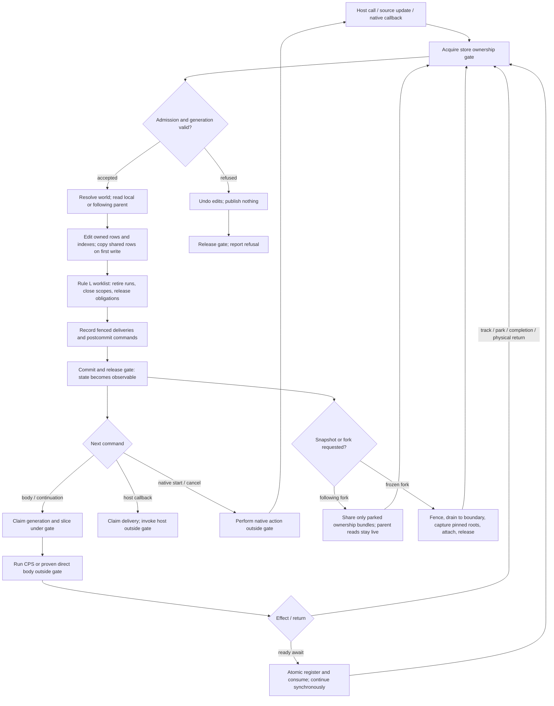

# Engine memory v2: owned world storage

Status: design candidate. The lifetime semantics in
[engine-formalism.md](engine-formalism.md) remain authoritative. This file
specifies a reference representation, a proposed mutable fast path, and their
refinement obligations. No runtime API is changed by this draft.

## Goal and unit of publication

One model transition (§4.4, including its Rule L closure) is the smallest
published unit. A successful transition has one linearization point for all
worlds it changes. A refused transition publishes nothing. User code,
callbacks, native operations and executor dispatch run only after commit.
T20–T25 also use their coordinator fences and cut protocol; a storage CAS
alone does not supply their admission or physical-return guarantees.

The engine may stage any number of edits within a transition. It may combine
consecutive model transitions only when no host read, fork, callback, user code,
foreign world, or model-visible event can observe the intermediate state.
This is an optimization to prove per path, not the default transaction rule.
Atomicity does not require a fresh immutable root after every transition:
exclusive engine-owned memory may change in place while all readers are
excluded. The visibility boundary is the release of that ownership gate.

A transaction records an outbox of deliveries and commands in committed
state. Dispatch after publication may be repeated and must claim each
obligation/event before invoking user code. Retries of an immutable state
builder cannot perform effects.

## Engine flow and visibility

This is the target flow. The experimental kernel implements the local
transition path; coordinated cuts, complete public API integration, and a
modelled committed command outbox remain migration gates.



A successful ready await can combine T5 and T6 because no user code runs
between registration and consumption. It still publishes before invoking the
continuation. A body slice may perform many such transitions; running a body
never grants it permission to mutate published rows directly. Every public
read acquires the gate and receives immutable values. Internal row references
are borrowed only until the next edit; rollback and snapshots must never
retain an alias to a mutable before-image.

Forking does not require copying an unforked world's rows on every commit.
It changes the edit ownership of shared roots. A following fork must retain
only the inherited parked ownership closure, including descendant explicit
scopes, rather than pinning the entire parent's old heap. A frozen basis may
retain the whole captured world until its capability is released.

## Physical layout

```text
WorldHandle
  id, store -> StoreHead, executor
  external handle arena

StoreHead (one per connected world lineage in the first implementation)
  epoch, world-id -> WorldVersion, registry, cut/admission state

WorldVersion
  status, admission, parent id or pinned basis,
  local shadow roots of versioned tables, queue/outbox
  entity index, run index, obligation index, scope index
  derived indexes: by-debtor, by-creditor, ownership children,
                   ready/graph order, token and foreign-dependency links

Table representation
  reference: immutable published root -> rows; transient private builder
  fast path: owned mutable pages; shared/pinned pages copied on first write
```

Entity, run, obligation and scope rows follow §4.1.2. Source rows own the
logical value; derived indexes hold IDs and may be rebuilt. A continuation
belongs to its obligation. Process-local closures and timer handles live in the
owning world's arena, keyed by row ID; fork copy rules install only the
descriptors/continuations the model permits. This arena cannot confer a
retention reason absent a semantic row.

The reference prototype uses Clojure's persistent hash maps and their
transient builders for ID-indexed tables. It establishes a simple refinement
target but does not make the fast-case performance claim. An ordered structure
may serve ready
queues, topological rank, or range indexes. `persistent-sorted-set` is a
candidate for those ordered indexes and its editable-node/seal contract is a
pattern for ownership; it is not assumed to be the entity table. A custom
hashed or segmented directory must beat the hash-map baseline on the engine's
actual transitions, including single-row updates and forked reads.

## Builder, freeze and publication

The immutable `StoreHead` algorithm below is the reference publication path.
It is easy to compare with the formal model and makes foreign edits atomic,
but it still allocates persistent paths and performs a CAS on each transition.
It is not sufficient evidence of competitiveness with a mutable runtime.

1. Read one committed store head. All worlds and following ancestors read by
   the transition come from that revision. Retries rebuild from a new head.
2. Validate admission and the action's preconditions against that view.
3. Stage row/index edits in a builder. A touched shared path is copied once;
   a node created by this builder may be edited in place. Maintain a worklist
   of changed entity IDs and apply Rule L until it reaches its fixpoint. Do
   not scan all worlds or all entities for ordinary reclamation.
4. Seal edited tables and form new immutable `WorldVersion` values for the
   touched worlds. A seal may be O(changed paths), never O(world size). Lazy
   serialization/materialization is allowed; lazy logical mutation of a
   published version is not.
5. Replace the affected world entries in one immutable `StoreHead` and CAS
   the store head. On a failed CAS, discard the draft and retry from the new
   head. The builder and validation must be pure. The successful CAS is the
   only point at which new rows, indexes and outbox become visible, including
   foreign debtor retention and creditor obligations together.
6. Dispatch the outbox after the CAS. A delivery first claims its
   semantic slot in another transition. Native effects use stable IDs and the
   existing durable settlement records where required.

## Exclusive mutable execution path

For the unforked case, use the same semantic rows and transition functions
with an engine-owned mutable representation. A store gate gives one writer
exclusive access and excludes engine readers during a transition. All runtime
access goes through the gate; internal pages and row objects never escape to
user code. After validating preconditions, the transition edits owned pages
and derived indexes in place, applies Rule L to completion, records its
outbox, and releases the gate. Release is its linearization point. The
mutation phase calls no user code and performs no native effects. Semantic
refusals occur before the first edit; any action that cannot satisfy that rule
uses a private draft or undo journal.

An owned page has an edit owner/epoch. A root world with no snapshot or frozen
fork reuses its owned pages across transitions: no persistent-map path copy,
`persistent!`, or store-head CAS is needed per signal update. At a fork or
snapshot boundary, the engine pins the current roots and rotates the writer's
owner token. Neither branch may subsequently mutate a page stamped with the
old token. Its first write copies the touched root/path, then newly owned
pages can be edited in place until the next sharing boundary. Fork attach is
O(lineage depth), independent of entity count; subsequent write cost follows
the touched paths. Explicit reference counts could later recover uniqueness
when a fork dies, but owner tokens suffice for safe copy-on-write.

A following child reads the parent's current pages while holding the store
gate, and stores only local shadows. A frozen child reads pinned pages.
Multi-world T5/T6/T19 actions hold the same gate while editing all affected
worlds, so a reader never sees half of a foreign dependency. A later design
may split gates only with an atomic cross-world protocol. External threads
enqueue work or acquire the gate; they cannot retain a mutable internal page.
JVM lock release/acquire and CLJS event-loop reentry are publication edges.

The fast representation must project to the same model state at every gate
release as the immutable reference prototype does at every CAS. In-place
mutation is an implementation detail, not permission to defer Rule L or a
callback-visible state change.

The reference model has actions that write another world's rows in the same
transition: T5/T6 foreign dependency admission and release, signal
notifications to foreign creditors, T19 inherited-debtor bundles, and cut
coordination. A local commit followed by a message is not equivalent to that
model: a concurrent release could observe the creditor obligation without its
debtor-side retention row. The single store root covers this case directly.
In the fast path the store gate supplies the same atomicity. Its cost is
contention among active worlds, even when their rows are disjoint. Measure
this separately from the single-world hot path. A later per-world-gate design
needs an atomic multi-world protocol or a formally revised foreign-action
protocol before it can replace this one.

A storage node may be reused in place only while owned exclusively by the
current world and unreachable from any pinned snapshot or other fork. An
immutable published root is never edited. Reference counts, if used, count
*explicit engine ownership* of
roots/nodes; they never replace the edit-token rule or decide logical entity
liveness. JVM/JS host aliases are not visible to an engine-owned counter.
Dropping a count releases physical storage only; Rule L decides semantic
retention. An epoch or edit-token implementation is the safe baseline, and a
node-reference-count variant must beat it in paired measurements.

In particular, a thread may have read an old immutable head immediately
before another thread replaces it. An internal count of world heads can now
say "one owner" while that reader still holds the old Java/JS object. The
mutable path avoids this ambiguity by never exposing its internal pages and
by requiring every engine reader to hold the gate. Immutable snapshots are
explicit pins. Counts alone do not authorize mutation of a pinned node.

This follows the useful part of the local
`../../persistent-sorted-set/doc/CONCURRENCY.md` contract: editable nodes are
single-writer, `persistent!` seals them, and publication is a separate
happens-before edge. Lean-style uniqueness reuse is a candidate optimization
for nodes whose internal ownership is provably unique, not a requirement for
correctness.

## Forks and reads

The initial owned-table implementation keeps a Clojure transient map across
transitions. Sealing at a snapshot boundary and immediately making a fresh
transient gives the edit-token rotation above without implementing another
hash trie. Access is sequential under the gate, including JVM thread handoff.
All row values remain immutable. The fixed-bucket Java page experiment is
only a probe: its first-write bucket copy grows with bucket population, so it
does not establish a world-size-independent bound for the final table.

The storage contract is:

1. Every row read/write belongs to an active transaction on its executing
   thread. An escaped transaction becomes unusable when it ends.
2. A transaction excludes all readers, snapshots and other transactions in
   its store. Reentrant transactions and snapshots are refused before reading
   partially changed state. Engine transition code alone holds the gate;
   arbitrary user code and native calls never execute there.
3. A refused or thrown transition restores all edited rows, index rows, and
   newly created tables/worlds before releasing the gate. The first storage
   implementation journals old values. Proven infallible paths may later
   omit that journal only with prevalidation and equivalent refusal tests.
4. A snapshot contains immutable maps and immutable rows, with no references
   to editable table containers. Subsequent edits in any world cannot change
   it. Snapshot construction costs the number of sealed table roots rather
   than the number of entity rows. Fork attachment must seal only its basis
   tables, not walk the store's entire world registry.
5. Foreign row changes and their Rule L cascades use one transaction in the
   same store. A cross-store dependency is not supported by this contract;
   it requires an explicit coordinator protocol before being admitted.
6. Completion/cancellation commands become dispatchable only after commit.
   Their handlers claim an obligation slot in a new transition. Neither
   physical page ownership nor host reachability supplies a retention reason.

The cell representation uses fixed field layouts for entities, runs,
obligations and scopes. A table's edit token owns its row cells as well as its
transient root. A field write copies a shared cell, then journals and changes
its owned field in place. The journal uses a reusable native buffer and clears
its references at transaction exit. Ordinary associative operations on a row
return immutable maps; only the store has a mutating field operation.

`owned-store/pin-world` seals table roots without walking row cells. The
diagnostic `snapshot` function materializes canonical maps and consequently
costs the number of exported rows in cell mode. Physical fork/snapshot capture
must use pinned roots; eager diagnostics are not the fork implementation.
Borrowed live rows are internal to one transition. Retained before-images,
host reads and commands that outlive a transition capture immutable values.

- **Root:** reads under the store gate or from one immutable committed head.
  A transition may edit privately or edit owned mutable pages under the gate;
  no reader or fork sees a partial transition.
- **Frozen fork:** pins one committed basis root and starts an empty local
  shadow table. Its untouched reads use that basis forever. Freezing a
  following child must also pin the versions of its read-through ancestors
  from the same store head; a pointer to the child's version alone still
  reaches live parents.
  Fork creation and physical attach are independent of parent entity count,
  though pinning a following ancestor chain costs O(lineage depth).
- **Following fork:** untouched entity reads resolve through the parent's
  version in the current store view. Local writes shadow whole entity rows;
  tombstones hide parent rows. A transaction uses one immutable store head or
  holds the gate, so its multi-row decision is internally consistent. Later
  transactions may see a newer parent version, as the contract permits. A
  foreign action also validates and publishes the debtor-side row atomically.
- **Inherited parked work:** T19/T23 share one immutable bundle root and
  install world-local execution/obligation descriptors according to the copy
  rule. Physical attach must not enumerate every copied row. Foreign debtor
  bundles are aggregated per debtor world.
- **Queues and egress:** each world has its own queue/outbox and claim records.
  Parent host callbacks and native claims are never copied as executable
  child callbacks. Cross-world dependencies use the model's pending-start,
  admitted and cancelling phases.

A fork taken during a body sees the last committed version. Any row whose
truth changed before that fork must already have been committed by its model
transition. Unprocessed notifications may be dropped only when the committed
state contains sufficient staleness evidence to reconstruct their effect.

## Observable transitions

| Transition | Required atomic contents before control escapes |
| --- | --- |
| Signal write | value/generation and notification or staleness evidence |
| T1/T2/T4 | entity, owner/run, token touch, caller obligation |
| T5 | obligation, continuation, indexes, debtor retention, parked state |
| T6 | slot claim, one-shot removal or standing update, run status |
| T7/T8/T9 | result/generation fence, completion event, delivery claim, successor run as specified by each separate transition |
| T10/T11/T13/T34/T36 | retirement, Rule L cascade, index/queue pruning, cancellation outbox |
| T16/T17/T18 | host token changes affect idle-cache retention only |
| T19/T20–T25 | pinned basis, copy evidence, admission/fence, child publication |
| T26–T33 | durable-capability/record boundary and recovery IDs |

Pure planning inside these transitions is private. Calls into arbitrary spin
code or external code are always outside a private builder. A statically
non-parking body can use direct execution after T4 publication and before T7,
while any engine API it calls still enters its own transition.

## Refinement and performance gates

A representation adapter projects each committed `StoreHead` or gate-released
mutable state to the
reference model's rows. Check L1–L26 after every successful transition and
unchanged state after refusal. Replay the complete staged lockstep traces;
do not hide unsupported edges by shortening a trace. In particular:

- L3/TL7: release reaches Rule L's fixpoint in one commit.
- L5/TL1/TL2/TL5: obligation slots are claimed once, never silently lost or
  resurrected by late delivery.
- L9/TL6/TL13: fork writes stay local and a cut pins one coherent basis.
- L13/TL16: physical storage and following-fork retention remain bounded.
- TL4/TL17: host GC changes only idle caches, never a wanted run.
- TL15/O12: callback execution uses the obligation's world and egress policy.

Check both JVM and CLJS publication/handoff behavior. Benchmark the same
matched reactive graphs and the existing lifetime gates: root, following and
frozen forks, large-parent paths, creation/retirement, world-size scaling,
allocation and retained heap. Compare the immutable reference, the owned
mutable path, and (only if warranted) a custom table or explicit node-count
variant. Require semantic parity before judging speed. The unforked mutable
path has to be measured directly against Missionary; a faster persistent
builder by itself does not establish the desired best-case result.

An exploratory REPL probe put and removed 100 rows per two publications on the
JVM. Repeated persistent-map updates used about 52 KB and 8 microseconds per
cycle; a transient hash-map builder used about 7 KB and 4.4 microseconds. A
naive 256-bucket segmented table used about 123 KB and 46 microseconds. The
probe is not an engine benchmark, but it rejects the segmented layout as a
default and shows that the available transient map deserves the first full
transition benchmark. For single-row transactions the transient setup costs
more than direct persistent updates; the builder may choose the direct path.

A separate 200,000-commit REPL probe of a single scalar update measured about
62 ns for a local atom and 147 ns for the same update through a one-world
registry atom on this JVM. That isolates the extra registry path, not the cost
of an actual engine transition or multi-threaded contention. The decisive
comparison is a paired end-to-end workload on the replacement engine.

The owned-page probe verifies that an unforked world reuses the same root,
that a fork shares it without copying entity rows, and that the first write
in either branch copies the touched page. In one 500,000-update REPL run, a
locked owned-page write took about 52 ns and 12 bytes/update; a one-row
immutable-store update took about 134 ns and 376 bytes/update. These numbers
exercise only row storage, so they cannot predict whole-engine speed. They
show why the mutable path must be included in the implementation and measured
with the full scheduler, dependency graph, and callback path.

For the no-fork matched graphs, aim to match or beat Missionary in time
and allocation on both JVM and optimized CLJS. A timing gap below 10× may be
acceptable for extended semantics; it is a tolerance, not the optimization
target. Report remaining costs by transition count, allocations, dependency
work, CPS dispatch and executor handoff. Measure allocation, retained heap and
GC pauses separately. Profile collected allocations as well as survivors;
heap growth alone does not measure allocation rate. Run unprofiled trials for
throughput because allocation sampling changes execution cost.

Measure fork frequency separately so copy cost does not hide a slow unforked
path. A body proved unable to park may run without CPS/Thunk dispatch; bodies
with unknown effects retain the general path until a sound direct/dynamic
handoff is implemented.

## Implementation sequence

1. Build the semantic transaction kernel against one `StoreHead`, projecting
   complete rows to the formal model after every transition. Start with B2
   obligations and Rule L, then B3 run generations, B4 scopes/cuts, and B5
   idle-cache GC. Preserve the existing runtime protocols at the API edge.
2. Implement T5/T6/T19 foreign edits as one store publication. Prove refusal
   leaves the old head intact; check stale callbacks and duplicate deliveries
   against the model. Test following and frozen fork views at every publication.
3. Implement the owned mutable representation and compare its gate-released
   projections after each transition with the immutable kernel. Exercise
   snapshot/fork interleavings and refusal rollback. Run the matched
   Missionary graphs and concurrent fork workloads before removing the old
   engine. A faster kernel alone is insufficient if CPS dispatch and host
   egress dominate afterward; non-parking bodies also need the direct
   execution path described above.

## Public state boundary

Engine graph, run, obligation, admission and scheduler mutations use typed
operations. Generic `PState` writes cannot replace that state or bypass the
transition's ownership and generation checks. Its engine reads are immutable
diagnostic views, not borrowed rows or an emulation of the old mutable node map.

Application extension cells retain get/swap/CAS. A transformation, structural
equality and key hashing can execute user code, so they run outside the family
gate. The commit validates the immutable roots read from the whole following
lineage under the gate and retries if any changed. This preserves reentrant
updates and observes a concurrent parent change before acquiring a private copy.
An explicit target context selects its own world, even inside another world's
native body; an ambient activation must not silently override it.

A following world reads current parent cells until a local write shadows them.
For map groups the copy unit is `[group cell-id]`, including all nested fields of
that cell. Replacing a whole group shadows the whole group; vector groups are
copied whole before nested edits. A local map-cell override still presents a map
if its parent group is subsequently replaced by a scalar, vector or nil. Direct
reads and bulk views must agree. Untouched cells do not pin historical parent
application maps. Immutable diagnostic views remain unchanged after later writes.

The native root-world extension-cell facility does not yet implement scoped
RuntimeAtom allocation/release, listener egress, component ownership or world
release. Those require typed lifecycle integration in addition to generic cell
payload updates; passing extension-cell tests does not close those gates.

Cancellation-shielded `await-finalization` is also an explicit migration gate.
It must preserve the cancelled cached result while asynchronous cleanup can
finish and physical joining waits. It cannot be translated into an ordinary
await on an unwinding run, whose new ordinary registrations are refused by the
lifetime model.

The opt-in executable `:cps-exit?` / `:slices?` profile now refines retirement
with a protected exit ticket for each entered, unfinished CPS generation.
Cancellation of a body that never entered creates no cleanup work; a completed
body has already returned from its finalizers. Logical retirement still removes
ordinary ownership and obligations. Cleanup tickets are physical evidence in the
environment, never ordinary execution roots or permission to create new work.

Cleanup retains existing owned source/atom payloads until its participants have
physically returned. Each retained cell is stored once, keyed by world, original
owner and entity, with explicit participant holders. Overlapping parent/child
retirement merges the retained views in either cancellation order. Cleanup writes
are shared among those participants. A source adopted by a successor before
retirement belongs to the successor and is absent from the old cleanup view.
Retention metadata copies no engine graph, body closures or historical world;
application payloads remain opaque.
World release still publishes a lineage-only tombstone; private retained payloads
remain outside it until the last cleanup participant returns.

`cleanup-claim` transfers a ready ticket to a cleanup frame only after the prior
physical slice returns. `cleanup-adopt` instead transfers the same authority to
the exact existing frame of that world/generation, allowing a running body to
unwind its finalizers without another dispatch or a second physical frame.
`cleanup-park` creates a new one-shot callback sequence;
`cleanup-deliver` commits readiness without executing user code. Duplicate, stale
and post-return deliveries are inert. `cleanup-return` records CPS completion,
but only T38 physical return releases the ticket and its cell holders. A second
cancellation and generic native acknowledgements cannot consume that authority.
In this restricted retirement profile, cleanup frames can access existing
retained cells and suspend/return; they cannot perform ordinary engine effects
or notify ordinary observers. This does not decide whether public finalizers may
update other live application cells/resources or emit their notifications; that
requires typed cleanup capabilities and generation admission. The L27 scan checks
ticket/frame/cell conservation; TL21 independently derives required retention
from pre-retirement ownership and detects consistently erased holder links.

The reference kernel implements this retirement profile using its ownership
indexes. Per-transition comparisons cover immutable rows, owned cells, and owned
cells without intermediate sealing. World-release T34 itself remains unsupported
by that kernel; cleanup after release is checked from a restored tombstone.

The profile also represents a finalizer already waiting on the success path.
`finalization-wait` records a protected native wait before suspending; normal
`finalization-resume` consumes its ready authority into one ordinary physical
frame of the current generation. It can continue inline on the existing frame
or dispatch after that frame returns, never both. A live wait does not put its
frame into cleanup-only admission. T11/T10/world release convert the same wait
to a retired exit ticket without resetting its callback sequence, readiness or
payload. A stale predecessor cannot use live resumption; retirement first
converts its authority to cleanup. Sequence numbers increase across successive
waits in a generation and seed later retirement waits, so an old success-path
callback cannot wake a new cleanup suspension.

This is a symbolic lifetime refinement, not yet the public `await-finalization`
implementation. The native implementation still needs the profile. Typed scoped
application resources (including their fork policy), error egress, and real CPS
continuation handoff remain integration gates. The existing model profiles and native default are unchanged.
The public backend cannot claim the finalization contract until those integration
checks pass on both platforms.

Result arbitration commits and returns the effective Result in one transaction.
An explicit cancellation fences the current generation's later success/error
proposals; a fresh generation clears that fence. Callback dispatch uses the
committed Result, including direct-await child completion, so a finalizer cannot
restore success after cancellation. Merely caching a propagated child-cancellation
error does not revoke a reactive owner's authority to recover. Separate reporting
of cleanup failures remains part of the error-egress integration gate.

Context scope handoff uses partial-cps's registered scope adapters. Public
callbacks and trampoline thunks capture the context's lexical `:bindings` map,
then restore it onto the runner-selected context. Portable regressions cover
initial inline loops, parked resumption, fork selection and bounded repeated
scope entry/exit; compiler tests also cover exception/finally egress. This
preserves Spindel's explicit context scope contract without introducing generic
snapshot semantics for arbitrary dynamic Vars. The native public adapter must
preserve the same selected-world/generation contract when it is integrated; a
wrapper that grows with every synchronous await does not satisfy it.

## Replacement acceptance

The default engine changes only after these gates pass on JVM and CLJS:

1. The shared benchmark driver covers fixed and changing dependency graphs,
   parking/resumption, cancellation and creation/reclamation. JVM allocation
   counts and JS allocation profiles are reported with their distinct scopes.
   Optimized Node builds are measured separately from development builds.
2. Native storage, registration closures, work queues and scratch buffers have
   bounded retention after churn. Host collection removes idle caches while
   wanted work survives. Diagnostic traces and checker-only history are
   excluded explicitly from production memory claims.
3. The executable replacement covers the public contracts: source intervals
   and deltas, spins, Deferred/Mailbox/native effects, scopes, all fork modes,
   foreign dependencies, coordinated cuts, disposal and physical joining.
   Its published transitions refine the model; refused operations leave state
   unchanged. Restricted prototype support does not satisfy this gate.
4. Behavioral tests run against an explicit engine selection on both
   platforms. Model replay and generated interleavings supplement the full
   functional suite. JVM concurrency stress and JS event-loop/optimized-build
   checks exercise publication and callback handoff.
5. An independently reviewed change selects the new engine by default after
   all gates pass. The old execution path is removed once the replacement
   passes the same integration checks, rather than remaining as a hidden
   fallback for unsupported operations.

The current compact probe is executable on both platforms, but still has
restricted parked-fork support and is not yet the public runtime replacement.
The pure model covers the lifecycle/control plane; functional tests remain
responsible for real CPS execution, values, interval/delta behavior and public
subsystems. Allocation profiles and retained-heap probes check physical costs
that logical transition replay cannot establish.
