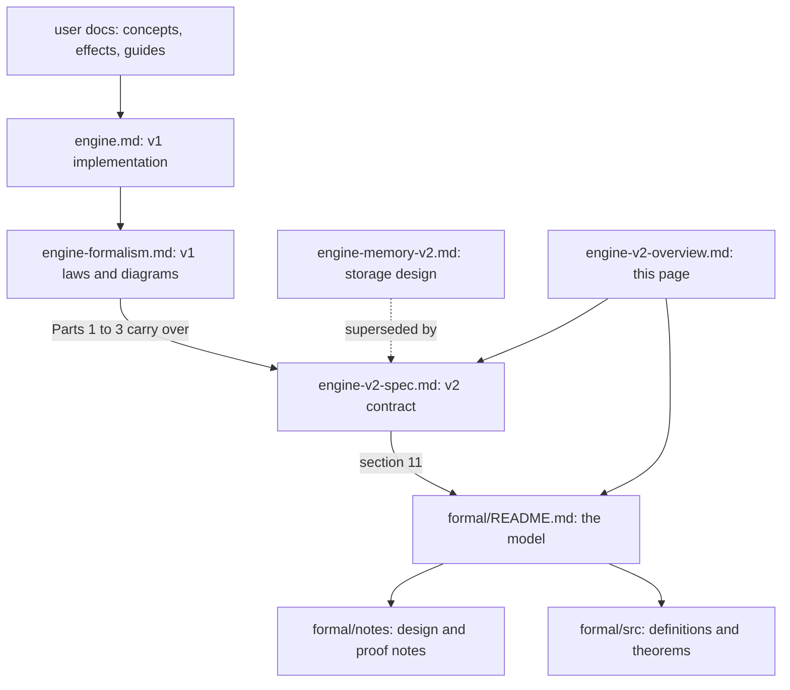
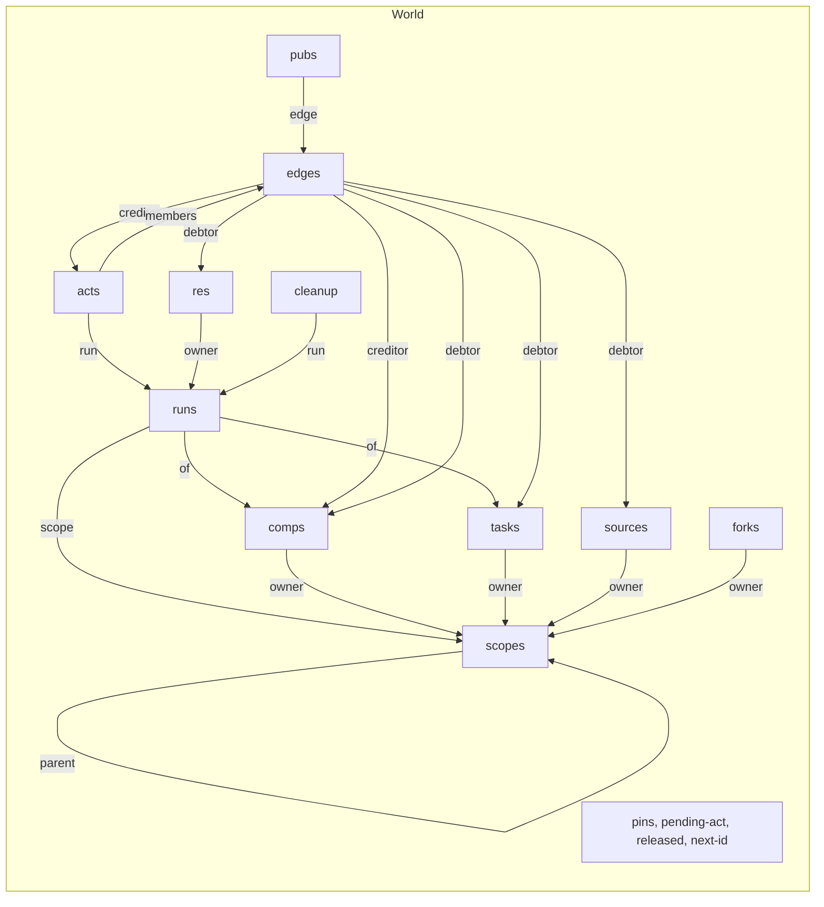
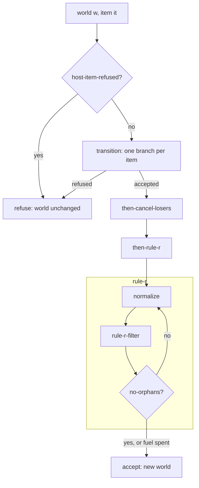
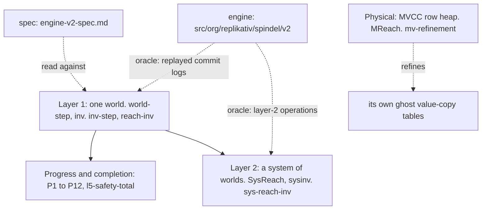

# Engine v2: overview and map

The v2 engine is the rewrite of spindel's runtime in `src/org/replikativ/spindel/v2/`. It keeps the
state of a reactive system as one record of tables, and it changes that record only in atomic steps.
This page is the map: it shows the state and one step in pictures, lists the properties the engine is
meant to have, and points from each property to the section of the specification that states it and to
the theorem of the machine-checked model that proves it, where there is one.

The page states nothing new. Where it and a source disagree, the source is right.

## Terms

Each definition is the spec's ([§1](engine-v2-spec.md#1-vocabulary) unless another section is named).

| Term | Meaning |
|---|---|
| **World** | An isolated state space. Its commits are linearizable. Different worlds run in parallel. |
| **Slice** | A maximal stretch of one run's body between two effects: from the run's start or a resume up to the next suspension, return or throw. |
| **Gate** | A world executes at most one slice at a time, and the active slice holds the world's gate. Every commit runs under the gate, and every reader goes through it (D0, §6). |
| **Step**, **item** | Every transition is a step of the world's single execution: an effect of the active slice, a completion, a scheduling choice, or a host operation processed between slices. The model calls the input of a step an item. |
| **Computation** | A `spin`: a body with a deterministic id, captured inputs and a cached result. It is reactive: `track`, and `await` on a debtor that can still change, are dependencies. It is retained only by demand (an edge on it, a pin, membership in a live computation's basis), not by its owner scope (§3.2). |
| **Task** | An uncached body, used for processes, loops and pumps. Every `await` in a task is a one-shot wait. A task is retained by its owner scope while it runs (§3.2). |
| **`live(W)`** | The least set of rows that contains the roots (§3.1: the root scope, pins, `observe` edges, open explicit scopes and others) and is closed under the retention edges of [§3.2](engine-v2-spec.md#32-retention-edges). |
| **Rule R** | The reclamation rule, run as the last part of every transition before it commits ([§3.3](engine-v2-spec.md#33-rule-r-a3-x10)): cancel and demote what is outside `live(W)`, remove every row that nothing retains, detach rows whose owner was removed. |
| **Savepoint** | An effect that publishes the rest of a body to a handler. The publication can be resumed in place, or instantiated as a fork ([§8.2](engine-v2-spec.md#82-savepoints-r7-r17)). |
| **`Z#n`** | A numbered clarification or patch of the spec that came from the model or the engine (spec, [History and tags](engine-v2-spec.md#history-and-tags)). `R#`, `V#`, `W#`, `X#`, `Y#` and `A#` are findings of earlier reviews. |

## How the documents are arranged



| Document | What it is for | When to read it |
|---|---|---|
| [README.md](README.md) and the user docs it lists | The public API and its mental model. | First, if you do not know spindel. |
| [engine.md](engine.md) | How the current (v1) engine is implemented. | When you work on v1 code. |
| [engine-formalism.md](engine-formalism.md) | Laws, flow charts and a correctness argument for v1 (Parts 1–3); a lifetime contract (Part 4). | For the algebra of `track`, `await` and deltas. The v2 spec says that Parts 1–3 carry over unless it says otherwise, and that it supersedes Part 4. |
| [engine-v2-spec.md](engine-v2-spec.md) | The normative contract of v2: vocabulary, state, transitions, invariants, forks and savepoints. | Before changing v2 behaviour. Sections 1–7 are one world, section 8 is forks and savepoints, section 9 is the settlement interface, sections 10–11 are not normative. |
| [engine-memory-v2.md](engine-memory-v2.md) | A design candidate for owned world storage. | For storage representation only. It names the v2 spec as authoritative, the v2 spec says it supersedes this file, and it uses the numbering of engine-formalism Part 4, not the spec's. |
| [formal/README.md](../formal/README.md) | The machine-checked model: what is proved, how the step proof works, a reading list, the namespace map, the invariant table, the trust boundary. | When you need the exact statement or status of a property. |
| [formal/notes/LAYER2.md](../formal/notes/LAYER2.md) | Design note for the model of forks, savepoints and merge, and of the MVCC row representation. | Before reading `layer2.*`. |
| [formal/notes/proof-layout.md](../formal/notes/proof-layout.md) | How the preservation proofs are organised, with measurements. | Before changing a proof. |

Two warnings about names. The model is written in [ansatz](https://github.com/replikativ/ansatz), a
proof layer for Clojure that uses the kernel of Lean 4; its theorems have global names, so
`inv-step` is one theorem wherever its namespace lives. And `engine-formalism.md` Part 4 uses the
labels `L1`–`L26`, `TL1`–`TL20` and `T1`–`T38` for its own items. They are not the `L1`–`L5` and
`T1`–`T28` of the v2 spec. On this page a bare `I`, `L`, `T` or `P` number is always the v2 spec's
or the model's.

## The engine's state in one picture

The state of a world is the record `World` (spec [§2](engine-v2-spec.md#2-state-layer-1); model
[`state.clj`](../formal/src/spindel/v2/state.clj)). In the model it has 11 row tables and four other
fields. An arrow below reads "a row of this table names a row of that table in this field".



| Table | A row is | Main fields |
|---|---|---|
| `scopes` | A **scope**: a lifetime container. Scopes form a tree from the world's root scope. | `parent`, `kind` (root, run, explicit), `open` |
| `comps` | A **computation** (see Terms). | `owner`, `run`, `epoch`, `done-epoch`, `pending`, `rank`, `version`, `result`, `idle` |
| `tasks` | A **task** (see Terms). | `owner`, `run`, `result`, `handles`, `local` |
| `runs` | A **run**: one execution of a body. | `of`, `stamp`, `epoch`, `scope`, `act` (active, parked, done), `mode` (normal, unwinding), `slice`, `finalizers`, `resources` |
| `sources` | A **source**: signal, cell, deferred, mailbox, semaphore, link or stream. | `owner`, `kind`, `state`, `version`, `open` |
| `edges` | An **edge**: a subscription from a creditor to a debtor. A `dep` edge is a computation's standing dependency, a `wait` edge is consumed once, an `observe` edge belongs to the host, and a `savepoint` edge is the one member of the activation in which a run parks when it publishes a savepoint. | `kind`, `creditor`, `debtor`, `cont`, `at`, `phase` (armed, fired), `marked` |
| `acts` | An **activation**: one suspended `await` of a run, with its continuation. | `run`, `mode` (one, all, any), `members`, `slots` |
| `res` | A **resource**: a physical obligation of a run (a timer, an offload). | `owner`, `kind`, `phase` |
| `cleanup` | The rows a done run that is not yet retired must still clean up. | `run`, `rows` |
| `pubs` | A savepoint publication. | `edge`, `basis`, `handles` |
| `forks` | A marker for a child world. | `child`, `owner` |

An owner is a scope, or the computation that created the row; the picture draws only the scope.
A creditor is a computation (`dep`), an activation (`wait`, `savepoint`) or the host (`observe`). The
other fields are `pins` (rows the host pins), `pending-act` (an activation waiting for a savepoint
instance to be activated; `pending-activation` in the spec), `released` (the world was released) and
`next-id` (the allocator; `Family.stamp` in the spec). The spec's `ingress` queue and its planned
`close` record (Z#66) are not in the model.

## One step in one picture

Every change of a world is one step, and a step takes the world and one item (see Terms). In the
model, `Item` has 49 constructors ([`step.clj`](../formal/src/spindel/v2/step.clj)) and the step is
exactly this ([`engine.clj`](../formal/src/spindel/v2/engine.clj)):

```
world-step w it              = then-rule-r (raw w it)
raw w it                     = then-cancel-losers w (host-guarded-transition w it)
host-guarded-transition w it = refuse when (host-item-refused w it), else (transition w it)
```

Rule R, the last stage, removes what the transition left without a reason to exist: it cancels and
demotes what is no longer retained, removes the rows nothing retains, and detaches rows whose owner
was removed.



| Stage | What it is for |
|---|---|
| `host-item-refused` | A released world refuses the host's operations, unless a run holds the slice (then the item is that run's effect). |
| `transition` | Dispatches on the item to the transitions of spec [§5.1](engine-v2-spec.md#51-transitions): T1–T22 and T28, plus the source operations of §4.3 and scheduling items. Some transitions have no item of their own and run inside others (T10 finalize, T13 retire). A branch with a guard checks it first (`<item>-refused`). T27 (host `rerun`) is not modelled; T3's different-inputs case models the rerun-source write. T23–T26 are planned (Z#66) and not modelled. |
| `then-cancel-losers` | After an accepted transition, cancels the losers of an `await` in mode `any`. |
| `then-rule-r` | Runs Rule R on an accepted outcome; a refusal stays the input world. |

**Rule R in the spec and in the model.** The spec ([§3.3](engine-v2-spec.md#33-rule-r-a3-x10))
states three steps, run as the last part of every transition before it commits
([§5.1](engine-v2-spec.md#51-transitions)): normalize to a fixpoint (recompute the retained set
`live(W)`, cancel runs outside it, demote computations outside it, detach rows whose owner was
removed), remove every row that nothing retains, then detach once more (Z#25). The model reads this
as rounds ([`rule.clj`](../formal/src/spindel/v2/rule.clj), reading 14 of its docstring):
`rule-r-round w = rule-r-filter (normalize w)`, where `normalize` starts with the detach, and
`rule-r` repeats rounds until `no-orphans` holds, that is until no source, task or computation is
left whose owner was removed. The loop is bounded by fuel (one plus the number of ids); when the fuel
is spent it returns the last round's world. `rule-r-no-orphans` (table below) says the result has no
orphan in either case.

A step either refuses with no change or commits whole. Every commit runs under the world's gate and
every reader goes through the gate, so no reader sees the world inside a step. An invariant may
therefore be broken between two edits of one step as long as the same step repairs it (spec
[§6](engine-v2-spec.md#6-invariants-and-temporal-laws), first paragraph).

## The layers of the model



**Layer 1: one world** (`state`, `edits`, `step`, `rule`, `engine`, `inv.*`, `top`). The state is
`World`, the step is `world-step`, and the top invariant is `inv`, a conjunction of executable Bool
predicates that state invariants of spec §6. Its base is `well-formed`: pending counts are exact,
every edge's creditor and debtor exist and have the right kind, ids are unique and below the
allocator. On the base sit about 45 parts, joined in a chain of 13 links (`chain-start` … `chain`);
`inv` is `chain` plus four parts proved beside it. The headline is `inv-step`, and from it
`reach-inv` by induction over `WorldReach`.

**Progress and completion** (`progress.*`, `completion.*`). Still about one world. Of the progress
obligations, P1, P2, P4 and P6–P9 say that the fuel-bounded loops of a step (the retention worklist,
normalization, the cancel cascade, validation, settling, reactivation, Rule R's rounds) finish in
the state they aim for. P3 says that Rule R's filter is safe. P5, P11 and P12 are step invariants.
P10 is open. `l5-safety-total` is the safety half of the spec's law L5. The completion namespaces
prove that a released world stays released and a quiet world stays quiet. None of these is a
liveness theorem: "eventually" statements (L2's join, L5's other half) are paper arguments.

**Layer 2: a system of worlds** (`layer2.sys`, `layer2.skip`, `layer2.top`). A system is a table of
cells, each holding one layer-1 world, and a table of publications. A fork is a value copy of the
parent's world. `SysReach` has one constructor for the initial systems and one for each of 29
operations (step in a cell, fork, wake, publish, resume, instantiate, activate, abandon, merge, seal,
release, join, own, transfer, retire and others), each with the guards the engine is assumed to
check. `sys-reach-inv` says that every reachable system satisfies `sysinv`.

**Physical representation** (`layer2.mvcc`). The engine does not copy a world at a fork; forks share
rows through versions and tokens. `mv-refinement` says that every active world still reads every id
as a value copy would. The value-copy tables it compares against are ghost state of `layer2.mvcc`
itself, not the cells of `layer2.sys`, so the diagram draws no arrow from it to layer 2.

**The oracle** (tests, [`oracle.clj`](../formal/test/spindel/v2/oracle.clj)) is the only link from
the model to the engine: it replays commit logs recorded from the engine through `world-step` and
the layer-2 operations and compares every committed state and every refusal.

## The properties, each with its pointers

Files are under [`formal/src/spindel/v2/`](../formal/src/spindel/v2/). The statements are
paraphrases; the source is the theorem. The Status column uses the words of the model's README:
**proved** (a theorem), **partial** (some clauses proved), **oracle only** (an executable check on
replayed engine states, no theorem), **out of scope** (not modelled, by design). For I11a–I16, L1–L3
and P1–P12 use the [invariant table](../formal/README.md#invariant-table) of that README, which this
table shortens.

| Property | Plain statement | Status | Spec | Theorem | File |
|---|---|---|---|---|---|
| Base invariant | `well-formed w`: pending counts exact, every edge's ends exist and have the right kind, ids unique and below the allocator. It holds in the empty world and after every step from a world that satisfies `chain-start`. | proved | [§2](engine-v2-spec.md#2-state-layer-1) (pending is exact), [§6](engine-v2-spec.md#6-invariants-and-temporal-laws) I2 | `well-formed`, `well-formed-empty`, `step-well-formed-total` | [`edits.clj`](../formal/src/spindel/v2/edits.clj), [`inv/base.clj`](../formal/src/spindel/v2/inv/base.clj) |
| The empty world is fine | `inv empty-world`. | proved | [§11](engine-v2-spec.md#11-verification-plan-non-normative) item 2 | `inv-empty` | [`top.clj`](../formal/src/spindel/v2/top.clj) |
| Every step keeps the invariant | If `inv w`, then `inv` holds in the world after `world-step w it`, for every item, accepted or refused. The only premise is `inv w`. | proved | [§5.1](engine-v2-spec.md#51-transitions), §6, §11 item 2 | `inv-step`; its core `step-chain` (`chain w` gives `chain` after the step) | [`top.clj`](../formal/src/spindel/v2/top.clj), [`inv/members/step.clj`](../formal/src/spindel/v2/inv/members/step.clj) |
| Every reachable world is fine | Every world reachable from the empty world by steps (`WorldReach`) satisfies `inv`. | proved | §11 item 2 | `reach-inv` | [`top.clj`](../formal/src/spindel/v2/top.clj) |
| I1 ownership | Scopes have parents; tasks, resources and attached sources have owners or a cleanup entry; a detached source is closed. | proved | §6 | `step-lit-i1-total` | [`inv/i1_runs.clj`](../formal/src/spindel/v2/inv/i1_runs.clj) |
| I2 referential integrity | Edges, activations and their members name existing rows. Not covered: "every basis member exists or is idle" and some member edges. | partial | §6 | `step-well-formed-total`, `step-chain-start`, `step-chain` | [`inv/base.clj`](../formal/src/spindel/v2/inv/base.clj), [`inv/members/step.clj`](../formal/src/spindel/v2/inv/members/step.clj) |
| I3 liveness | Every row is retained: in `live(W)`, in storage, in a cleanup entry, or admitted by §3.4. | proved | §6, [§3](engine-v2-spec.md#3-retention) | `step-i3-inv` | [`completion/quiet_world.clj`](../formal/src/spindel/v2/completion/quiet_world.clj) |
| I4 work is reachable | A run that is not done is in `live(W)`; a done run that is not retired has a cleanup entry. | proved | §6 | `step-i4-p3` (accepted steps), `step-chain-to-i1-runs` | [`inv/base.clj`](../formal/src/spindel/v2/inv/base.clj), [`inv/i1_runs.clj`](../formal/src/spindel/v2/inv/i1_runs.clj) |
| I5 consumption | No `wait` edge without its activation; no armed `dep` edge on a final debtor; an `observe` edge's `seen` never exceeds its debtor's version. | proved | §6 | `step-i5-total`, `step-i5-seen-total`, `step-lit-i5-dep-final-total`, `step-i5-wait` | [`inv/base.clj`](../formal/src/spindel/v2/inv/base.clj), [`inv/i5.clj`](../formal/src/spindel/v2/inv/i5.clj), [`inv.clj`](../formal/src/spindel/v2/inv.clj) |
| I6 continuation placement | Continuations exist only in activations, `dep` edges, finalizer boundaries and scheduled slices. The model treats continuations as opaque ids. | out of scope | §6 | none | none |
| I7 idle shape | An idle computation has no edges, no run, an empty basis and no adoption. The empty-basis clause is oracle only. | partial | §6 | `step-lit-i7-total` | [`inv/base.clj`](../formal/src/spindel/v2/inv/base.clj) |
| I8 closed scopes | A closed scope owns no run that is not done and no open source. The proof uses the model-only guard `cur-closed`; that the guard never fires (P10) is open. | proved, under that guard | §6 | `step-lit-i8-total` | [`inv/i8.clj`](../formal/src/spindel/v2/inv/i8.clj) |
| I9 unwinding | An unwinding run has no ordinary activation; its resources are cancelling or fired. Z#66 is not modelled. | proved for synchronous finalizers | §6 | `step-i9`, `step-lit-i9-res-total`, `step-edge-kinds` | [`inv.clj`](../formal/src/spindel/v2/inv.clj), [`inv/base.clj`](../formal/src/spindel/v2/inv/base.clj), [`inv/members/cascade.clj`](../formal/src/spindel/v2/inv/members/cascade.clj) |
| I10 runs | A computation has at most one current run; a task has exactly one run until it completes; at most one run holds the slice. | proved | §6 | `step-lit-i10-current-total`, `alive-run-latest-i10-comp`, `step-lit-i10-task-total`, `step-i10-slice` | [`inv/i10.clj`](../formal/src/spindel/v2/inv/i10.clj), [`inv/alive_runs.clj`](../formal/src/spindel/v2/inv/alive_runs.clj), [`inv/base.clj`](../formal/src/spindel/v2/inv/base.clj), [`inv.clj`](../formal/src/spindel/v2/inv.clj) |
| I11a–I16 | I11a, I14: proved. I12: the rank order is proved, the `::cycle` refusal is not. I13: guard lemmas only. I11b: out of scope. I15: not modelled. I16: the run half and LOC3 are proved, the rest is oracle only. | mixed | §6 | `step-i11a-total`, `step-i14-total`, `step-rank-total`, `i13-fire-dep-live`, `loc1-runs`, `sys-reach-rinv` | see the [invariant table](../formal/README.md#invariant-table) |
| L4 no resurrection | If the item's validity token is invalid (`raw-token-ok w it = false`), the step is a refusal and the world is unchanged. | proved | §6 L4, §2 (validity tokens) | `step-l4` | [`engine.clj`](../formal/src/spindel/v2/engine.clj) |
| L5 admission, safety half | In a world that satisfies `chain` and is `quiescent`, take a computation that is waiting (not idle and not live). Then these three cannot all hold: nothing in its cone is blocked, no non-idle `needs-run` computation in its cone is eligible, and every parked task in its cone is blocked. So one of the spec's three cases holds. That the third case is a cyclic wait among tasks is a paper step; the liveness half is a paper argument. | proved (safety half) | §6 L5, [§4.5](engine-v2-spec.md#45-coherence-and-scheduling-r6-v1-v2-w1-w7) | `l5-safety-total` | [`inv/members/step.clj`](../formal/src/spindel/v2/inv/members/step.clj) |
| Rule R leaves no orphan (P9) | If `well-formed w` and `rule-r-safe w`, then `no-orphans (rule-r w)`. | proved | [§3.3](engine-v2-spec.md#33-rule-r-a3-x10) | `rule-r-no-orphans`; the other loops: [progress obligations](../formal/README.md#progress-obligations) | [`inv/i1_owners.clj`](../formal/src/spindel/v2/inv/i1_owners.clj) |
| Layer 2: every reachable system is fine | `SysReach cells pubs` gives `sysinv cells pubs`: every live world and every live publication's basis satisfies `inv`; a live complete cell is ready; every live world is quiet-compatible; the host joins are well formed. The guards of the operations are premises of `SysReach`. | proved, under those guards | [§8](engine-v2-spec.md#8-layer-2-forks-and-savepoints) (F5), §11 item 2 | `sys-reach-inv` | [`layer2/top.clj`](../formal/src/spindel/v2/layer2/top.clj) |
| Fork-local retirement comes first | In every reachable system, a cell whose fork-local retirement is pending has processed no item. | proved | §6 I16 (Z#77) | `sys-reach-rinv` | [`layer2/top.clj`](../formal/src/spindel/v2/layer2/top.clj) |
| Refinement of the row heap | In every state reachable from `mv-init` (`MReach`), for every active world `u` and every id `i` of its domain, the MVCC read of `i` in `u` returns the value the value-copy table has for `u` and `i`. | proved, against the ghost tables of `layer2.mvcc` | [§8.1](engine-v2-spec.md#81-forks) (Representation, MVCC), §11 item 2 | `mv-refinement`, from `mv-reach-good` | [`layer2/mvcc.clj`](../formal/src/spindel/v2/layer2/mvcc.clj) |
| Re-entry rule for T6 and T7 (PR #342) | A `dep` edge's `cont` is a continuation, not `restart`, only if the run that writes it holds no finalizer entry and no resource, and at an `await` only in mode `one`. This holds for the definitions `track-cont` and `await-cont`, for the edge an accepted T7 leaves in the world before Rule R, and for the two rows T6's wiring writes. | proved as a postcondition, not as an invariant | §2 (Re-entrant sites), [§7](engine-v2-spec.md#7-body-interface-the-cps-contract) B3 | `reentrant-cont-needs-no-finalizer`, `t7-track-reentrant-needs-no-finalizer`, `t6-await-reentrant-needs-no-finalizer` | [`engine.clj`](../formal/src/spindel/v2/engine.clj), [`step.clj`](../formal/src/spindel/v2/step.clj) |

## Algebraic laws

`engine-formalism.md` states its laws for the v1 engine. The v2 spec has a **carry-over clause** (the
last paragraph of its [History and tags](engine-v2-spec.md#history-and-tags)): "Parts 1–3 of
`engine-formalism.md` carry over unless this document says otherwise", and the spec supersedes
Part 4. The lists below sort the laws by what v2 does with them. "Proved" means a kernel-checked
theorem of the model. The model treats values, continuations and deltas as opaque, so most of the
algebra is outside its reach.

**(a) A law of Parts 1–3, proved in the model.**

- **Resume idempotence (1.9), the token half.** v2 states it as validity tokens (spec §2) and law
  L4: a fire is valid only while its edge is `armed`, and an operation with an invalid token changes
  nothing. `step-l4` proves exactly that: an invalid token gives a refusal. What an accepted fire
  does to its edge's phase (it stays `fired`, is re-armed after a delivery, or is removed) is T9's
  definition, not a theorem. The other half of 1.9 is in list (b).

**(b) Claimed by v2, not proved in the model.**

- **`track` as a comonad (1.1).** Carried by the carry-over clause; spec
  [§4.4](engine-v2-spec.md#44-track-intervals-r22-w12) defines the interval a `track` delivers. The
  model stores an edge's baseline, but values are opaque numbers and no comonad law is stated.
- **`await` as a monad (1.2).** Carried by the carry-over clause. The model treats continuations as
  opaque ids (I6 is out of scope); the body contract B1–B8 of spec §7 is checked by property tests
  in partial-cps, not by the model.
- **Delta algebra laws (1.3).** Carried by the carry-over clause; spec §4.4 composes deltas. The
  model does not model deltas (`step.clj`, T2: "deltas are not modelled").
- **Glitch-freedom (1.4).** v2 restates it as coherence and scheduling (spec
  [§4.5](engine-v2-spec.md#45-coherence-and-scheduling-r6-v1-v2-w1-w7)) with I13 and I15, and it
  drops v1's limit to the synchronous sub-graph: a result is consumed only when it is `live`
  (rule 5), and a computation with a blocked debtor runs its coherent prefix and parks (rules 6
  and 7). Proved pieces: the I13 guard lemmas (`i13-fire-dep-live` and its siblings in `inv.clj`)
  and the rank order of I12 (`step-rank-total`). I15 (coherence of results) is not modelled, so the
  law without the limit is a claim, not a theorem.
- **Determinism and replay (1.5).** The spec requires deterministic ids (§0, §1) and fixes the
  effect index (§2, Z#12). In the model, ids are inputs of the items; nothing is proved about how
  they are computed.
- **The B-gate (1.6).** T3 cites formalism §1.6 for the capture comparison. The model has T3 with
  an `inputs` field. The model has no theorem that states the idempotence of re-registration; its
  theorems named `t3-…` are the two refusal lemmas.
- **Delta-once delivery (1.7).** v2 replaces the consumed generation by a baseline per track site
  (§4.4) and `seen` on `observe` edges (§4.2). Proved: `seen` never exceeds the debtor's version
  (I5, `step-i5-seen-total`). Exactly-once delivery is not a theorem.
- **Commutativity of independent signal changes (1.8).** Claimed through the carry-over clause; the
  spec does not restate it. Literal equality of states cannot hold once follow-up runs are
  dispatched, because T11 gives each new run a fresh id in step order. A v2 form of the law has to
  hold up to renaming of allocated ids. The model has no such theorem.
- **Resume idempotence (1.9), the continuation half.** B2 (a continuation is resumed at most once
  per fire) is a property-test claim of the body contract.
- **Part 3, correctness per composition.** Claimed through the carry-over clause. The arguments
  cite v1 code (continuation truncation) that v2 replaces by re-entry through T11, and they have
  not been redone for v2. The spec's decision Q9 (§12) covers one of them: effect-index truncation
  in forks and savepoints carries over formalism §3.4 and is to be re-verified against foerster
  replay.

**(c) v2 laws with a namesake in Part 4.** Part 4 is superseded, so these are not carried over; the
v2 law has the same name and subject.

- **L4 ↔ TL5, no resurrection.** v2's L4 is proved (`step-l4`), in its v2 wording (invalid token).
- **L2 ↔ TL19, join.** Partial: measure lemmas are proved (`step-mu-le` and others in
  `progress/measures.clj`); fair termination is a paper argument and Z#66 is not modelled.

**(d) v1-only, or not taken over by v2.**

- **Part 2, the flow charts.** They draw v1 mechanisms (the drain cycle, the await cascade,
  track-resume). v2's pictures are the two above.
- **Part 4's L1–L26 and TL1–TL20 as a contract.** Superseded by the v2 spec, which states lifetimes
  in its own I1–I16 and L1–L5. The items are not mapped: no document says which Part 4 item
  corresponds to which v2 item. Some titles recur (idle shape, closed scopes, unwinding), but the
  statements differ, so compare them before relying on one.
- **Settlement, custody, cuts and durable records (Part 4's L16–L19, L22, Custody and
  TL8–TL14).** Non-goals of v2 (spec [§0](engine-v2-spec.md#0-workloads-goals-non-goals-gates)):
  they belong to yggdrasil and dvergr.

## What is not proved

The full account is the model's [trust boundary](../formal/README.md#trust-boundary) and spec
[§11](engine-v2-spec.md#11-verification-plan-non-normative). In short:

- **The engine is not verified.** The model is checked against the engine only by the oracle, on
  recorded samples. `inv` itself is evaluated on the worlds of three samples; on the others the
  oracle runs the executable checks `inv-all` and the `lit-*` readings.
- **The guards of layer 2 are assumptions.** The premises of `SysReach` and `MReach` are what the
  engine is assumed to check. The merge takes its basis as a free argument.
- **The model reads the spec; nothing checks that reading.** Docstrings list where the model
  differs from the spec's wording.
- **No liveness.** L2 (join) and the liveness half of L5 are paper arguments. Some loops have fuel
  with no sufficiency theorem (the I12 raise loop, blockedness, the dirty cone, `cur-scope`).
- **Open or partial invariants.** I2, I7 and I13 are partial; I15 is not modelled; I6 and I11b are
  out of scope; P10 (the guard `cur-closed` never fires) is open; parts of I16 are oracle only.
- **Planned behaviour.** Z#66 (asynchronous finalizers, T23–T26, world close and join) is neither
  implemented nor modelled.
- **Not modelled at all:** host ingress and threads (H1–H4), the host `rerun` (T27), continuations
  and bodies, deltas.

Three gaps concern the re-entry rule in particular:

- **Nothing is proved about how T11 uses the rule.** T11 (`dispatch`) resumes a computation at
  `E.cont`, and the spec says that nothing transfers because no finalizer or resource predates
  `E.at`. No theorem states this. T11 keeps `inv` like every item, and
  `z59-t11-dispatch-no-fired` (Z#59) is about its fired edges, not about finalizers.
- **The rule holds when the edge is written, not afterwards.** The theorems are postconditions of
  T7 (before Rule R) and of the rows T6's wiring writes. They are not an invariant of reachable
  worlds: no theorem says that every `dep` edge with a continuation in a reachable world was written
  by a run without finalizer entry and resource.
- **Other transitions are not excluded.** That no other transition turns an existing edge's
  `restart` into a continuation is not a theorem.

## Where to read next

1. [engine-v2-spec.md §1–2](engine-v2-spec.md#1-vocabulary): vocabulary and state.
2. [engine-v2-spec.md §5.1 and §6](engine-v2-spec.md#51-transitions): the transitions and the
   invariants.
3. [formal/README.md](../formal/README.md), "What is proved, in plain words".
4. [`top.clj`](../formal/src/spindel/v2/top.clj): `inv`, `inv-step`, `WorldReach`, `reach-inv` on
   one screen.
5. [formal/README.md, the reading list](../formal/README.md#reading-list-the-whole-proof-in-14-stops):
   the step proof in 14 stops.
6. [formal/README.md, the invariant table](../formal/README.md#invariant-table): status per
   invariant and per progress obligation.
7. [formal/notes/LAYER2.md](../formal/notes/LAYER2.md), then
   [`layer2/top.clj`](../formal/src/spindel/v2/layer2/top.clj): forks, savepoints and the MVCC
   refinement.
8. [engine-formalism.md Part 1](engine-formalism.md#part-1--algebraic-properties): the algebra that
   v2 inherits.
